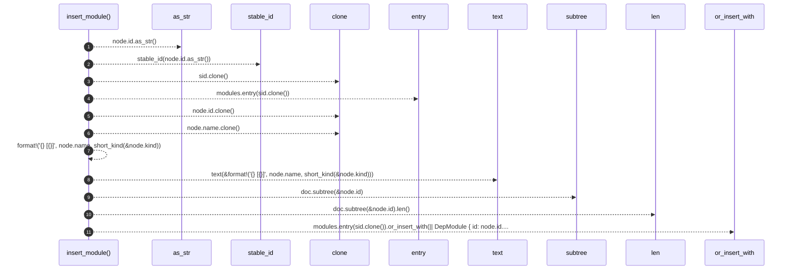

# `robby_render::view::deps::insert_module`

[Self-model](../../../README.md) · [view::deps](index.md)

| | |
|---|---|
| kind | `code.function` |
| signature | `fn insert_module(     modules: &mut BTreeMap<String, DepModule>,     node: &Node,     external: bool,     doc: &Document, )` |
| location | [`crates/robby-render/src/view/deps.rs:663`](../../../../../crates/robby-render/src/view/deps.rs#L663) |
| provenance | extractor · confidence 1.00 |

```rust
fn insert_module(
    modules: &mut BTreeMap<String, DepModule>,
    node: &Node,
    external: bool,
    doc: &Document,
) {
    let sid = stable_id(node.id.as_str());
    modules.entry(sid.clone()).or_insert_with(|| DepModule {
        id: node.id.clone(),
        stable_id: sid,
        name: node.name.clone(),
        label: text(&format!("{} [{}]", node.name, short_kind(&node.kind))),
        item_count: doc.subtree(&node.id).len(),
        external,
    });
}
```



11 steps · 0 observed · 11 possible only

**Edges**

- calls → [`robby_render::view::comments::impl NoteKind::as_str`](../comments/index.md)
- calls → [`robby_render::stable_id`](../../stable-id.md)
- calls → [`robby_render::util::text`](../../util/text.md)
- calls → [`robby_ir::model::impl Document::subtree`](../../../robby_ir/model/index.md)

## References

- calls → [`robby_ir::model`](../../../robby_ir/model/index.md) — subtree
- calls → [`robby_render`](../../index.md) — stable_id
- calls → [`robby_render::util`](../../util/index.md) — text
- calls → [`robby_render::view::comments`](../comments/index.md) — as_str

## Referenced by

- calls ← [`robby_render::view::deps::package_edges`](package-edges.md)

