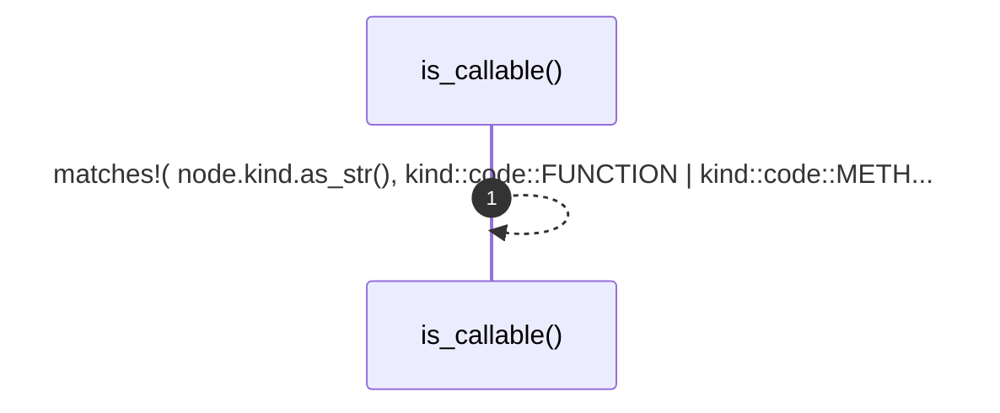

# `robby_render::view::deps::is_callable`

[Self-model](../../../README.md) · [view::deps](index.md)

| | |
|---|---|
| kind | `code.function` |
| signature | `fn is_callable(node: &Node) -> bool` |
| location | [`crates/robby-render/src/view/deps.rs:680`](../../../../../crates/robby-render/src/view/deps.rs#L680) |
| provenance | extractor · confidence 1.00 |

```rust
fn is_callable(node: &Node) -> bool {
    matches!(
        node.kind.as_str(),
        kind::code::FUNCTION | kind::code::METHOD
    )
}
```



1 steps · 0 observed · 1 possible only

## Referenced by

- calls ← [`robby_render::view::deps::impl CouplingGraph::from_root`](index.md)

