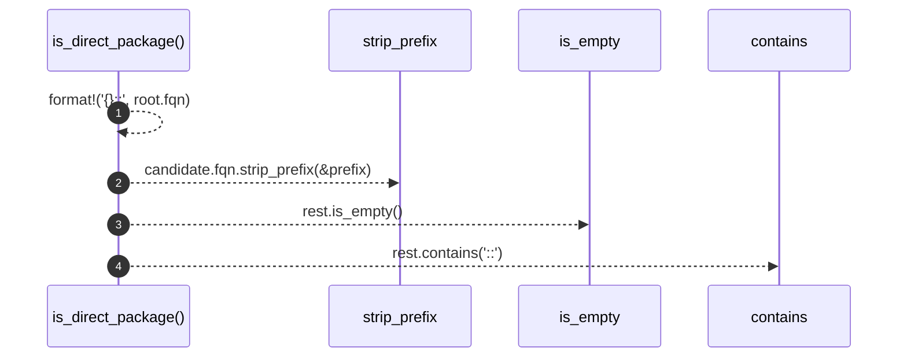

# `robby_render::view::deps::is_direct_package`

[Self-model](../../../README.md) · [view::deps](index.md)

| | |
|---|---|
| kind | `code.function` |
| signature | `fn is_direct_package(root: &Node, candidate: &Node) -> bool` |
| location | [`crates/robby-render/src/view/deps.rs:764`](../../../../../crates/robby-render/src/view/deps.rs#L764) |
| provenance | extractor · confidence 1.00 |

```rust
fn is_direct_package(root: &Node, candidate: &Node) -> bool {
    let prefix = format!("{}::", root.fqn);
    let Some(rest) = candidate.fqn.strip_prefix(&prefix) else {
        return false;
    };
    !rest.is_empty() && !rest.contains("::")
}
```



4 steps · 0 observed · 4 possible only

**Edges**

- calls → [`robby_render::view::deps::impl CouplingGraph::is_empty`](index.md)
- calls → [`robby_render::view::scene::impl WorldRect::contains`](../scene/index.md)

## References

- calls → [`robby_render::view::deps`](index.md) — is_empty
- calls → [`robby_render::view::scene`](../scene/index.md) — contains

## Referenced by

- calls ← [`robby_render::view::deps::impl CouplingGraph::workspace`](index.md)

