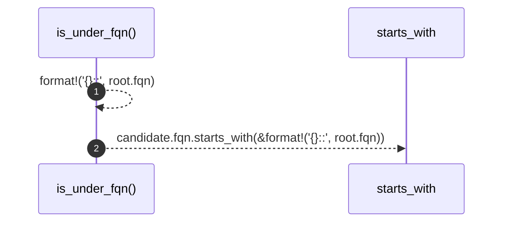

# `robby_render::view::deps::is_under_fqn`

[Self-model](../../../README.md) · [view::deps](index.md)

| | |
|---|---|
| kind | `code.function` |
| signature | `fn is_under_fqn(root: &Node, candidate: &Node) -> bool` |
| location | [`crates/robby-render/src/view/deps.rs:670`](../../../../../crates/robby-render/src/view/deps.rs#L670) |
| provenance | extractor · confidence 1.00 |

```rust
fn is_under_fqn(root: &Node, candidate: &Node) -> bool {
    candidate.fqn.starts_with(&format!("{}::", root.fqn))
}
```



2 steps · 0 observed · 2 possible only

## Referenced by

- calls ← [`robby_render::view::deps::impl CouplingGraph::from_root`](index.md)
- calls ← [`robby_render::view::deps::impl PackageStructure::from_root`](index.md)
- calls ← [`robby_render::view::deps::under_root_fqn`](under-root-fqn.md)

