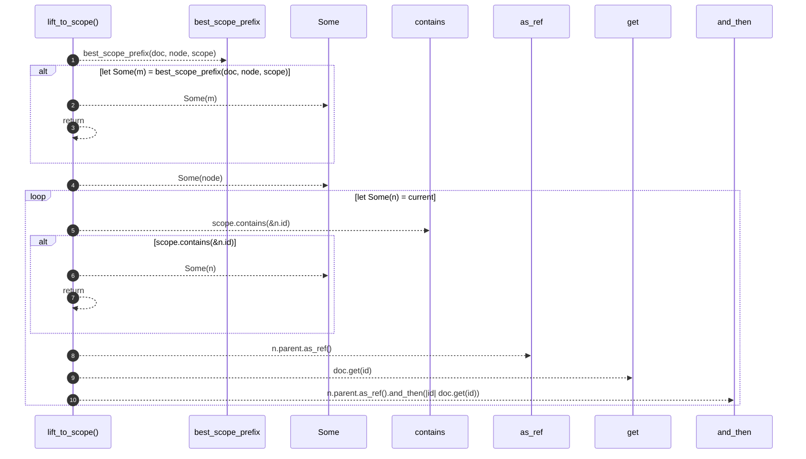

# `robby_render::view::deps::lift_to_scope`

[Self-model](../../../README.md) · [view::deps](index.md)

| | |
|---|---|
| kind | `code.function` |
| signature | `fn lift_to_scope<'a>(     doc: &'a Document,     node: &'a Node,     scope: &BTreeSet<NodeId>, ) -> Option<&'a Node>` |
| location | [`crates/robby-render/src/view/deps.rs:723`](../../../../../crates/robby-render/src/view/deps.rs#L723) |
| provenance | extractor · confidence 1.00 |

```rust
fn lift_to_scope<'a>(
    doc: &'a Document,
    node: &'a Node,
    scope: &BTreeSet<NodeId>,
) -> Option<&'a Node> {
    if let Some(m) = best_scope_prefix(doc, node, scope) {
        return Some(m);
    }
    let mut current = Some(node);
    while let Some(n) = current {
        if scope.contains(&n.id) {
            return Some(n);
        }
        current = n.parent.as_ref().and_then(|id| doc.get(id));
    }
    None
}
```



10 steps · 0 observed · 10 possible only

**Edges**

- calls → [`robby_render::view::deps::best_scope_prefix`](best-scope-prefix.md)
- calls → [`robby_render::view::scene::impl WorldRect::contains`](../scene/index.md)
- calls → [`robby_ir::model::impl Document::get`](../../../robby_ir/model/index.md)

## References

- calls → [`robby_ir::model`](../../../robby_ir/model/index.md) — get
- calls → [`robby_render::view::deps`](index.md) — best_scope_prefix
- calls → [`robby_render::view::scene`](../scene/index.md) — contains

## Referenced by

- calls ← [`robby_render::view::deps::impl CouplingGraph::workspace`](index.md)
- calls ← [`robby_render::view::deps::package_edges`](package-edges.md)

