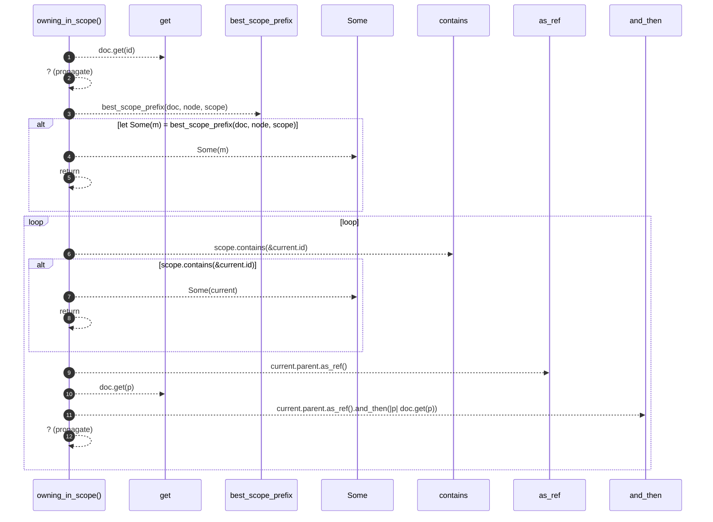

# `robby_render::view::deps::owning_in_scope`

[Self-model](../../../README.md) · [view::deps](index.md)

| | |
|---|---|
| kind | `code.function` |
| signature | `fn owning_in_scope<'a>(     doc: &'a Document,     id: &NodeId,     scope: &BTreeSet<NodeId>, ) -> Option<&'a Node>` |
| location | [`crates/robby-render/src/view/deps.rs:678`](../../../../../crates/robby-render/src/view/deps.rs#L678) |
| provenance | extractor · confidence 1.00 |

```rust
fn owning_in_scope<'a>(
    doc: &'a Document,
    id: &NodeId,
    scope: &BTreeSet<NodeId>,
) -> Option<&'a Node> {
    let node = doc.get(id)?;
    if let Some(m) = best_scope_prefix(doc, node, scope) {
        return Some(m);
    }
    let mut current = node;
    loop {
        if scope.contains(&current.id) {
            return Some(current);
        }
        let parent = current.parent.as_ref().and_then(|p| doc.get(p))?;
        current = parent;
    }
}
```



12 steps · 0 observed · 12 possible only

**Edges**

- calls → [`robby_ir::run::RecipeCatalog::get`](../../../robby_ir/run/index.md)
- calls → [`robby_render::view::deps::best_scope_prefix`](best-scope-prefix.md)
- calls → [`robby_render::view::scene::impl WorldRect::contains`](../scene/index.md)
- calls → [`robby_ir::run::RecipeCatalog::get`](../../../robby_ir/run/index.md)

## References

- calls → [`robby_ir::run`](../../../robby_ir/run/index.md) — get
- calls → [`robby_render::view::deps`](index.md) — best_scope_prefix
- calls → [`robby_render::view::scene`](../scene/index.md) — contains

## Referenced by

- calls ← [`robby_render::view::deps::impl CouplingGraph::from_root`](index.md)
- calls ← [`robby_render::view::deps::impl CouplingGraph::workspace`](index.md)
- calls ← [`robby_render::view::deps::package_edges`](package-edges.md)

