# `robby_render::view::deps::package_edges`

[Self-model](../../../README.md) · [view::deps](index.md)

| | |
|---|---|
| kind | `code.function` |
| signature | `fn package_edges<'a>(     doc: &Document,     scope: &BTreeSet<NodeId>,     nodes: impl Iterator<Item = &'a Node>,     both_in_scope: bool,     _root_hint: &Node, ) -> (     Vec<WeightedEdge>,     Vec<DepModule>,     Vec<DepModule>,     Vec<Vec<String>>,     Vec<Vec<String>>, )` |
| location | [`crates/robby-render/src/view/deps.rs:453`](../../../../../crates/robby-render/src/view/deps.rs#L453) |
| provenance | extractor · confidence 1.00 |

```rust
fn package_edges<'a>(
    doc: &Document,
    scope: &BTreeSet<NodeId>,
    nodes: impl Iterator<Item = &'a Node>,
    both_in_scope: bool,
    _root_hint: &Node,
) -> (
    Vec<WeightedEdge>,
    Vec<DepModule>,
    Vec<DepModule>,
    Vec<Vec<String>>,
    Vec<Vec<String>>,
) {
    let mut weights: BTreeMap<(String, String), usize> = BTreeMap::new();
    let mut modules: BTreeMap<String, DepModule> = BTreeMap::new();

    for id in scope {
        if let Some(node) = doc.get(id) {
            insert_module(&mut modules, node, false, doc);
        }
    }

    for node in nodes {
        for edge in &node.edges {
            let Some(from_mod) = owning_in_scope(doc, &node.id, scope) else {
                continue;
            };
            let Some(to_owner) = container_of(doc, &edge.to) else {
                continue;
            };
            let Some(to_mod) = lift_to_scope(doc, to_owner, scope).or_else(|| {
                if both_in_scope {
                    None
                } else {
                    Some(crate_of(doc, to_owner).unwrap_or(to_owner))
                }
            }) else {
                continue;
            };
            if from_mod.id == to_mod.id {
                continue;
            }
            let from_sid = stable_id(from_mod.id.as_str());
            let to_sid = stable_id(to_mod.id.as_str());
            insert_module(&mut modules, from_mod, false, doc);
            insert_module(&mut modules, to_mod, !scope.contains(&to_mod.id), doc);
            *weights.entry((from_sid, to_sid)).or_default() += 1;
        }
    }

    let adjacency: BTreeMap<String, BTreeSet<String>> = {
        let mut adj: BTreeMap<String, BTreeSet<String>> = BTreeMap::new();
        for sid in modules.keys() {
            adj.entry(sid.clone()).or_default();
        }
        for (from, to) in weights.keys() {
            adj.entry(from.clone()).or_default().insert(to.clone());
        }
        adj
    };

    let sccs = tarjan(&adjacency);
    let cyclic: BTreeSet<String> = sccs
        .iter()
        .filter(|scc| scc.len() > 1)
        .flat_map(|scc| scc.iter().cloned())
        .collect();

    let mut edge_in_cycle: BTreeSet<(String, String)> = BTreeSet::new();
    for scc in &sccs {
        if scc.len() < 2 {
            continue;
        }
        let set: BTreeSet<_> = scc.iter().cloned().collect();
        for (from, to) in weights.keys() {
            if set.contains(from) && set.contains(to) {
                edge_in_cycle.insert((from.clone(), to.clone()));
            }
        }
    }

    let mut edges: Vec<WeightedEdge> = weights
        .into_iter()
        .map(|((from, to), weight)| WeightedEdge {
            in_cycle: edge_in_cycle.contains(&(from.clone(), to.clone())),
            from,
            to,
            weight,
        })
        .collect();
    edges.sort_by(|a, b| (&a.from, &a.to).cmp(&(&b.from, &b.to)));

    let cycles: Vec<Vec<String>> = sccs
        .into_iter()
        .filter(|scc| scc.len() > 1)
        .map(|mut scc| {
            scc.sort();
            scc
        })
        .collect();

    let layers = topological_layers(&adjacency, &cyclic);

    let mut module_list: Vec<DepModule> = modules.into_values().collect();
    module_list.sort_by(|a, b| a.name.cmp(&b.name));
    let externals: Vec<DepModule> = module_list.iter().filter(|m| m.external).cloned().collect();

    (edges, externals, module_list, layers, cycles)
}
```

```mermaid
sequenceDiagram
    autonumber
    participant package_edges as package_edges()
    participant BTreeMap__new as BTreeMap::new
    participant get as get
    participant insert_module as insert_module
    participant owning_in_scope as owning_in_scope
    participant container_of as container_of
    participant lift_to_scope as lift_to_scope
    participant crate_of as crate_of
    participant unwrap_or as unwrap_or
    participant Some as Some
    participant or_else as or_else
    participant as_str as as_str
    participant stable_id as stable_id
    participant contains as contains
    participant entry as entry
    participant or_default as or_default
    participant keys as keys
    participant clone as clone
    participant insert as insert
    participant tarjan as tarjan
    participant iter as iter
    participant len as len
    participant filter as filter
    participant cloned as cloned
    participant flat_map as flat_map
    participant collect as collect
    participant BTreeSet__new as BTreeSet::new
    participant into_iter as into_iter
    participant map as map
    participant cmp as cmp
    participant sort_by as sort_by
    participant sort as sort
    participant topological_layers as topological_layers
    participant into_values as into_values
    package_edges-->>BTreeMap__new: BTreeMap::new()
    package_edges-->>BTreeMap__new: BTreeMap::new()
    loop scope
    package_edges-->>get: doc.get(id)
    alt let Some(node) = doc.get(id)
    package_edges-->>insert_module: insert_module(&mut modules, node, false, doc)
    end
    end
    loop nodes
    loop &node.edges
    package_edges-->>owning_in_scope: owning_in_scope(doc, &node.id, scope)
    package_edges-->>container_of: container_of(doc, &edge.to)
    package_edges-->>lift_to_scope: lift_to_scope(doc, to_owner, scope)
    alt both_in_scope
    package_edges-->>crate_of: crate_of(doc, to_owner)
    package_edges-->>unwrap_or: crate_of(doc, to_owner).unwrap_or(to_owner)
    package_edges-->>Some: Some(crate_of(doc, to_owner).unwrap_or(to_owner))
    end
    package_edges-->>or_else: lift_to_scope(doc, to_owner, scope).or_else(|| { if both_in_scope { N...
    package_edges-->>as_str: from_mod.id.as_str()
    package_edges-->>stable_id: stable_id(from_mod.id.as_str())
    package_edges-->>as_str: to_mod.id.as_str()
    package_edges-->>stable_id: stable_id(to_mod.id.as_str())
    package_edges-->>insert_module: insert_module(&mut modules, from_mod, false, doc)
    package_edges-->>contains: scope.contains(&to_mod.id)
    package_edges-->>insert_module: insert_module(&mut modules, to_mod, !scope.contains(&to_mod.id), doc)
    package_edges-->>entry: weights.entry((from_sid, to_sid))
    package_edges-->>or_default: weights.entry((from_sid, to_sid)).or_default()
    end
    end
    package_edges-->>BTreeMap__new: BTreeMap::new()
    package_edges-->>keys: modules.keys()
    loop modules.keys()
    package_edges-->>clone: sid.clone()
    package_edges-->>entry: adj.entry(sid.clone())
    package_edges-->>or_default: adj.entry(sid.clone()).or_default()
    end
    package_edges-->>keys: weights.keys()
    loop weights.keys()
    package_edges-->>clone: from.clone()
    package_edges-->>entry: adj.entry(from.clone())
    package_edges-->>or_default: adj.entry(from.clone()).or_default()
    package_edges-->>clone: to.clone()
    package_edges-->>insert: adj.entry(from.clone()).or_default().insert(to.clone())
    end
    package_edges-->>tarjan: tarjan(&adjacency)
    package_edges-->>iter: sccs .iter()
    package_edges-->>len: scc.len()
    package_edges-->>filter: sccs .iter() .filter(|scc| scc.len() > 1)
    package_edges-->>iter: scc.iter()
    package_edges-->>cloned: scc.iter().cloned()
    package_edges-->>flat_map: sccs .iter() .filter(|scc| scc.len() > 1) .flat_map(|scc| scc.iter()....
    package_edges-->>collect: sccs .iter() .filter(|scc| scc.len() > 1) .flat_map(|scc| scc.iter()....
    package_edges-->>BTreeSet__new: BTreeSet::new()
    loop &sccs
    package_edges-->>len: scc.len()
    package_edges-->>iter: scc.iter()
    package_edges-->>cloned: scc.iter().cloned()
    package_edges-->>collect: scc.iter().cloned().collect()
    package_edges-->>keys: weights.keys()
    loop weights.keys()
    package_edges-->>contains: set.contains(from)
    package_edges-->>contains: set.contains(to)
    alt set.contains(from) && set.contains(to)
    package_edges-->>clone: from.clone()
    package_edges-->>clone: to.clone()
    package_edges-->>insert: edge_in_cycle.insert((from.clone(), to.clone()))
    end
    end
    end
    package_edges-->>into_iter: weights .into_iter()
    package_edges-->>clone: from.clone()
    package_edges-->>clone: to.clone()
    package_edges-->>contains: edge_in_cycle.contains(&(from.clone(), to.clone()))
    package_edges-->>map: weights .into_iter() .map(|((from, to), weight)| WeightedEdge { in_cy...
    package_edges-->>collect: weights .into_iter() .map(|((from, to), weight)| WeightedEdge { in_cy...
    package_edges-->>cmp: (&a.from, &a.to).cmp(&(&b.from, &b.to))
    package_edges-->>sort_by: edges.sort_by(|a, b| (&a.from, &a.to).cmp(&(&b.from, &b.to)))
    package_edges-->>into_iter: sccs .into_iter()
    package_edges-->>len: scc.len()
    package_edges-->>filter: sccs .into_iter() .filter(|scc| scc.len() > 1)
    package_edges-->>sort: scc.sort()
    package_edges-->>map: sccs .into_iter() .filter(|scc| scc.len() > 1) .map(|mut scc| { scc.s...
    package_edges-->>collect: sccs .into_iter() .filter(|scc| scc.len() > 1) .map(|mut scc| { scc.s...
    package_edges-->>topological_layers: topological_layers(&adjacency, &cyclic)
    package_edges-->>into_values: modules.into_values()
    package_edges-->>collect: modules.into_values().collect()
    package_edges-->>cmp: a.name.cmp(&b.name)
    package_edges-->>sort_by: module_list.sort_by(|a, b| a.name.cmp(&b.name))
    package_edges-->>iter: module_list.iter()
    package_edges-->>filter: module_list.iter().filter(|m| m.external)
    package_edges-->>cloned: module_list.iter().filter(|m| m.external).cloned()
    package_edges-->>collect: module_list.iter().filter(|m| m.external).cloned().collect()
```



73 steps · 0 observed · 73 possible only

**Edges**

- calls → [`robby_render::view::scene::impl Rect::new`](../scene/index.md)
- calls → [`robby_render::view::scene::impl Rect::new`](../scene/index.md)
- calls → [`robby_ir::run::RecipeCatalog::get`](../../../robby_ir/run/index.md)
- calls → [`robby_render::view::deps::insert_module`](insert-module.md)
- calls → [`robby_render::view::deps::owning_in_scope`](owning-in-scope.md)
- calls → [`robby_render::view::deps::container_of`](container-of.md)
- calls → [`robby_render::view::deps::lift_to_scope`](lift-to-scope.md)
- calls → [`robby_render::view::deps::crate_of`](crate-of.md)
- calls → [`robby_render::view::comments::impl CommentKind::as_str`](../comments/index.md)
- calls → [`robby_render::stable_id`](../../stable-id.md)
- calls → [`robby_render::view::comments::impl CommentKind::as_str`](../comments/index.md)
- calls → [`robby_render::stable_id`](../../stable-id.md)
- calls → [`robby_render::view::deps::insert_module`](insert-module.md)
- calls → [`robby_render::view::scene::impl WorldRect::contains`](../scene/index.md)
- calls → [`robby_render::view::deps::insert_module`](insert-module.md)
- calls → [`robby_render::view::scene::impl Rect::new`](../scene/index.md)
- calls → [`robby_ir::model::impl Document::insert`](../../../robby_ir/model/index.md)
- calls → [`robby_render::view::deps::tarjan`](tarjan.md)
- calls → [`robby_render::view::select::collect`](../select/collect.md)
- calls → [`robby_render::view::scene::impl Rect::new`](../scene/index.md)
- calls → [`robby_render::view::select::collect`](../select/collect.md)
- calls → [`robby_render::view::scene::impl WorldRect::contains`](../scene/index.md)
- calls → [`robby_render::view::scene::impl WorldRect::contains`](../scene/index.md)
- calls → [`robby_ir::model::impl Document::insert`](../../../robby_ir/model/index.md)
- calls → [`robby_render::view::scene::impl WorldRect::contains`](../scene/index.md)
- calls → [`robby_render::view::select::collect`](../select/collect.md)
- calls → [`robby_render::view::select::collect`](../select/collect.md)
- calls → [`robby_render::view::deps::topological_layers`](topological-layers.md)
- calls → [`robby_render::view::select::collect`](../select/collect.md)
- calls → [`robby_render::view::select::collect`](../select/collect.md)

## References

- calls → [`robby_ir::model`](../../../robby_ir/model/index.md) — insert
- calls → [`robby_ir::run`](../../../robby_ir/run/index.md) — get
- calls → [`robby_render`](../../index.md) — stable_id
- calls → [`robby_render::view::comments`](../comments/index.md) — as_str
- calls → [`robby_render::view::deps`](index.md) — 7 items
- calls → [`robby_render::view::scene`](../scene/index.md) — contains, new
- calls → [`robby_render::view::select`](../select/index.md) — collect

## Referenced by

- calls ← [`robby_render::view::deps::impl PackageStructure::from_root`](index.md)
- calls ← [`robby_render::view::deps::impl PackageStructure::workspace`](index.md)

