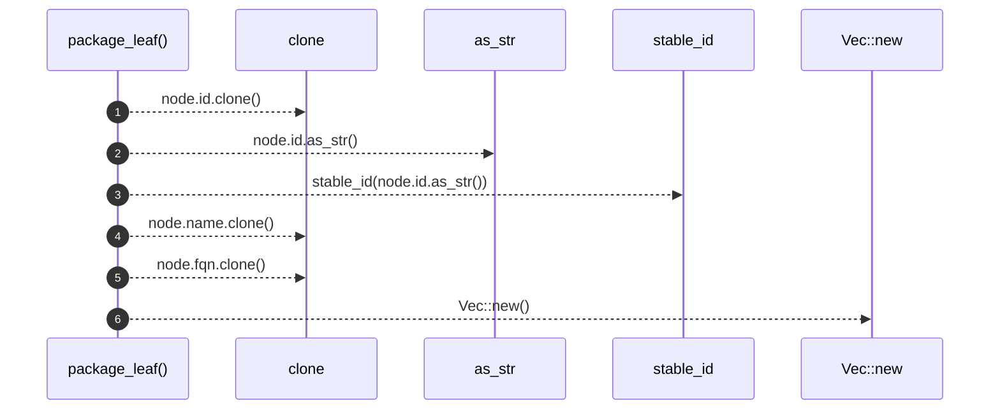

# `robby_render::view::deps::package_leaf`

[Self-model](../../../README.md) · [view::deps](index.md)

| | |
|---|---|
| kind | `code.function` |
| signature | `fn package_leaf(node: &Node) -> PackageNode` |
| location | [`crates/robby-render/src/view/deps.rs:636`](../../../../../crates/robby-render/src/view/deps.rs#L636) |
| provenance | extractor · confidence 1.00 |

```rust
fn package_leaf(node: &Node) -> PackageNode {
    PackageNode {
        id: node.id.clone(),
        stable_id: stable_id(node.id.as_str()),
        name: node.name.clone(),
        fqn: node.fqn.clone(),
        children: Vec::new(),
    }
}
```



6 steps · 0 observed · 6 possible only

**Edges**

- calls → [`robby_render::view::comments::impl CommentKind::as_str`](../comments/index.md)
- calls → [`robby_render::stable_id`](../../stable-id.md)
- calls → [`robby_render::view::scene::impl Rect::new`](../scene/index.md)

## References

- calls → [`robby_render`](../../index.md) — stable_id
- calls → [`robby_render::view::comments`](../comments/index.md) — as_str
- calls → [`robby_render::view::scene`](../scene/index.md) — new

## Referenced by

- calls ← [`robby_render::view::deps::build_package_tree`](build-package-tree.md)
- calls ← [`robby_render::view::deps::impl CouplingGraph::workspace`](index.md)
- calls ← [`robby_render::view::deps::impl PackageStructure::workspace`](index.md)

