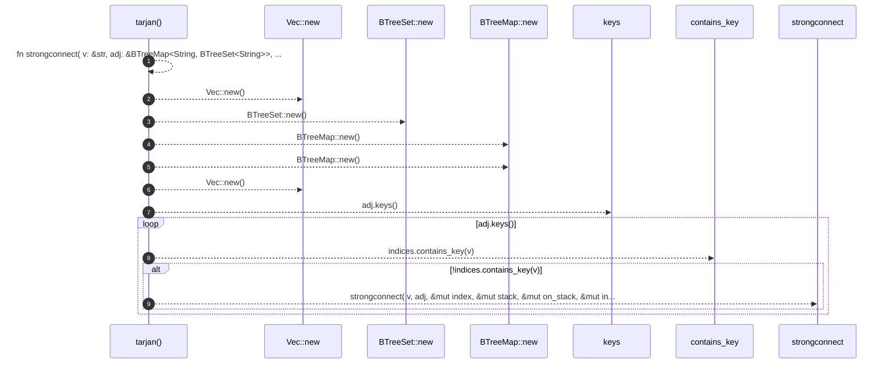

# `robby_render::view::deps::tarjan`

[Self-model](../../../README.md) · [view::deps](index.md)

| | |
|---|---|
| kind | `code.function` |
| signature | `fn tarjan(adj: &BTreeMap<String, BTreeSet<String>>) -> Vec<Vec<String>>` |
| location | [`crates/robby-render/src/view/deps.rs:772`](../../../../../crates/robby-render/src/view/deps.rs#L772) |
| provenance | extractor · confidence 1.00 |

```rust
fn tarjan(adj: &BTreeMap<String, BTreeSet<String>>) -> Vec<Vec<String>> {
    fn strongconnect(
        v: &str,
        adj: &BTreeMap<String, BTreeSet<String>>,
        index: &mut usize,
        stack: &mut Vec<String>,
        on_stack: &mut BTreeSet<String>,
        indices: &mut BTreeMap<String, usize>,
        lowlink: &mut BTreeMap<String, usize>,
        sccs: &mut Vec<Vec<String>>,
    ) {
        indices.insert(v.to_owned(), *index);
        lowlink.insert(v.to_owned(), *index);
        *index += 1;
        stack.push(v.to_owned());
        on_stack.insert(v.to_owned());

        if let Some(neighbors) = adj.get(v) {
            for w in neighbors {
                if !indices.contains_key(w) {
                    strongconnect(w, adj, index, stack, on_stack, indices, lowlink, sccs);
                    let lw = lowlink[w];
                    let lv = lowlink[v];
                    lowlink.insert(v.to_owned(), lv.min(lw));
                } else if on_stack.contains(w) {
                    let iw = indices[w];
                    let lv = lowlink[v];
                    lowlink.insert(v.to_owned(), lv.min(iw));
                }
            }
        }

        if lowlink[v] == indices[v] {
            let mut scc = Vec::new();
            loop {
                let w = stack.pop().expect("scc stack");
                on_stack.remove(&w);
                scc.push(w.clone());
                if w == v {
                    break;
                }
            }
            sccs.push(scc);
        }
    }

    let mut index = 0usize;
    let mut stack: Vec<String> = Vec::new();
    let mut on_stack: BTreeSet<String> = BTreeSet::new();
    let mut indices: BTreeMap<String, usize> = BTreeMap::new();
    let mut lowlink: BTreeMap<String, usize> = BTreeMap::new();
    let mut sccs: Vec<Vec<String>> = Vec::new();

    for v in adj.keys() {
        if !indices.contains_key(v) {
            strongconnect(
                v,
                adj,
                &mut index,
                &mut stack,
                &mut on_stack,
                &mut indices,
                &mut lowlink,
                &mut sccs,
            );
        }
    }

    sccs
}
```



9 steps · 0 observed · 9 possible only

**Edges**

- calls → [`robby_render::view::scene::impl Rect::new`](../scene/index.md)
- calls → [`robby_render::view::scene::impl Rect::new`](../scene/index.md)
- calls → [`robby_render::view::scene::impl Rect::new`](../scene/index.md)
- calls → [`robby_render::view::scene::impl Rect::new`](../scene/index.md)
- calls → [`robby_render::view::scene::impl Rect::new`](../scene/index.md)

## References

- calls → [`robby_render::view::scene`](../scene/index.md) — new

## Referenced by

- calls ← [`robby_render::view::deps::finalize_edges`](finalize-edges.md)
- calls ← [`robby_render::view::deps::package_edges`](package-edges.md)

