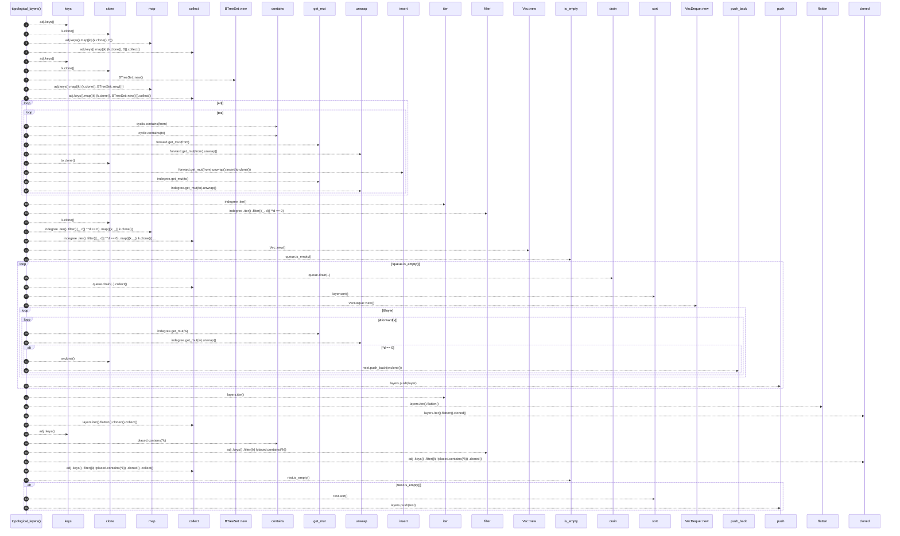

# `robby_render::view::deps::topological_layers`

[Self-model](../../../README.md) · [view::deps](index.md)

| | |
|---|---|
| kind | `code.function` |
| signature | `fn topological_layers(     adj: &BTreeMap<String, BTreeSet<String>>,     cyclic: &BTreeSet<String>, ) -> Vec<Vec<String>>` |
| location | [`crates/robby-render/src/view/deps.rs:843`](../../../../../crates/robby-render/src/view/deps.rs#L843) |
| provenance | extractor · confidence 1.00 |

```rust
fn topological_layers(
    adj: &BTreeMap<String, BTreeSet<String>>,
    cyclic: &BTreeSet<String>,
) -> Vec<Vec<String>> {
    let mut indegree: BTreeMap<String, usize> = adj.keys().map(|k| (k.clone(), 0)).collect();
    let mut forward: BTreeMap<String, BTreeSet<String>> =
        adj.keys().map(|k| (k.clone(), BTreeSet::new())).collect();

    for (from, tos) in adj {
        for to in tos {
            if cyclic.contains(from) && cyclic.contains(to) {
                continue;
            }
            forward.get_mut(from).unwrap().insert(to.clone());
            *indegree.get_mut(to).unwrap() += 1;
        }
    }

    let mut queue: VecDeque<String> = indegree
        .iter()
        .filter(|(_, d)| **d == 0)
        .map(|(k, _)| k.clone())
        .collect();
    let mut layers = Vec::new();

    while !queue.is_empty() {
        let mut layer: Vec<String> = queue.drain(..).collect();
        layer.sort();
        let mut next = VecDeque::new();
        for v in &layer {
            for w in &forward[v] {
                let d = indegree.get_mut(w).unwrap();
                *d -= 1;
                if *d == 0 {
                    next.push_back(w.clone());
                }
            }
        }
        layers.push(layer);
        queue = next;
    }

    let placed: BTreeSet<_> = layers.iter().flatten().cloned().collect();
    let mut rest: Vec<String> = adj
        .keys()
        .filter(|k| !placed.contains(*k))
        .cloned()
        .collect();
    if !rest.is_empty() {
        rest.sort();
        layers.push(rest);
    }

    layers
}
```



45 steps · 0 observed · 45 possible only

**Edges**

- calls → [`robby_render::view::select::collect`](../select/collect.md)
- calls → [`robby_render::view::scene::impl Rect::new`](../scene/index.md)
- calls → [`robby_render::view::select::collect`](../select/collect.md)
- calls → [`robby_render::view::scene::impl WorldRect::contains`](../scene/index.md)
- calls → [`robby_render::view::scene::impl WorldRect::contains`](../scene/index.md)
- calls → [`robby_ir::model::impl Document::insert`](../../../robby_ir/model/index.md)
- calls → [`robby_render::view::select::collect`](../select/collect.md)
- calls → [`robby_render::view::scene::impl Rect::new`](../scene/index.md)
- calls → [`robby_render::view::deps::impl CouplingGraph::is_empty`](index.md)
- calls → [`robby_render::view::select::collect`](../select/collect.md)
- calls → [`robby_render::view::scene::impl Rect::new`](../scene/index.md)
- calls → [`robby_render::report::impl Report::push`](../../report/index.md)
- calls → [`robby_render::view::select::collect`](../select/collect.md)
- calls → [`robby_render::view::scene::impl WorldRect::contains`](../scene/index.md)
- calls → [`robby_render::view::select::collect`](../select/collect.md)
- calls → [`robby_render::view::deps::impl CouplingGraph::is_empty`](index.md)
- calls → [`robby_render::report::impl Report::push`](../../report/index.md)

## References

- calls → [`robby_ir::model`](../../../robby_ir/model/index.md) — insert
- calls → [`robby_render::report`](../../report/index.md) — push
- calls → [`robby_render::view::deps`](index.md) — is_empty
- calls → [`robby_render::view::scene`](../scene/index.md) — contains, new
- calls → [`robby_render::view::select`](../select/index.md) — collect

## Referenced by

- calls ← [`robby_render::view::deps::package_edges`](package-edges.md)

