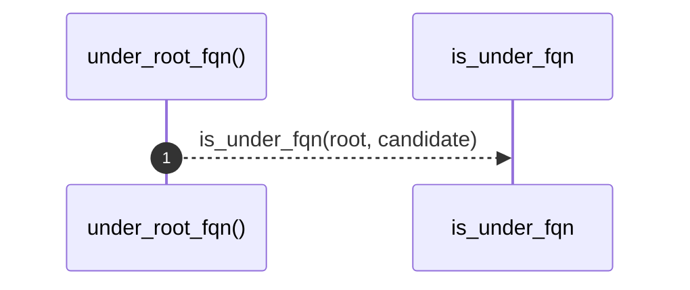

# `robby_render::view::deps::under_root_fqn`

[Self-model](../../../README.md) · [view::deps](index.md)

| | |
|---|---|
| kind | `code.function` |
| signature | `fn under_root_fqn(root: &Node, candidate: &Node) -> bool` |
| location | [`crates/robby-render/src/view/deps.rs:691`](../../../../../crates/robby-render/src/view/deps.rs#L691) |
| provenance | extractor · confidence 1.00 |

```rust
fn under_root_fqn(root: &Node, candidate: &Node) -> bool {
    candidate.fqn == root.fqn || is_under_fqn(root, candidate)
}
```



1 steps · 0 observed · 1 possible only

**Edges**

- calls → [`robby_render::view::deps::is_under_fqn`](is-under-fqn.md)

## References

- calls → [`robby_render::view::deps`](index.md) — is_under_fqn

## Referenced by

- calls ← [`robby_render::view::deps::impl CouplingGraph::from_root`](index.md)

