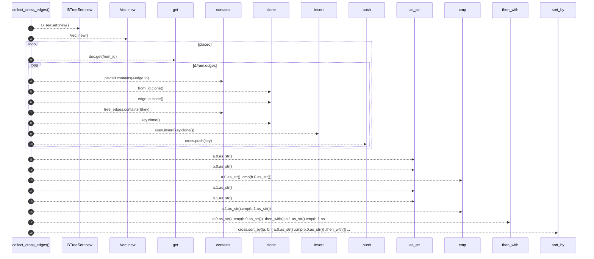

# `robby_render::view::entrypoints::collect_cross_edges`

[Self-model](../../../README.md) · [view::entrypoints](index.md)

| | |
|---|---|
| kind | `code.function` |
| signature | `fn collect_cross_edges(     doc: &Document,     placed: &BTreeSet<NodeId>,     tree_edges: &BTreeSet<(NodeId, NodeId)>, ) -> Vec<(NodeId, NodeId)>` |
| location | [`crates/robby-render/src/view/entrypoints.rs:98`](../../../../../crates/robby-render/src/view/entrypoints.rs#L98) |
| provenance | extractor · confidence 1.00 |

```rust
fn collect_cross_edges(
    doc: &Document,
    placed: &BTreeSet<NodeId>,
    tree_edges: &BTreeSet<(NodeId, NodeId)>,
) -> Vec<(NodeId, NodeId)> {
    let mut seen = BTreeSet::new();
    let mut cross = Vec::new();
    for from_id in placed {
        let Some(from) = doc.get(from_id) else {
            continue;
        };
        for edge in &from.edges {
            if edge.kind != EdgeKind::Calls || !edge.resolved {
                continue;
            }
            if !placed.contains(&edge.to) || edge.to == *from_id {
                continue;
            }
            let key = (from_id.clone(), edge.to.clone());
            if tree_edges.contains(&key) || !seen.insert(key.clone()) {
                continue;
            }
            cross.push(key);
        }
    }
    cross.sort_by(|a, b| {
        a.0.as_str()
            .cmp(b.0.as_str())
            .then_with(|| a.1.as_str().cmp(b.1.as_str()))
    });
    cross
}
```



18 steps · 0 observed · 18 possible only

**Edges**

- calls → [`robby_render::view::scene::impl Rect::new`](../scene/index.md)
- calls → [`robby_render::view::scene::impl Rect::new`](../scene/index.md)
- calls → [`robby_ir::model::impl Document::get`](../../../robby_ir/model/index.md)
- calls → [`robby_render::view::scene::impl WorldRect::contains`](../scene/index.md)
- calls → [`robby_render::view::scene::impl WorldRect::contains`](../scene/index.md)
- calls → [`robby_ir::model::impl Document::insert`](../../../robby_ir/model/index.md)
- calls → [`robby_render::report::impl Report::push`](../../report/index.md)
- calls → [`robby_render::view::comments::impl NoteKind::as_str`](../comments/index.md)
- calls → [`robby_render::view::comments::impl NoteKind::as_str`](../comments/index.md)
- calls → [`robby_render::view::comments::impl NoteKind::as_str`](../comments/index.md)
- calls → [`robby_render::view::comments::impl NoteKind::as_str`](../comments/index.md)

## References

- calls → [`robby_ir::model`](../../../robby_ir/model/index.md) — get, insert
- calls → [`robby_render::report`](../../report/index.md) — push
- calls → [`robby_render::view::comments`](../comments/index.md) — as_str
- calls → [`robby_render::view::scene`](../scene/index.md) — contains, new

## Referenced by

- calls ← [`robby_render::view::entrypoints::impl CallTree::from_code_paths`](index.md)

