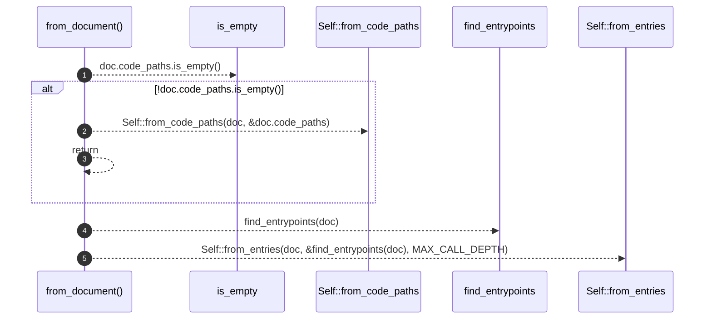
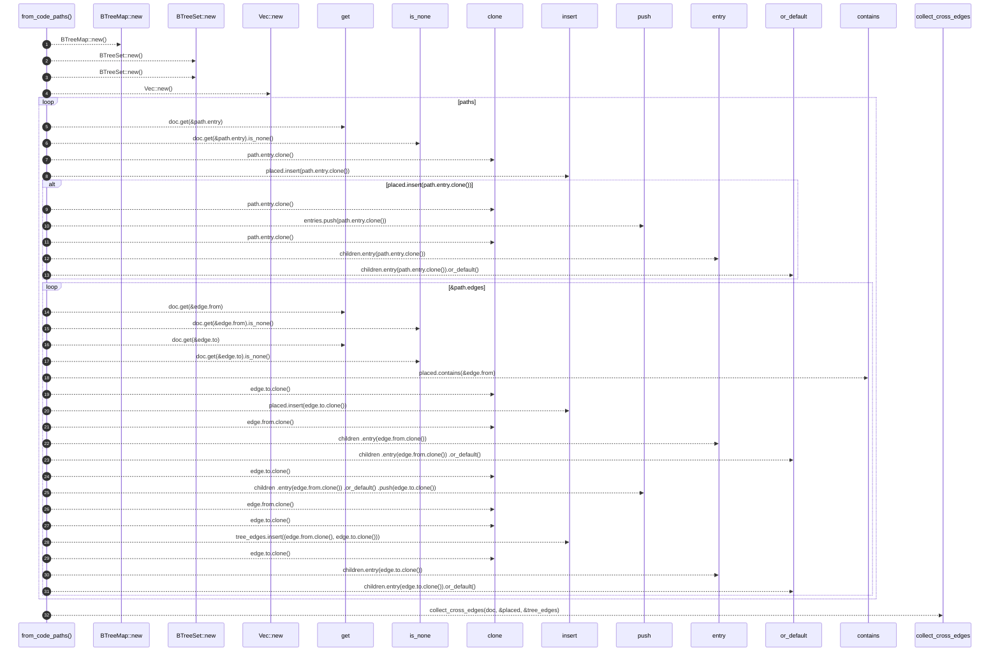
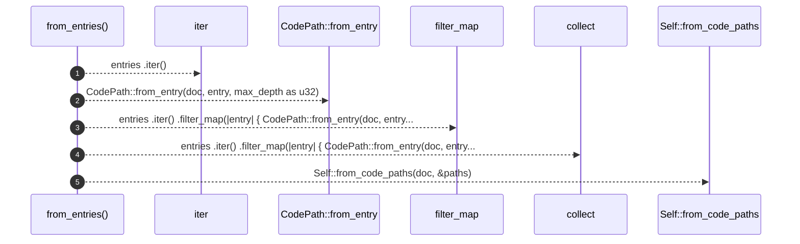
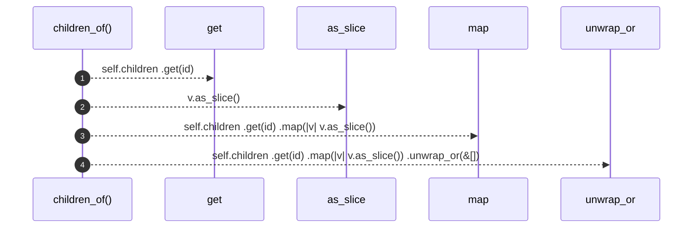

# `robby_render::view::entrypoints::impl CallTree`

[Self-model](../../../README.md) · [view::entrypoints](index.md)

| | |
|---|---|
| kind | `code.impl` |
| location | [`crates/robby-render/src/view/entrypoints.rs:27`](../../../../../crates/robby-render/src/view/entrypoints.rs#L27) |
| provenance | extractor · confidence 1.00 |

```rust
impl CallTree {
    pub fn from_document(doc: &Document) -> Self {
        if !doc.code_paths.is_empty() {
            return Self::from_code_paths(doc, &doc.code_paths);
        }
        Self::from_entries(doc, &find_entrypoints(doc), MAX_CALL_DEPTH)
    }

    /// Merge IR code paths into one forest (first parent wins across entries).
    pub fn from_code_paths(doc: &Document, paths: &[CodePath]) -> Self {
        let mut children: BTreeMap<NodeId, Vec<NodeId>> = BTreeMap::new();
        let mut placed: BTreeSet<NodeId> = BTreeSet::new();
        let mut tree_edges: BTreeSet<(NodeId, NodeId)> = BTreeSet::new();
        let mut entries = Vec::new();

        for path in paths {
            if doc.get(&path.entry).is_none() {
                continue;
            }
            if placed.insert(path.entry.clone()) {
                entries.push(path.entry.clone());
                children.entry(path.entry.clone()).or_default();
            }
            for edge in &path.edges {
                if doc.get(&edge.from).is_none() || doc.get(&edge.to).is_none() {
                    continue;
                }
                if !placed.contains(&edge.from) {
                    // Orphan edge — skip until from is placed (paths are BFS-ordered).
                    continue;
                }
                if !placed.insert(edge.to.clone()) {
                    continue;
                }
                children
                    .entry(edge.from.clone())
                    .or_default()
                    .push(edge.to.clone());
                tree_edges.insert((edge.from.clone(), edge.to.clone()));
                children.entry(edge.to.clone()).or_default();
            }
        }

        let cross_edges = collect_cross_edges(doc, &placed, &tree_edges);

        Self {
            entries,
            children,
            placed,
            cross_edges,
        }
    }

    pub fn from_entries(doc: &Document, entries: &[NodeId], max_depth: usize) -> Self {
        let paths: Vec<CodePath> = entries
            .iter()
            .filter_map(|entry| {
                CodePath::from_entry(doc, entry, max_depth as u32)
            })
            .collect();
        Self::from_code_paths(doc, &paths)
    }

    pub fn children_of(&self, id: &NodeId) -> &[NodeId] {
        self.children
            .get(id)
            .map(|v| v.as_slice())
            .unwrap_or(&[])
    }
}
```

## References

- calls → [`robby_ir::codepath`](../../../robby_ir/codepath/index.md) — find_entrypoints, from_entry
- calls → [`robby_ir::model`](../../../robby_ir/model/index.md) — get, insert
- calls → [`robby_render::report`](../../report/index.md) — push
- calls → [`robby_render::view::entrypoints`](index.md) — collect_cross_edges
- calls → [`robby_render::view::links`](../links/index.md) — is_empty
- calls → [`robby_render::view::scene`](../scene/index.md) — contains, new
- calls → [`robby_render::view::select`](../select/index.md) — collect

## Referenced by

- calls ← [`robby_render::view::deps::build_package_tree`](../deps/build-package-tree.md)
- calls ← [`robby_render::view::entrypoints::first_parent_wins_shared_callee`](tests/first-parent-wins-shared-callee.md)
- calls ← [`robby_render::view::entrypoints::prefers_document_code_paths`](tests/prefers-document-code-paths.md)
- calls ← [`robby_render::view::scene::build_call_frame`](../scene/build-call-frame.md)

### `from_document`

| | |
|---|---|
| kind | `code.method` |
| signature | `fn from_document(1)` |
| location | [`crates/robby-render/src/view/entrypoints.rs:28`](../../../../../crates/robby-render/src/view/entrypoints.rs#L28) |
| provenance | extractor · confidence 1.00 |

```rust
pub fn from_document(doc: &Document) -> Self {
        if !doc.code_paths.is_empty() {
            return Self::from_code_paths(doc, &doc.code_paths);
        }
        Self::from_entries(doc, &find_entrypoints(doc), MAX_CALL_DEPTH)
    }
```



5 steps · 0 observed · 5 possible only

**Edges**

- calls → [`robby_render::view::links::impl LinkGraph::is_empty`](../links/index.md)
- calls → [`robby_render::view::entrypoints::impl CallTree::from_code_paths`](index.md)
- calls → [`robby_ir::codepath::find_entrypoints`](../../../robby_ir/codepath/find-entrypoints.md)
- calls → [`robby_render::view::entrypoints::impl CallTree::from_entries`](index.md)

### `from_code_paths`

| | |
|---|---|
| kind | `code.method` |
| signature | `fn from_code_paths(2)` |
| location | [`crates/robby-render/src/view/entrypoints.rs:35`](../../../../../crates/robby-render/src/view/entrypoints.rs#L35) |
| provenance | extractor · confidence 1.00 |

> Merge IR code paths into one forest (first parent wins across entries).

```rust
/// Merge IR code paths into one forest (first parent wins across entries).
    pub fn from_code_paths(doc: &Document, paths: &[CodePath]) -> Self {
        let mut children: BTreeMap<NodeId, Vec<NodeId>> = BTreeMap::new();
        let mut placed: BTreeSet<NodeId> = BTreeSet::new();
        let mut tree_edges: BTreeSet<(NodeId, NodeId)> = BTreeSet::new();
        let mut entries = Vec::new();

        for path in paths {
            if doc.get(&path.entry).is_none() {
                continue;
            }
            if placed.insert(path.entry.clone()) {
                entries.push(path.entry.clone());
                children.entry(path.entry.clone()).or_default();
            }
            for edge in &path.edges {
                if doc.get(&edge.from).is_none() || doc.get(&edge.to).is_none() {
                    continue;
                }
                if !placed.contains(&edge.from) {
                    // Orphan edge — skip until from is placed (paths are BFS-ordered).
                    continue;
                }
                if !placed.insert(edge.to.clone()) {
                    continue;
                }
                children
                    .entry(edge.from.clone())
                    .or_default()
                    .push(edge.to.clone());
                tree_edges.insert((edge.from.clone(), edge.to.clone()));
                children.entry(edge.to.clone()).or_default();
            }
        }

        let cross_edges = collect_cross_edges(doc, &placed, &tree_edges);

        Self {
            entries,
            children,
            placed,
            cross_edges,
        }
    }
```



32 steps · 0 observed · 32 possible only

**Edges**

- calls → [`robby_render::view::scene::impl Rect::new`](../scene/index.md)
- calls → [`robby_render::view::scene::impl Rect::new`](../scene/index.md)
- calls → [`robby_render::view::scene::impl Rect::new`](../scene/index.md)
- calls → [`robby_render::view::scene::impl Rect::new`](../scene/index.md)
- calls → [`robby_ir::model::impl Document::get`](../../../robby_ir/model/index.md)
- calls → [`robby_ir::model::impl Document::insert`](../../../robby_ir/model/index.md)
- calls → [`robby_render::report::impl Report::push`](../../report/index.md)
- calls → [`robby_ir::model::impl Document::get`](../../../robby_ir/model/index.md)
- calls → [`robby_ir::model::impl Document::get`](../../../robby_ir/model/index.md)
- calls → [`robby_render::view::scene::impl WorldRect::contains`](../scene/index.md)
- calls → [`robby_ir::model::impl Document::insert`](../../../robby_ir/model/index.md)
- calls → [`robby_render::report::impl Report::push`](../../report/index.md)
- calls → [`robby_ir::model::impl Document::insert`](../../../robby_ir/model/index.md)
- calls → [`robby_render::view::entrypoints::collect_cross_edges`](collect-cross-edges.md)

### `from_entries`

| | |
|---|---|
| kind | `code.method` |
| signature | `fn from_entries(3)` |
| location | [`crates/robby-render/src/view/entrypoints.rs:80`](../../../../../crates/robby-render/src/view/entrypoints.rs#L80) |
| provenance | extractor · confidence 1.00 |

```rust
pub fn from_entries(doc: &Document, entries: &[NodeId], max_depth: usize) -> Self {
        let paths: Vec<CodePath> = entries
            .iter()
            .filter_map(|entry| {
                CodePath::from_entry(doc, entry, max_depth as u32)
            })
            .collect();
        Self::from_code_paths(doc, &paths)
    }
```



5 steps · 0 observed · 5 possible only

**Edges**

- calls → [`robby_ir::codepath::impl CodePath::from_entry`](../../../robby_ir/codepath/index.md)
- calls → [`robby_render::view::select::collect`](../select/collect.md)
- calls → [`robby_render::view::entrypoints::impl CallTree::from_code_paths`](index.md)

### `children_of`

| | |
|---|---|
| kind | `code.method` |
| signature | `fn children_of(2)` |
| location | [`crates/robby-render/src/view/entrypoints.rs:90`](../../../../../crates/robby-render/src/view/entrypoints.rs#L90) |
| provenance | extractor · confidence 1.00 |

```rust
pub fn children_of(&self, id: &NodeId) -> &[NodeId] {
        self.children
            .get(id)
            .map(|v| v.as_slice())
            .unwrap_or(&[])
    }
```



4 steps · 0 observed · 4 possible only

**Edges**

- calls → [`robby_ir::model::impl Document::get`](../../../robby_ir/model/index.md)

