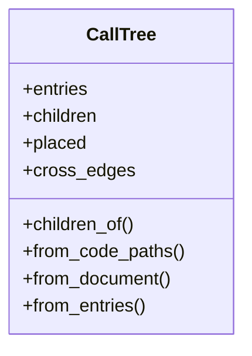
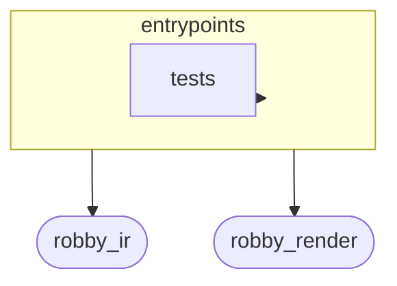
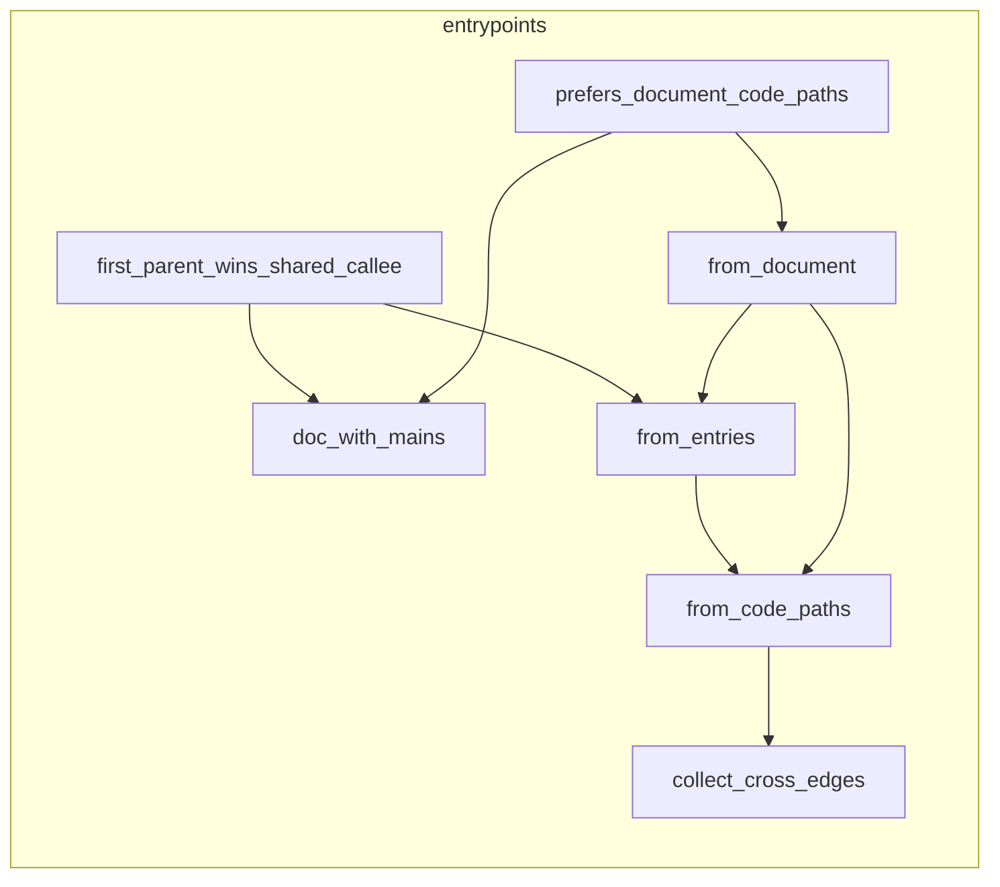

# `robby_render::view::entrypoints`

[Self-model](../../../README.md) · [robby_render](../../index.md)

| | |
|---|---|
| kind | `code.module` |
| declared at | [`crates/robby-render/src/view/mod.rs:8`](../../../../../crates/robby-render/src/view/mod.rs#L8) |
| provenance | extractor · confidence 1.00 |
| nodes | 21 |

## Types



## Package diagram



## Module coupling



## Dependency matrix

| | entrypoints | robby_ir | robby_render | tests |
|---|---:|---:|---:|---:|
| **entrypoints** | · | 23 | 29 | 2 |
| **robby_ir** | | · | | |
| **robby_render** | | | · | |
| **tests** | | | | · |

## Comments

- `crates/robby-render/src/view/entrypoints.rs:14:1` (docs, `robby_render::view::entrypoints::CallTree`): "Containment tree over `Calls` / code paths: first parent wins; extras are cross edges."
  ```
  /// Containment tree over `Calls` / code paths: first parent wins; extras are cross edges.
  #[derive(Debug, Clone, PartialEq, Eq)]
  pub struct CallTree {
      /// Entrypoint node ids (sorted).
      pub entries: Vec<NodeId>,
      /// Parent → ordered children in the tree.
      pub children: BTreeMap<NodeId, Vec<NodeId>>,
      /// Every node placed in the tree (entries + reachable callees).
      pub placed: BTreeSet<NodeId>,
      /// Resolved `Calls` between placed nodes that are not tree edges.
      pub cross_edges: Vec<(NodeId, NodeId)>,
  }
  ```
- `crates/robby-render/src/view/entrypoints.rs:35:5` (docs, `robby_render::view::entrypoints::impl CallTree::from_code_paths`): "Merge IR code paths into one forest (first parent wins across entries)."
  ```
  /// Merge IR code paths into one forest (first parent wins across entries).
      pub fn from_code_paths(doc: &Document, paths: &[CodePath]) -> Self {
          let mut children: BTreeMap<NodeId, Vec<NodeId>> = BTreeMap::new();
          let mut placed: BTreeSet<NodeId> = BTreeSet::new();
          let mut tree_edges: BTreeSet<(NodeId, NodeId)> = BTreeSet::new();
          let mut entries = Vec::new();
  
          for path in paths {
              if doc.get(&path.entry).is_none() {
                  continue;
              }
              if placed.insert(path.entry.clone()) {
                  entries.push(path.entry.clone());
                  children.entry(path.entry.clone()).or_default();
              }
              for edge in &path.edges {
                  if doc.get(&edge.from).is_none() || doc.get(&edge.to).is_none() {
                      continue;
                  }
                  if !placed.contains(&edge.from) {
                      // Orphan edge — skip until from is placed (paths are BFS-ordered).
                      continue;
                  }
                  if !placed.insert(edge.to.clone()) {
                      continue;
                  }
                  children
                      .entry(edge.from.clone())
                      .or_default()
                      .push(edge.to.clone());
                  tree_edges.insert((edge.from.clone(), edge.to.clone()));
                  children.entry(edge.to.clone()).or_default();
              }
          }
  
          let cross_edges = collect_cross_edges(doc, &placed, &tree_edges);
  
          Self {
              entries,
              children,
              placed,
              cross_edges,
          }
      }
  ```
## References

- calls → [`robby_ir::codepath`](../../../robby_ir/codepath/index.md) — find_entrypoints, from_entry
- calls → [`robby_ir::model`](../../../robby_ir/model/index.md) — get, insert, rebuild_code_paths, symbol
- calls → [`robby_render::report`](../../report/index.md) — push
- calls → [`robby_render::view::comments`](../comments/index.md) — as_str
- calls → [`robby_render::view::links`](../links/index.md) — is_empty
- calls → [`robby_render::view::scene`](../scene/index.md) — contains, new
- calls → [`robby_render::view::select`](../select/index.md) — collect

## Referenced by

- calls ← [`robby_render::view::deps::build_package_tree`](../deps/build-package-tree.md)
- calls ← [`robby_render::view::scene::build_call_frame`](../scene/build-call-frame.md)

## Modules

- [`view::entrypoints::tests`](tests/index.md) — 6 nodes

## Items

| Item | Kind | Steps | Location |
|---|---|---:|---|
| [`MAX_CALL_DEPTH`](max-call-depth.md) | `code.const` | — | `crates/robby-render/src/view/entrypoints.rs:11:1` |
| [`CallTree`](calltree.md) | `code.struct` | — | `crates/robby-render/src/view/entrypoints.rs:14:1` |
| [`impl CallTree`](impl-calltree.md) | `code.impl` | — | `crates/robby-render/src/view/entrypoints.rs:27:1` |
| [`collect_cross_edges`](collect-cross-edges.md) | `code.function` | 18 | `crates/robby-render/src/view/entrypoints.rs:98:1` |

## Imports

- `use std::collections::{BTreeMap, BTreeSet};`
- [`use robby_ir::{CodePath, Document, EdgeKind, NodeId, DEFAULT_MAX_DEPTH, find_entrypoints};`](../../../robby_ir/index.md)

