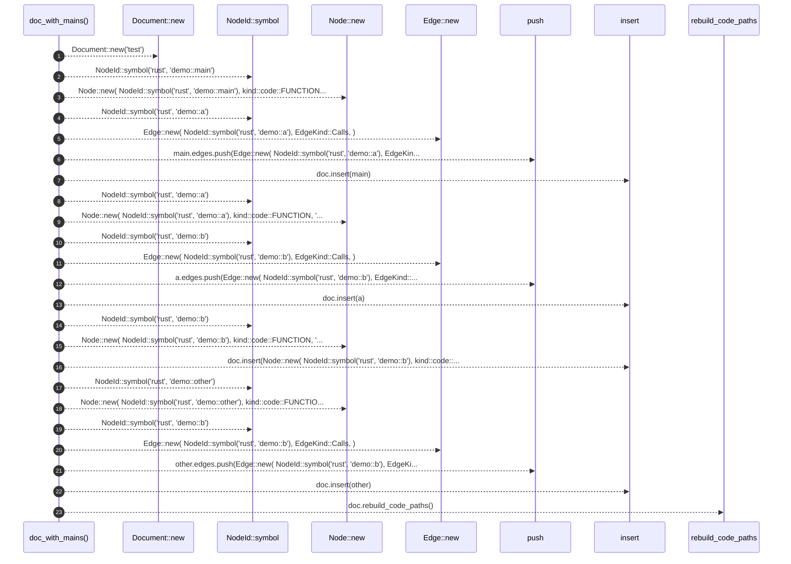

# `robby_render::view::entrypoints::doc_with_mains`

[Self-model](../../../../README.md) · [view::entrypoints::tests](index.md)

| | |
|---|---|
| kind | `code.function` |
| signature | `fn doc_with_mains() -> Document` |
| location | [`crates/robby-render/src/view/entrypoints.rs:131`](../../../../../../crates/robby-render/src/view/entrypoints.rs#L131) |
| provenance | extractor · confidence 1.00 |

```rust
fn doc_with_mains() -> Document {
        let mut doc = Document::new("test");
        let mut main = Node::new(
            NodeId::symbol("rust", "demo::main"),
            kind::code::FUNCTION,
            "demo::main",
        );
        main.edges.push(Edge::new(
            NodeId::symbol("rust", "demo::a"),
            EdgeKind::Calls,
        ));
        doc.insert(main);

        let mut a = Node::new(
            NodeId::symbol("rust", "demo::a"),
            kind::code::FUNCTION,
            "demo::a",
        );
        a.edges.push(Edge::new(
            NodeId::symbol("rust", "demo::b"),
            EdgeKind::Calls,
        ));
        doc.insert(a);

        doc.insert(Node::new(
            NodeId::symbol("rust", "demo::b"),
            kind::code::FUNCTION,
            "demo::b",
        ));

        let mut other = Node::new(
            NodeId::symbol("rust", "demo::other"),
            kind::code::FUNCTION,
            "demo::other",
        );
        other.edges.push(Edge::new(
            NodeId::symbol("rust", "demo::b"),
            EdgeKind::Calls,
        ));
        doc.insert(other);

        doc.rebuild_code_paths();
        doc
    }
```



23 steps · 0 observed · 23 possible only

**Edges**

- calls → [`robby_render::view::scene::impl Rect::new`](../../scene/index.md)
- calls → [`robby_ir::model::impl NodeId::symbol`](../../../../robby_ir/model/index.md)
- calls → [`robby_render::view::scene::impl Rect::new`](../../scene/index.md)
- calls → [`robby_ir::model::impl NodeId::symbol`](../../../../robby_ir/model/index.md)
- calls → [`robby_render::view::scene::impl Rect::new`](../../scene/index.md)
- calls → [`robby_render::report::impl Report::push`](../../../report/index.md)
- calls → [`robby_ir::model::impl Document::insert`](../../../../robby_ir/model/index.md)
- calls → [`robby_ir::model::impl NodeId::symbol`](../../../../robby_ir/model/index.md)
- calls → [`robby_render::view::scene::impl Rect::new`](../../scene/index.md)
- calls → [`robby_ir::model::impl NodeId::symbol`](../../../../robby_ir/model/index.md)
- calls → [`robby_render::view::scene::impl Rect::new`](../../scene/index.md)
- calls → [`robby_render::report::impl Report::push`](../../../report/index.md)
- calls → [`robby_ir::model::impl Document::insert`](../../../../robby_ir/model/index.md)
- calls → [`robby_ir::model::impl NodeId::symbol`](../../../../robby_ir/model/index.md)
- calls → [`robby_render::view::scene::impl Rect::new`](../../scene/index.md)
- calls → [`robby_ir::model::impl Document::insert`](../../../../robby_ir/model/index.md)
- calls → [`robby_ir::model::impl NodeId::symbol`](../../../../robby_ir/model/index.md)
- calls → [`robby_render::view::scene::impl Rect::new`](../../scene/index.md)
- calls → [`robby_ir::model::impl NodeId::symbol`](../../../../robby_ir/model/index.md)
- calls → [`robby_render::view::scene::impl Rect::new`](../../scene/index.md)
- calls → [`robby_render::report::impl Report::push`](../../../report/index.md)
- calls → [`robby_ir::model::impl Document::insert`](../../../../robby_ir/model/index.md)
- calls → [`robby_ir::model::impl Document::rebuild_code_paths`](../../../../robby_ir/model/index.md)

## References

- calls → [`robby_ir::model`](../../../../robby_ir/model/index.md) — insert, rebuild_code_paths, symbol
- calls → [`robby_render::report`](../../../report/index.md) — push
- calls → [`robby_render::view::scene`](../../scene/index.md) — new

## Referenced by

- calls ← [`robby_render::view::entrypoints::first_parent_wins_shared_callee`](first-parent-wins-shared-callee.md)
- calls ← [`robby_render::view::entrypoints::prefers_document_code_paths`](prefers-document-code-paths.md)

