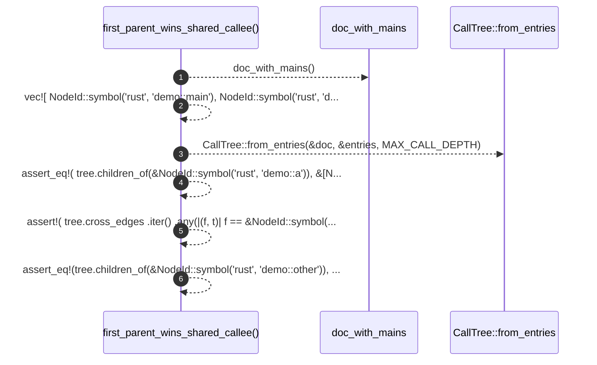

# `robby_render::view::entrypoints::first_parent_wins_shared_callee`

[Self-model](../../../../README.md) · [view::entrypoints::tests](index.md)

| | |
|---|---|
| kind | `code.function` |
| signature | `fn first_parent_wins_shared_callee()` |
| location | [`crates/robby-render/src/view/entrypoints.rs:189`](../../../../../../crates/robby-render/src/view/entrypoints.rs#L189) |
| provenance | extractor · confidence 1.00 |

```rust
#[test]
    fn first_parent_wins_shared_callee() {
        let doc = doc_with_mains();
        let entries = vec![
            NodeId::symbol("rust", "demo::main"),
            NodeId::symbol("rust", "demo::other"),
        ];
        let tree = CallTree::from_entries(&doc, &entries, MAX_CALL_DEPTH);

        assert_eq!(
            tree.children_of(&NodeId::symbol("rust", "demo::a")),
            &[NodeId::symbol("rust", "demo::b")]
        );
        assert!(
            tree.cross_edges
                .iter()
                .any(|(f, t)| f == &NodeId::symbol("rust", "demo::other")
                    && t == &NodeId::symbol("rust", "demo::b"))
        );
        assert_eq!(tree.children_of(&NodeId::symbol("rust", "demo::other")), []);
    }
```



6 steps · 0 observed · 6 possible only

**Edges**

- calls → [`robby_render::view::entrypoints::doc_with_mains`](doc-with-mains.md)
- calls → [`robby_render::view::entrypoints::impl CallTree::from_entries`](../index.md)

## References

- calls → [`robby_render::view::entrypoints`](../index.md) — from_entries
- calls → [`robby_render::view::entrypoints::tests`](index.md) — doc_with_mains

