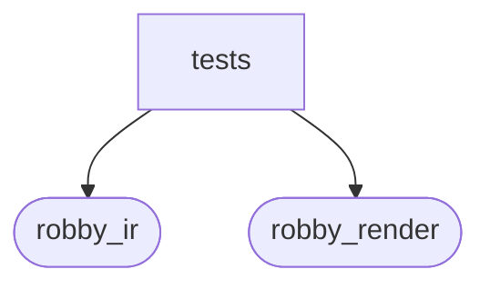

# `robby_render::view::entrypoints::tests`

[Self-model](../../../../README.md) · [view::entrypoints](../index.md)

| | |
|---|---|
| kind | `code.module` |
| declared at | [`crates/robby-render/src/view/entrypoints.rs:126`](../../../../../../crates/robby-render/src/view/entrypoints.rs#L126) |
| provenance | extractor · confidence 1.00 |
| nodes | 6 |

## Package diagram

## Dependency matrix

| | tests | robby_ir | robby_render |
|---|---:|---:|---:|
| **tests** | · | 12 | 13 |
| **robby_ir** | | · | |
| **robby_render** | | | · |
## References

- calls → [`robby_ir::model`](../../../../robby_ir/model/index.md) — insert, rebuild_code_paths, symbol
- calls → [`robby_render::report`](../../../report/index.md) — push
- calls → [`robby_render::view::entrypoints`](../index.md) — from_document, from_entries
- calls → [`robby_render::view::scene`](../../scene/index.md) — new

## Items

| Item | Kind | Steps | Location |
|---|---|---:|---|
| [`doc_with_mains`](doc-with-mains.md) | `code.function` | 23 | `crates/robby-render/src/view/entrypoints.rs:131:5` |
| [`prefers_document_code_paths`](prefers-document-code-paths.md) | `code.function` | 5 | `crates/robby-render/src/view/entrypoints.rs:176:5` |
| [`first_parent_wins_shared_callee`](first-parent-wins-shared-callee.md) | `code.function` | 6 | `crates/robby-render/src/view/entrypoints.rs:189:5` |

## Imports

- `use super::*;`
- [`use robby_ir::{Edge, Node, kind};`](../../../../robby_ir/index.md)

