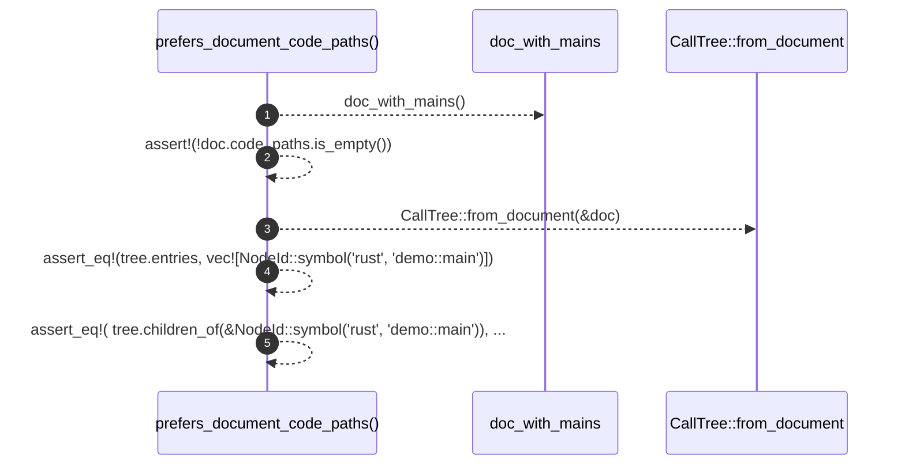

# `robby_render::view::entrypoints::prefers_document_code_paths`

[Self-model](../../../../README.md) · [view::entrypoints::tests](index.md)

| | |
|---|---|
| kind | `code.function` |
| signature | `fn prefers_document_code_paths()` |
| location | [`crates/robby-render/src/view/entrypoints.rs:176`](../../../../../../crates/robby-render/src/view/entrypoints.rs#L176) |
| provenance | extractor · confidence 1.00 |

```rust
#[test]
    fn prefers_document_code_paths() {
        let doc = doc_with_mains();
        assert!(!doc.code_paths.is_empty());
        let tree = CallTree::from_document(&doc);
        assert_eq!(tree.entries, vec![NodeId::symbol("rust", "demo::main")]);
        assert_eq!(
            tree.children_of(&NodeId::symbol("rust", "demo::main")),
            &[NodeId::symbol("rust", "demo::a")]
        );
    }
```



5 steps · 0 observed · 5 possible only

**Edges**

- calls → [`robby_render::view::entrypoints::doc_with_mains`](doc-with-mains.md)
- calls → [`robby_render::view::entrypoints::impl CallTree::from_document`](../index.md)

## References

- calls → [`robby_render::view::entrypoints`](../index.md) — from_document
- calls → [`robby_render::view::entrypoints::tests`](index.md) — doc_with_mains

