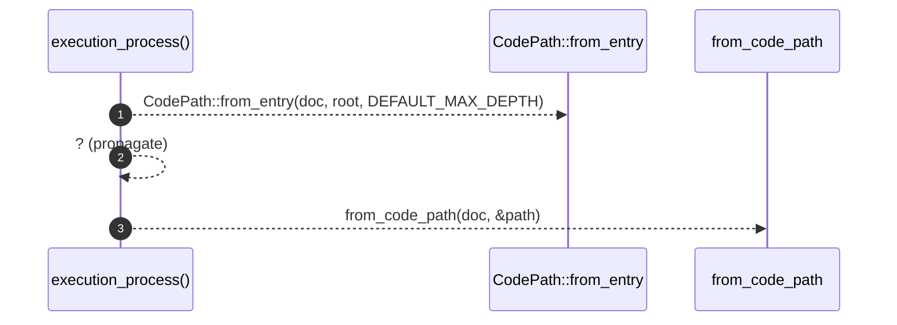

# `robby_render::view::execution::execution_process`

[Self-model](../../../README.md) · [view::execution](index.md)

| | |
|---|---|
| kind | `code.function` |
| signature | `fn execution_process(doc: &Document, root: &NodeId) -> Option<Process>` |
| location | [`crates/robby-render/src/view/execution.rs:16`](../../../../../crates/robby-render/src/view/execution.rs#L16) |
| provenance | extractor · confidence 1.00 |

> Build an execution [`Process`] rooted at `root` (BFS Calls, depth-capped).

```rust
/// Build an execution [`Process`] rooted at `root` (BFS Calls, depth-capped).
pub fn execution_process(doc: &Document, root: &NodeId) -> Option<Process> {
    let path = CodePath::from_entry(doc, root, DEFAULT_MAX_DEPTH)?;
    from_code_path(doc, &path)
}
```



3 steps · 0 observed · 3 possible only

**Edges**

- calls → [`robby_ir::codepath::impl CodePath::from_entry`](../../../robby_ir/codepath/index.md)
- calls → [`robby_render::view::execution::from_code_path`](from-code-path.md)

## References

- calls → [`robby_ir::codepath`](../../../robby_ir/codepath/index.md) — from_entry
- calls → [`robby_render::view::execution`](index.md) — from_code_path

## Referenced by

- calls ← [`robby_render::view::execution::sequence_includes_call_and_type_lifeline`](tests/sequence-includes-call-and-type-lifeline.md)
- calls ← [`robby_render::web::impl FrameDetail::from_node_in_doc`](../../web/index.md)

