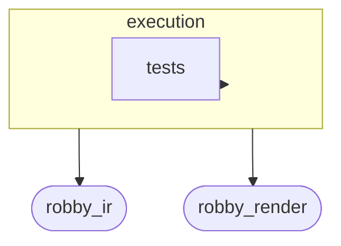
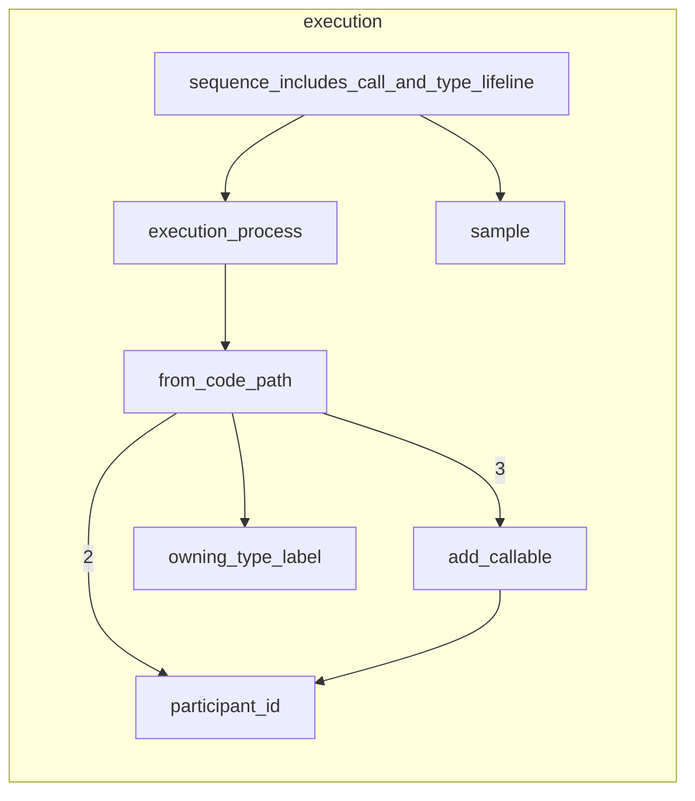

# `robby_render::view::execution`

[Self-model](../../../README.md) · [robby_render](../../index.md)

| | |
|---|---|
| kind | `code.module` |
| declared at | [`crates/robby-render/src/view/mod.rs:9`](../../../../../crates/robby-render/src/view/mod.rs#L9) |
| provenance | extractor · confidence 1.00 |
| nodes | 14 |

## Package diagram



## Module coupling



## Dependency matrix

| | execution | robby_ir | robby_render | tests |
|---|---:|---:|---:|---:|
| **execution** | · | 20 | 26 | 1 |
| **robby_ir** | | · | | |
| **robby_render** | | | · | |
| **tests** | | | | · |

## Comments

- `crates/robby-render/src/view/execution.rs:16:1` (docs, `robby_render::view::execution::execution_process`): "Build an execution [`Process`] rooted at `root` (BFS Calls, depth-capped)."
  ```
  /// Build an execution [`Process`] rooted at `root` (BFS Calls, depth-capped).
  pub fn execution_process(doc: &Document, root: &NodeId) -> Option<Process> {
      let path = CodePath::from_entry(doc, root, DEFAULT_MAX_DEPTH)?;
      from_code_path(doc, &path)
  }
  ```
- `crates/robby-render/src/view/execution.rs:84:1` (docs, `robby_render::view::execution::owning_type_label`): "From a method under `impl … for Type`, recover the type name for a lifeline."
  ```
  /// From a method under `impl … for Type`, recover the type name for a lifeline.
  fn owning_type_label(doc: &Document, method: &Node) -> Option<String> {
      if method.kind.as_str() != kind::code::METHOD {
          return None;
      }
      let parent = method.parent.as_ref().and_then(|id| doc.get(id))?;
      if parent.kind.as_str() != kind::code::IMPL {
          return None;
      }
      let name = parent.name.trim();
      if let Some((_, ty)) = name.rsplit_once(" for ") {
          let ty = ty.trim();
          if !ty.is_empty() {
              return Some(ty.to_owned());
          }
      }
      name.strip_prefix("impl")
          .map(str::trim)
          .filter(|s| !s.is_empty() && !s.contains(' '))
          .map(str::to_owned)
  }
  ```
## References

- calls → [`robby_ir::codepath`](../../../robby_ir/codepath/index.md) — from_entry
- calls → [`robby_ir::kind`](../../../robby_ir/kind/index.md) — from
- calls → [`robby_ir::model`](../../../robby_ir/model/index.md) — get, insert, symbol
- calls → [`robby_ir::process`](../../../robby_ir/process/index.md) — participant
- calls → [`robby_render::report`](../../report/index.md) — push
- calls → [`robby_render::test_render`](../../test_render/index.md) — step
- calls → [`robby_render::util`](../../util/index.md) — alias
- calls → [`robby_render::view::comments`](../comments/index.md) — as_str
- calls → [`robby_render::view::links`](../links/index.md) — is_empty
- calls → [`robby_render::view::scene`](../scene/index.md) — contains, new
- calls → [`robby_render::view::select`](../select/index.md) — collect

## Referenced by

- calls ← [`robby_render::web::impl FrameDetail::from_node_in_doc`](../../web/index.md)

## Modules

- [`view::execution::tests`](tests/index.md) — 5 nodes

## Items

| Item | Kind | Steps | Location |
|---|---|---:|---|
| [`MAX_EDGES`](max-edges.md) | `code.const` | — | `crates/robby-render/src/view/execution.rs:13:1` |
| [`execution_process`](execution-process.md) | `code.function` | 3 | `crates/robby-render/src/view/execution.rs:16:1` |
| [`from_code_path`](from-code-path.md) | `code.function` | 32 | `crates/robby-render/src/view/execution.rs:22:1` |
| [`add_callable`](add-callable.md) | `code.function` | 4 | `crates/robby-render/src/view/execution.rs:76:1` |
| [`participant_id`](participant-id.md) | `code.function` | 2 | `crates/robby-render/src/view/execution.rs:80:1` |
| [`owning_type_label`](owning-type-label.md) | `code.function` | 21 | `crates/robby-render/src/view/execution.rs:84:1` |

## Imports

- [`use robby_ir::{`](../../../robby_ir/index.md)
- `use crate::util::alias;`

