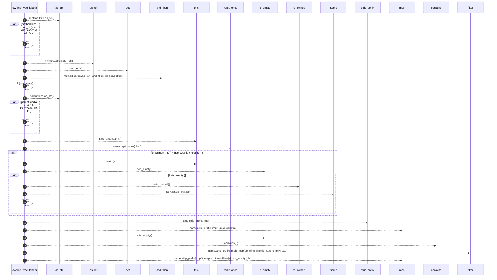

# `robby_render::view::execution::owning_type_label`

[Self-model](../../../README.md) · [view::execution](index.md)

| | |
|---|---|
| kind | `code.function` |
| signature | `fn owning_type_label(doc: &Document, method: &Node) -> Option<String>` |
| location | [`crates/robby-render/src/view/execution.rs:92`](../../../../../crates/robby-render/src/view/execution.rs#L92) |
| provenance | extractor · confidence 1.00 |

> From a method under `impl … for Type`, recover the type name for a lifeline.

```rust
/// From a method under `impl … for Type`, recover the type name for a lifeline.
fn owning_type_label(doc: &Document, method: &Node) -> Option<String> {
    if method.kind.as_str() != kind::code::METHOD {
        return None;
    }
    let parent = method.parent.as_ref().and_then(|id| doc.get(id))?;
    if parent.kind.as_str() != kind::code::IMPL {
        return None;
    }
    let name = parent.name.trim();
    if let Some((_, ty)) = name.rsplit_once(" for ") {
        let ty = ty.trim();
        if !ty.is_empty() {
            return Some(ty.to_owned());
        }
    }
    name.strip_prefix("impl")
        .map(str::trim)
        .filter(|s| !s.is_empty() && !s.contains(' '))
        .map(str::to_owned)
}
```



21 steps · 0 observed · 21 possible only

**Edges**

- calls → [`robby_render::view::comments::impl NoteKind::as_str`](../comments/index.md)
- calls → [`robby_ir::model::impl Document::get`](../../../robby_ir/model/index.md)
- calls → [`robby_render::view::comments::impl NoteKind::as_str`](../comments/index.md)
- calls → [`robby_render::view::links::impl LinkGraph::is_empty`](../links/index.md)
- calls → [`robby_render::view::links::impl LinkGraph::is_empty`](../links/index.md)
- calls → [`robby_render::view::scene::impl WorldRect::contains`](../scene/index.md)

## References

- calls → [`robby_ir::model`](../../../robby_ir/model/index.md) — get
- calls → [`robby_render::view::comments`](../comments/index.md) — as_str
- calls → [`robby_render::view::links`](../links/index.md) — is_empty
- calls → [`robby_render::view::scene`](../scene/index.md) — contains

## Referenced by

- calls ← [`robby_render::view::execution::from_code_path`](from-code-path.md)

