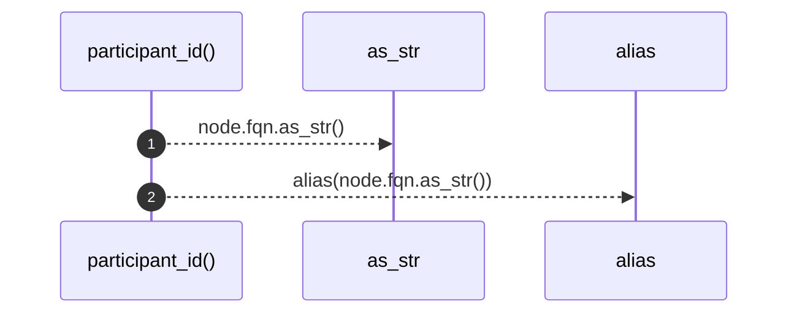

# `robby_render::view::execution::participant_id`

[Self-model](../../../README.md) · [view::execution](index.md)

| | |
|---|---|
| kind | `code.function` |
| signature | `fn participant_id(node: &Node) -> String` |
| location | [`crates/robby-render/src/view/execution.rs:80`](../../../../../crates/robby-render/src/view/execution.rs#L80) |
| provenance | extractor · confidence 1.00 |

```rust
fn participant_id(node: &Node) -> String {
    alias(node.fqn.as_str())
}
```



2 steps · 0 observed · 2 possible only

**Edges**

- calls → [`robby_render::view::comments::impl CommentKind::as_str`](../comments/index.md)
- calls → [`robby_render::util::alias`](../../util/alias.md)

## References

- calls → [`robby_render::util`](../../util/index.md) — alias
- calls → [`robby_render::view::comments`](../comments/index.md) — as_str

## Referenced by

- calls ← [`robby_render::view::execution::add_callable`](add-callable.md)
- calls ← [`robby_render::view::execution::from_code_path`](from-code-path.md)

