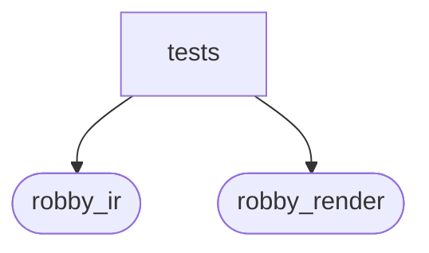

# `robby_render::view::execution::tests`

[Self-model](../../../../README.md) · [view::execution](../index.md)

| | |
|---|---|
| kind | `code.module` |
| declared at | [`crates/robby-render/src/view/execution.rs:106`](../../../../../../crates/robby-render/src/view/execution.rs#L106) |
| provenance | extractor · confidence 1.00 |
| nodes | 5 |

## Package diagram

## Dependency matrix

| | tests | robby_ir | robby_render |
|---|---:|---:|---:|
| **tests** | · | 12 | 10 |
| **robby_ir** | | · | |
| **robby_render** | | | · |
## References

- calls → [`robby_ir::model`](../../../../robby_ir/model/index.md) — insert, symbol
- calls → [`robby_render::report`](../../../report/index.md) — push
- calls → [`robby_render::view::execution`](../index.md) — execution_process
- calls → [`robby_render::view::scene`](../../scene/index.md) — new

## Items

| Item | Kind | Steps | Location |
|---|---|---:|---|
| [`sample`](sample.md) | `code.function` | 23 | `crates/robby-render/src/view/execution.rs:111:5` |
| [`sequence_includes_call_and_type_lifeline`](sequence-includes-call-and-type-lifeline.md) | `code.function` | 8 | `crates/robby-render/src/view/execution.rs:155:5` |

## Imports

- `use super::*;`
- [`use robby_ir::{Edge, EdgeKind};`](../../../../robby_ir/index.md)

