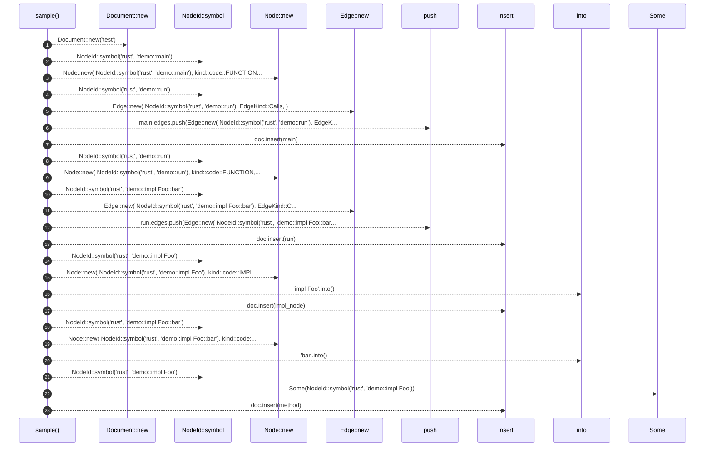

# `robby_render::view::execution::sample`

[Self-model](../../../../README.md) · [view::execution::tests](index.md)

| | |
|---|---|
| kind | `code.function` |
| signature | `fn sample() -> Document` |
| location | [`crates/robby-render/src/view/execution.rs:111`](../../../../../../crates/robby-render/src/view/execution.rs#L111) |
| provenance | extractor · confidence 1.00 |

```rust
fn sample() -> Document {
        let mut doc = Document::new("test");
        let mut main = Node::new(
            NodeId::symbol("rust", "demo::main"),
            kind::code::FUNCTION,
            "demo::main",
        );
        main.edges.push(Edge::new(
            NodeId::symbol("rust", "demo::run"),
            EdgeKind::Calls,
        ));
        doc.insert(main);

        let mut run = Node::new(
            NodeId::symbol("rust", "demo::run"),
            kind::code::FUNCTION,
            "demo::run",
        );
        run.edges.push(Edge::new(
            NodeId::symbol("rust", "demo::impl Foo::bar"),
            EdgeKind::Calls,
        ));
        doc.insert(run);

        let mut impl_node = Node::new(
            NodeId::symbol("rust", "demo::impl Foo"),
            kind::code::IMPL,
            "impl Foo",
        );
        impl_node.name = "impl Foo".into();
        doc.insert(impl_node);

        let mut method = Node::new(
            NodeId::symbol("rust", "demo::impl Foo::bar"),
            kind::code::METHOD,
            "demo::impl Foo::bar",
        );
        method.name = "bar".into();
        method.parent = Some(NodeId::symbol("rust", "demo::impl Foo"));
        doc.insert(method);

        doc
    }
```



23 steps · 0 observed · 23 possible only

**Edges**

- calls → [`robby_render::view::scene::impl Rect::new`](../../scene/index.md)
- calls → [`robby_ir::model::impl NodeId::symbol`](../../../../robby_ir/model/index.md)
- calls → [`robby_render::view::scene::impl Rect::new`](../../scene/index.md)
- calls → [`robby_ir::model::impl NodeId::symbol`](../../../../robby_ir/model/index.md)
- calls → [`robby_render::view::scene::impl Rect::new`](../../scene/index.md)
- calls → [`robby_render::report::impl Report::push`](../../../report/index.md)
- calls → [`robby_ir::model::impl Document::insert`](../../../../robby_ir/model/index.md)
- calls → [`robby_ir::model::impl NodeId::symbol`](../../../../robby_ir/model/index.md)
- calls → [`robby_render::view::scene::impl Rect::new`](../../scene/index.md)
- calls → [`robby_ir::model::impl NodeId::symbol`](../../../../robby_ir/model/index.md)
- calls → [`robby_render::view::scene::impl Rect::new`](../../scene/index.md)
- calls → [`robby_render::report::impl Report::push`](../../../report/index.md)
- calls → [`robby_ir::model::impl Document::insert`](../../../../robby_ir/model/index.md)
- calls → [`robby_ir::model::impl NodeId::symbol`](../../../../robby_ir/model/index.md)
- calls → [`robby_render::view::scene::impl Rect::new`](../../scene/index.md)
- calls → [`robby_ir::model::impl Document::insert`](../../../../robby_ir/model/index.md)
- calls → [`robby_ir::model::impl NodeId::symbol`](../../../../robby_ir/model/index.md)
- calls → [`robby_render::view::scene::impl Rect::new`](../../scene/index.md)
- calls → [`robby_ir::model::impl NodeId::symbol`](../../../../robby_ir/model/index.md)
- calls → [`robby_ir::model::impl Document::insert`](../../../../robby_ir/model/index.md)

## References

- calls → [`robby_ir::model`](../../../../robby_ir/model/index.md) — insert, symbol
- calls → [`robby_render::report`](../../../report/index.md) — push
- calls → [`robby_render::view::scene`](../../scene/index.md) — new

## Referenced by

- calls ← [`robby_render::view::execution::sequence_includes_call_and_type_lifeline`](sequence-includes-call-and-type-lifeline.md)

