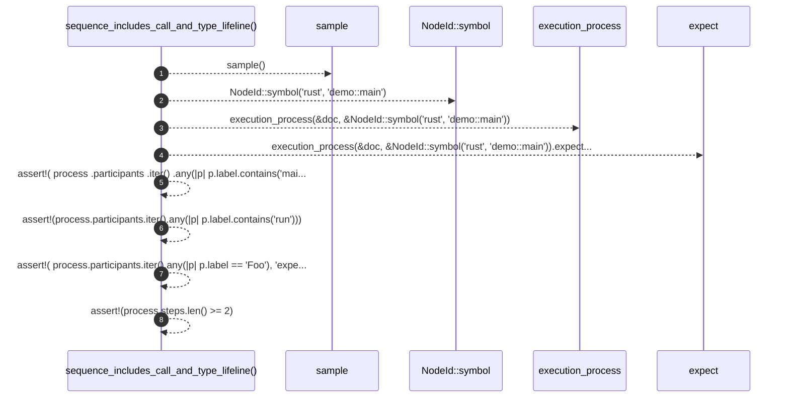

# `robby_render::view::execution::sequence_includes_call_and_type_lifeline`

[Self-model](../../../../README.md) · [view::execution::tests](index.md)

| | |
|---|---|
| kind | `code.function` |
| signature | `fn sequence_includes_call_and_type_lifeline()` |
| location | [`crates/robby-render/src/view/execution.rs:155`](../../../../../../crates/robby-render/src/view/execution.rs#L155) |
| provenance | extractor · confidence 1.00 |

```rust
#[test]
    fn sequence_includes_call_and_type_lifeline() {
        let doc = sample();
        let process =
            execution_process(&doc, &NodeId::symbol("rust", "demo::main")).expect("process");
        assert!(
            process
                .participants
                .iter()
                .any(|p| p.label.contains("main"))
        );
        assert!(process.participants.iter().any(|p| p.label.contains("run")));
        assert!(
            process.participants.iter().any(|p| p.label == "Foo"),
            "expected Foo type participant, got {:?}",
            process.participants
        );
        assert!(process.steps.len() >= 2);
    }
```



8 steps · 0 observed · 8 possible only

**Edges**

- calls → [`robby_render::view::execution::sample`](sample.md)
- calls → [`robby_ir::model::impl NodeId::symbol`](../../../../robby_ir/model/index.md)
- calls → [`robby_render::view::execution::execution_process`](../execution-process.md)

## References

- calls → [`robby_ir::model`](../../../../robby_ir/model/index.md) — symbol
- calls → [`robby_render::view::execution`](../index.md) — execution_process
- calls → [`robby_render::view::execution::tests`](index.md) — sample

