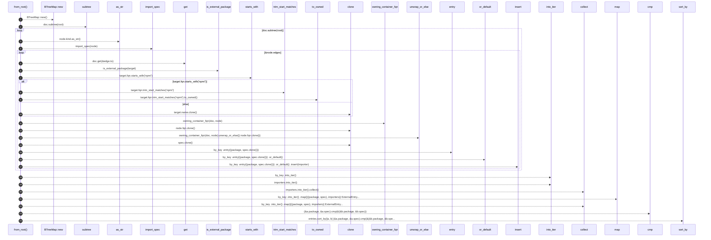
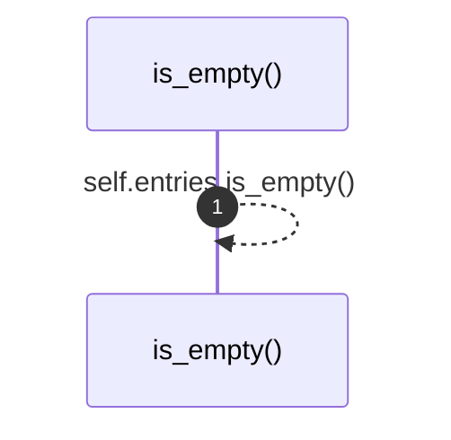

# `robby_render::view::externals::impl ExternalsView`

[Self-model](../../../README.md) · [view::externals](index.md)

| | |
|---|---|
| kind | `code.impl` |
| location | [`crates/robby-render/src/view/externals.rs:21`](../../../../../crates/robby-render/src/view/externals.rs#L21) |
| provenance | extractor · confidence 1.00 |

```rust
impl ExternalsView {
    pub fn from_root(doc: &Document, root: &NodeId) -> Self {
        let mut by_key: BTreeMap<(String, String), BTreeSet<String>> = BTreeMap::new();

        for node in doc.subtree(root) {
            if node.kind.as_str() != kind::code::IMPORT {
                continue;
            }
            let Some(spec) = import_spec(node) else {
                continue;
            };
            for edge in &node.edges {
                if edge.kind != EdgeKind::Imports {
                    continue;
                }
                let Some(target) = doc.get(&edge.to) else {
                    continue;
                };
                if !is_external_package(target) {
                    continue;
                }
                let package = if target.fqn.starts_with("npm/") {
                    target.fqn.trim_start_matches("npm/").to_owned()
                } else {
                    target.name.clone()
                };
                let importer = owning_container_fqn(doc, node).unwrap_or_else(|| node.fqn.clone());
                by_key
                    .entry((package, spec.clone()))
                    .or_default()
                    .insert(importer);
            }
        }

        let mut entries: Vec<ExternalEntry> = by_key
            .into_iter()
            .map(|((package, spec), importers)| ExternalEntry {
                package,
                spec,
                importers: importers.into_iter().collect(),
            })
            .collect();
        entries.sort_by(|a, b| (&a.package, &a.spec).cmp(&(&b.package, &b.spec)));
        Self { entries }
    }

    pub fn is_empty(&self) -> bool {
        self.entries.is_empty()
    }
}
```

## References

- calls → [`robby_ir::model`](../../../robby_ir/model/index.md) — get, insert, subtree
- calls → [`robby_render::view::comments`](../comments/index.md) — as_str
- calls → [`robby_render::view::externals`](index.md) — import_spec, is_external_package, owning_container_fqn
- calls → [`robby_render::view::scene`](../scene/index.md) — new
- calls → [`robby_render::view::select`](../select/index.md) — collect

### `from_root`

| | |
|---|---|
| kind | `code.method` |
| signature | `fn from_root(2)` |
| location | [`crates/robby-render/src/view/externals.rs:22`](../../../../../crates/robby-render/src/view/externals.rs#L22) |
| provenance | extractor · confidence 1.00 |

```rust
pub fn from_root(doc: &Document, root: &NodeId) -> Self {
        let mut by_key: BTreeMap<(String, String), BTreeSet<String>> = BTreeMap::new();

        for node in doc.subtree(root) {
            if node.kind.as_str() != kind::code::IMPORT {
                continue;
            }
            let Some(spec) = import_spec(node) else {
                continue;
            };
            for edge in &node.edges {
                if edge.kind != EdgeKind::Imports {
                    continue;
                }
                let Some(target) = doc.get(&edge.to) else {
                    continue;
                };
                if !is_external_package(target) {
                    continue;
                }
                let package = if target.fqn.starts_with("npm/") {
                    target.fqn.trim_start_matches("npm/").to_owned()
                } else {
                    target.name.clone()
                };
                let importer = owning_container_fqn(doc, node).unwrap_or_else(|| node.fqn.clone());
                by_key
                    .entry((package, spec.clone()))
                    .or_default()
                    .insert(importer);
            }
        }

        let mut entries: Vec<ExternalEntry> = by_key
            .into_iter()
            .map(|((package, spec), importers)| ExternalEntry {
                package,
                spec,
                importers: importers.into_iter().collect(),
            })
            .collect();
        entries.sort_by(|a, b| (&a.package, &a.spec).cmp(&(&b.package, &b.spec)));
        Self { entries }
    }
```



24 steps · 0 observed · 24 possible only

**Edges**

- calls → [`robby_render::view::scene::impl Rect::new`](../scene/index.md)
- calls → [`robby_ir::model::impl Document::subtree`](../../../robby_ir/model/index.md)
- calls → [`robby_render::view::comments::impl CommentKind::as_str`](../comments/index.md)
- calls → [`robby_render::view::externals::import_spec`](import-spec.md)
- calls → [`robby_ir::model::impl Document::get`](../../../robby_ir/model/index.md)
- calls → [`robby_render::view::externals::is_external_package`](is-external-package.md)
- calls → [`robby_render::view::externals::owning_container_fqn`](owning-container-fqn.md)
- calls → [`robby_ir::model::impl Document::insert`](../../../robby_ir/model/index.md)
- calls → [`robby_render::view::select::collect`](../select/collect.md)
- calls → [`robby_render::view::select::collect`](../select/collect.md)

### `is_empty`

| | |
|---|---|
| kind | `code.method` |
| signature | `fn is_empty(1)` |
| location | [`crates/robby-render/src/view/externals.rs:67`](../../../../../crates/robby-render/src/view/externals.rs#L67) |
| provenance | extractor · confidence 1.00 |

```rust
pub fn is_empty(&self) -> bool {
        self.entries.is_empty()
    }
```



1 steps · 0 observed · 1 possible only

**Edges**

- calls → [`robby_render::view::externals::impl ExternalsView::is_empty`](index.md)

