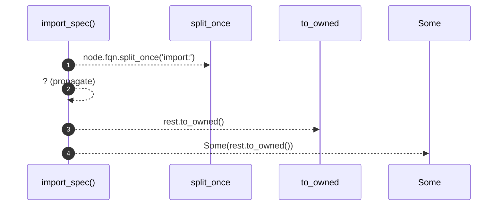

# `robby_render::view::externals::import_spec`

[Self-model](../../../README.md) · [view::externals](index.md)

| | |
|---|---|
| kind | `code.function` |
| signature | `fn import_spec(node: &Node) -> Option<String>` |
| location | [`crates/robby-render/src/view/externals.rs:81`](../../../../../crates/robby-render/src/view/externals.rs#L81) |
| provenance | extractor · confidence 1.00 |

```rust
fn import_spec(node: &Node) -> Option<String> {
    let (_, rest) = node.fqn.split_once("import:")?;
    Some(rest.to_owned())
}
```



4 steps · 0 observed · 4 possible only

## Referenced by

- calls ← [`robby_render::view::externals::impl ExternalsView::from_root`](index.md)

