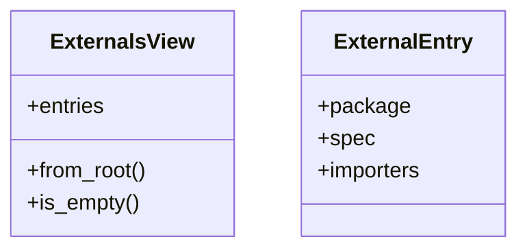
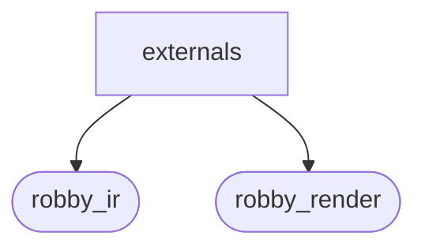
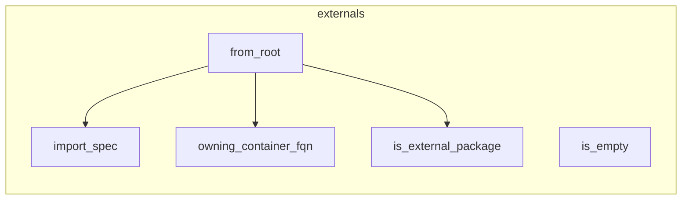

# `robby_render::view::externals`

[Self-model](../../../README.md) · [robby_render](../../index.md)

| | |
|---|---|
| kind | `code.module` |
| declared at | [`crates/robby-render/src/view/mod.rs:10`](../../../../../crates/robby-render/src/view/mod.rs#L10) |
| provenance | extractor · confidence 1.00 |
| nodes | 16 |

## Types

## Package diagram

## Module coupling

## Dependency matrix

| | externals | robby_ir | robby_render |
|---|---:|---:|---:|
| **externals** | · | 6 | 7 |
| **robby_ir** | | · | |
| **robby_render** | | | · |
## References

- calls → [`robby_ir::model`](../../../robby_ir/model/index.md) — get, insert, subtree
- calls → [`robby_render::view::comments`](../comments/index.md) — as_str
- calls → [`robby_render::view::links`](../links/index.md) — is_module_kind
- calls → [`robby_render::view::scene`](../scene/index.md) — new
- calls → [`robby_render::view::select`](../select/index.md) — collect

## Items

| Item | Kind | Steps | Location |
|---|---|---:|---|
| [`ExternalsView`](externalsview.md) | `code.struct` | — | `crates/robby-render/src/view/externals.rs:9:1` |
| [`ExternalEntry`](externalentry.md) | `code.struct` | — | `crates/robby-render/src/view/externals.rs:14:1` |
| [`impl ExternalsView`](impl-externalsview.md) | `code.impl` | — | `crates/robby-render/src/view/externals.rs:21:1` |
| [`is_external_package`](is-external-package.md) | `code.function` | 8 | `crates/robby-render/src/view/externals.rs:72:1` |
| [`import_spec`](import-spec.md) | `code.function` | 4 | `crates/robby-render/src/view/externals.rs:85:1` |
| [`owning_container_fqn`](owning-container-fqn.md) | `code.function` | 11 | `crates/robby-render/src/view/externals.rs:90:1` |

## Imports

- `use std::collections::{BTreeMap, BTreeSet};`
- [`use robby_ir::{Document, EdgeKind, Node, NodeId, kind};`](../../../robby_ir/index.md)
- `use super::links::is_module_kind;`

