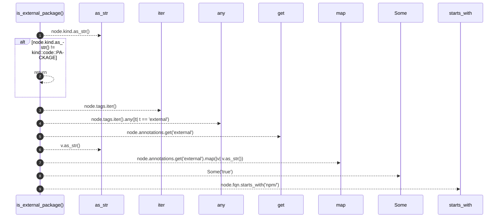

# `robby_render::view::externals::is_external_package`

[Self-model](../../../README.md) · [view::externals](index.md)

| | |
|---|---|
| kind | `code.function` |
| signature | `fn is_external_package(node: &Node) -> bool` |
| location | [`crates/robby-render/src/view/externals.rs:72`](../../../../../crates/robby-render/src/view/externals.rs#L72) |
| provenance | extractor · confidence 1.00 |

```rust
fn is_external_package(node: &Node) -> bool {
    if node.kind.as_str() != kind::code::PACKAGE {
        return false;
    }
    node.tags.iter().any(|t| t == "external")
        || node.annotations.get("external").map(|v| v.as_str()) == Some("true")
        || node.fqn.starts_with("npm/")
}
```



9 steps · 0 observed · 9 possible only

**Edges**

- calls → [`robby_render::view::comments::impl NoteKind::as_str`](../comments/index.md)
- calls → [`robby_ir::model::impl Document::get`](../../../robby_ir/model/index.md)
- calls → [`robby_render::view::comments::impl NoteKind::as_str`](../comments/index.md)

## References

- calls → [`robby_ir::model`](../../../robby_ir/model/index.md) — get
- calls → [`robby_render::view::comments`](../comments/index.md) — as_str

## Referenced by

- calls ← [`robby_render::view::externals::impl ExternalsView::from_root`](index.md)

