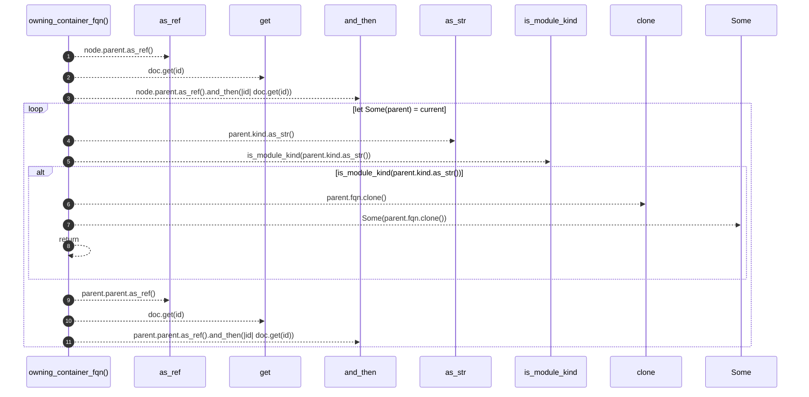

# `robby_render::view::externals::owning_container_fqn`

[Self-model](../../../README.md) · [view::externals](index.md)

| | |
|---|---|
| kind | `code.function` |
| signature | `fn owning_container_fqn(doc: &Document, node: &Node) -> Option<String>` |
| location | [`crates/robby-render/src/view/externals.rs:90`](../../../../../crates/robby-render/src/view/externals.rs#L90) |
| provenance | extractor · confidence 1.00 |

```rust
fn owning_container_fqn(doc: &Document, node: &Node) -> Option<String> {
    let mut current = node.parent.as_ref().and_then(|id| doc.get(id));
    while let Some(parent) = current {
        if is_module_kind(parent.kind.as_str()) {
            return Some(parent.fqn.clone());
        }
        current = parent.parent.as_ref().and_then(|id| doc.get(id));
    }
    None
}
```



11 steps · 0 observed · 11 possible only

**Edges**

- calls → [`robby_ir::run::RecipeCatalog::get`](../../../robby_ir/run/index.md)
- calls → [`robby_render::view::comments::impl CommentKind::as_str`](../comments/index.md)
- calls → [`robby_render::view::links::is_module_kind`](../links/is-module-kind.md)
- calls → [`robby_ir::run::RecipeCatalog::get`](../../../robby_ir/run/index.md)

## References

- calls → [`robby_ir::run`](../../../robby_ir/run/index.md) — get
- calls → [`robby_render::view::comments`](../comments/index.md) — as_str
- calls → [`robby_render::view::links`](../links/index.md) — is_module_kind

## Referenced by

- calls ← [`robby_render::view::externals::impl ExternalsView::from_root`](index.md)

