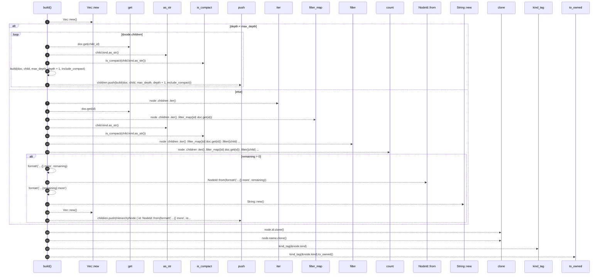

# `robby_render::view::hierarchy::build`

[Self-model](../../../README.md) · [view::hierarchy](index.md)

| | |
|---|---|
| kind | `code.function` |
| signature | `fn build(     doc: &Document,     node: &Node,     max_depth: usize,     depth: usize,     include_compact: bool, ) -> HierarchyNode` |
| location | [`crates/robby-render/src/view/hierarchy.rs:40`](../../../../../crates/robby-render/src/view/hierarchy.rs#L40) |
| provenance | extractor · confidence 1.00 |

```rust
fn build(
    doc: &Document,
    node: &Node,
    max_depth: usize,
    depth: usize,
    include_compact: bool,
) -> HierarchyNode {
    let mut children = Vec::new();
    if depth < max_depth {
        for child_id in &node.children {
            let Some(child) = doc.get(child_id) else {
                continue;
            };
            if !include_compact && is_compact(child.kind.as_str()) {
                continue;
            }
            children.push(build(doc, child, max_depth, depth + 1, include_compact));
        }
    } else {
        let remaining = node
            .children
            .iter()
            .filter_map(|id| doc.get(id))
            .filter(|child| include_compact || !is_compact(child.kind.as_str()))
            .count();
        if remaining > 0 {
            children.push(HierarchyNode {
                id: NodeId::from(format!("…{} more", remaining)),
                name: format!("…{remaining} more"),
                kind_tag: String::new(),
                children: Vec::new(),
            });
        }
    }

    HierarchyNode {
        id: node.id.clone(),
        name: node.name.clone(),
        kind_tag: kind_tag(&node.kind).to_owned(),
        children,
    }
}
```



23 steps · 0 observed · 23 possible only

**Edges**

- calls → [`robby_render::view::scene::impl Rect::new`](../scene/index.md)
- calls → [`robby_ir::model::impl Document::get`](../../../robby_ir/model/index.md)
- calls → [`robby_render::view::comments::impl NoteKind::as_str`](../comments/index.md)
- calls → [`robby_render::view::hierarchy::is_compact`](is-compact.md)
- calls → [`robby_render::view::hierarchy::build`](build.md)
- calls → [`robby_render::report::impl Report::push`](../../report/index.md)
- calls → [`robby_ir::model::impl Document::get`](../../../robby_ir/model/index.md)
- calls → [`robby_render::view::comments::impl NoteKind::as_str`](../comments/index.md)
- calls → [`robby_render::view::hierarchy::is_compact`](is-compact.md)
- calls → [`robby_ir::kind::impl From<&str> for Kind::from`](../../../robby_ir/kind/index.md)
- calls → [`robby_render::view::scene::impl Rect::new`](../scene/index.md)
- calls → [`robby_render::view::scene::impl Rect::new`](../scene/index.md)
- calls → [`robby_render::report::impl Report::push`](../../report/index.md)
- calls → [`robby_render::view::hierarchy::kind_tag`](kind-tag.md)

## References

- calls → [`robby_ir::kind`](../../../robby_ir/kind/index.md) — from
- calls → [`robby_ir::model`](../../../robby_ir/model/index.md) — get
- calls → [`robby_render::report`](../../report/index.md) — push
- calls → [`robby_render::view::comments`](../comments/index.md) — as_str
- calls → [`robby_render::view::hierarchy`](index.md) — is_compact, kind_tag
- calls → [`robby_render::view::scene`](../scene/index.md) — new

## Referenced by

- calls ← [`robby_agent::openrouter::impl OpenRouterClient::new`](../../../robby_agent/openrouter/index.md)
- calls ← [`robby_render::view::hierarchy::impl HierarchyView::from_node`](index.md)

