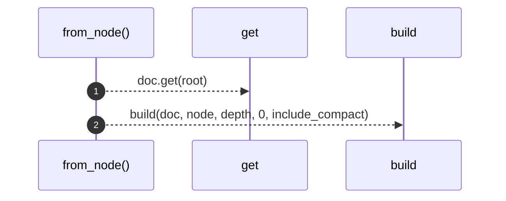
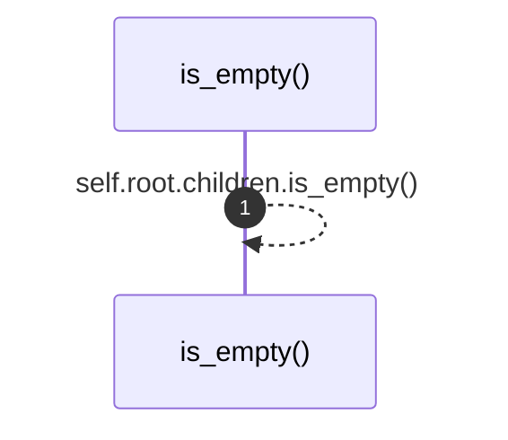

# `robby_render::view::hierarchy::impl HierarchyView`

[Self-model](../../../README.md) · [view::hierarchy](index.md)

| | |
|---|---|
| kind | `code.impl` |
| location | [`crates/robby-render/src/view/hierarchy.rs:18`](../../../../../crates/robby-render/src/view/hierarchy.rs#L18) |
| provenance | extractor · confidence 1.00 |

```rust
impl HierarchyView {
    pub fn from_node(doc: &Document, root: &NodeId, depth: usize, include_compact: bool) -> Self {
        let Some(node) = doc.get(root) else {
            return Self {
                root: HierarchyNode {
                    id: root.clone(),
                    name: String::new(),
                    kind_tag: String::new(),
                    children: Vec::new(),
                },
            };
        };
        Self {
            root: build(doc, node, depth, 0, include_compact),
        }
    }

    pub fn is_empty(&self) -> bool {
        self.root.children.is_empty()
    }
}
```

## References

- calls → [`robby_ir::model`](../../../robby_ir/model/index.md) — get
- calls → [`robby_render::view::hierarchy`](index.md) — build

### `from_node`

| | |
|---|---|
| kind | `code.method` |
| signature | `fn from_node(4)` |
| location | [`crates/robby-render/src/view/hierarchy.rs:19`](../../../../../crates/robby-render/src/view/hierarchy.rs#L19) |
| provenance | extractor · confidence 1.00 |

```rust
pub fn from_node(doc: &Document, root: &NodeId, depth: usize, include_compact: bool) -> Self {
        let Some(node) = doc.get(root) else {
            return Self {
                root: HierarchyNode {
                    id: root.clone(),
                    name: String::new(),
                    kind_tag: String::new(),
                    children: Vec::new(),
                },
            };
        };
        Self {
            root: build(doc, node, depth, 0, include_compact),
        }
    }
```



2 steps · 0 observed · 2 possible only

**Edges**

- calls → [`robby_ir::model::impl Document::get`](../../../robby_ir/model/index.md)
- calls → [`robby_render::view::hierarchy::build`](build.md)

### `is_empty`

| | |
|---|---|
| kind | `code.method` |
| signature | `fn is_empty(1)` |
| location | [`crates/robby-render/src/view/hierarchy.rs:35`](../../../../../crates/robby-render/src/view/hierarchy.rs#L35) |
| provenance | extractor · confidence 1.00 |

```rust
pub fn is_empty(&self) -> bool {
        self.root.children.is_empty()
    }
```



1 steps · 0 observed · 1 possible only

**Edges**

- calls → [`robby_render::view::hierarchy::impl HierarchyView::is_empty`](index.md)

