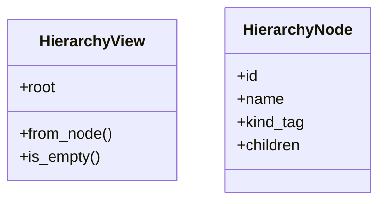
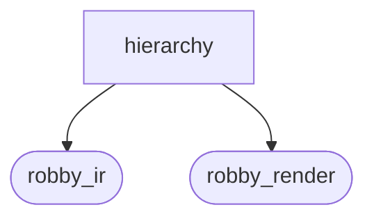
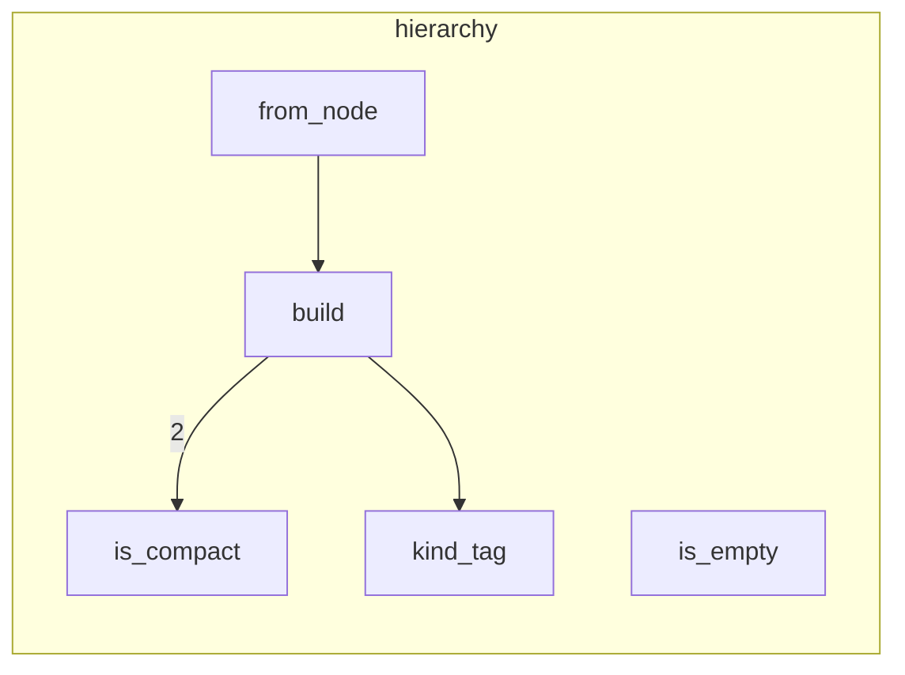

# `robby_render::view::hierarchy`

[Self-model](../../../README.md) · [robby_render](../../index.md)

| | |
|---|---|
| kind | `code.module` |
| declared at | [`crates/robby-render/src/view/mod.rs:11`](../../../../../crates/robby-render/src/view/mod.rs#L11) |
| provenance | extractor · confidence 1.00 |
| nodes | 15 |

## Types

## Package diagram

## Module coupling

## Dependency matrix

| | hierarchy | robby_ir | robby_render |
|---|---:|---:|---:|
| **hierarchy** | · | 4 | 8 |
| **robby_ir** | | · | |
| **robby_render** | | | · |
## References

- calls → [`robby_ir::kind`](../../../robby_ir/kind/index.md) — from
- calls → [`robby_ir::model`](../../../robby_ir/model/index.md) — get
- calls → [`robby_render::report`](../../report/index.md) — push
- calls → [`robby_render::view::comments`](../comments/index.md) — as_str
- calls → [`robby_render::view::scene`](../scene/index.md) — new

## Referenced by

- calls ← [`robby_agent::openrouter::impl OpenRouterClient::new`](../../../robby_agent/openrouter/index.md)

## Items

| Item | Kind | Steps | Location |
|---|---|---:|---|
| [`HierarchyView`](hierarchyview.md) | `code.struct` | — | `crates/robby-render/src/view/hierarchy.rs:5:1` |
| [`HierarchyNode`](hierarchynode.md) | `code.struct` | — | `crates/robby-render/src/view/hierarchy.rs:10:1` |
| [`impl HierarchyView`](impl-hierarchyview.md) | `code.impl` | — | `crates/robby-render/src/view/hierarchy.rs:18:1` |
| [`build`](build.md) | `code.function` | 23 | `crates/robby-render/src/view/hierarchy.rs:40:1` |
| [`is_compact`](is-compact.md) | `code.function` | 1 | `crates/robby-render/src/view/hierarchy.rs:83:1` |
| [`kind_tag`](kind-tag.md) | `code.function` | 1 | `crates/robby-render/src/view/hierarchy.rs:90:1` |

## Imports

- [`use robby_ir::{Document, Node, NodeId, kind};`](../../../robby_ir/index.md)

