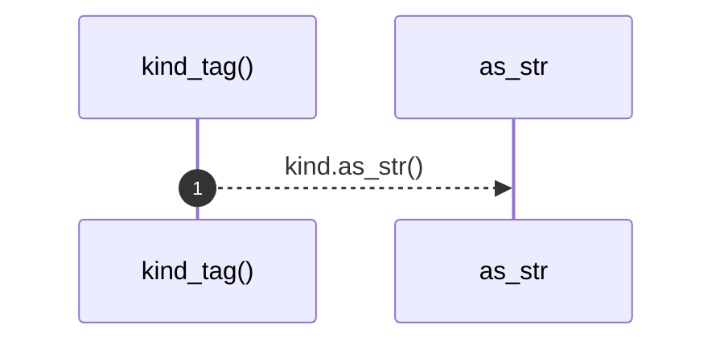

# `robby_render::view::hierarchy::kind_tag`

[Self-model](../../../README.md) · [view::hierarchy](index.md)

| | |
|---|---|
| kind | `code.function` |
| signature | `fn kind_tag(kind: &robby_ir::Kind) -> &'static str` |
| location | [`crates/robby-render/src/view/hierarchy.rs:90`](../../../../../crates/robby-render/src/view/hierarchy.rs#L90) |
| provenance | extractor · confidence 1.00 |

```rust
fn kind_tag(kind: &robby_ir::Kind) -> &'static str {
    match kind.as_str() {
        kind::code::CRATE => "crate",
        kind::code::PACKAGE => "package",
        kind::code::MODULE => "mod",
        kind::code::STRUCT => "struct",
        kind::code::CLASS => "class",
        kind::code::ENUM => "enum",
        kind::code::TRAIT => "trait",
        kind::code::INTERFACE => "interface",
        kind::code::IMPL => "impl",
        kind::code::FUNCTION | kind::code::METHOD => "fn",
        kind::code::CONST => "const",
        kind::code::FIELD => "field",
        kind::code::VARIANT => "variant",
        kind::code::IMPORT => "use",
        _ => "node",
    }
}
```



1 steps · 0 observed · 1 possible only

**Edges**

- calls → [`robby_render::view::comments::impl CommentKind::as_str`](../comments/index.md)

## References

- calls → [`robby_render::view::comments`](../comments/index.md) — as_str

## Referenced by

- calls ← [`robby_render::view::hierarchy::build`](build.md)

