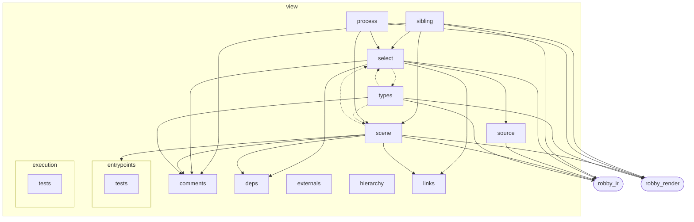

# `robby_render::view`

[Self-model](../../README.md) · [robby_render](../index.md)

| | |
|---|---|
| kind | `code.module` |
| declared at | [`crates/robby-render/src/lib.rs:18`](../../../../crates/robby-render/src/lib.rs#L18) |
| provenance | extractor · confidence 1.00 |
| nodes | 224 |

## Package diagram



## Module coupling

```mermaid
flowchart TB
    subgraph n_ca65ecef8a7529fb["view"]
        direction TB
        subgraph n_2bf7728895532b9d["comments"]
            direction TB
            n_fab4eeebb9766d7f["as_str"]
        end
        subgraph n_55531c5d49993a41["deps"]
            direction TB
            n_ca5056d43b6f5293["from_root"]
        end
        subgraph n_ad6e3f155bb8c0b6["entrypoints"]
            direction TB
            n_43e14e4cbda3060d["children_of"]
        end
        subgraph n_d98da197ad772974["links"]
            direction TB
            n_b8cfed370f7630fa["for_node"]
            n_0b2e754c404da854["is_empty"]
            n_8775b28cd211f488["is_module_kind"]
        end
        subgraph n_6b09e2da2b3d3ec0["process"]
            direction TB
            n_570e2c532788087a["common_prefix"]
            n_25dacce096110768["from_process"]
        end
        subgraph n_f006da06b5256ba9["scene"]
            direction TB
            n_28988dd039e06d31["attach_call_portals"]
            n_1923d2917a857926["build_call_frame"]
            n_5d0e4314e8ae7165["build_frame"]
            n_4958b0fbabca34bc["contains"]
            n_d8f08dd1d2200ed6["crate_roots"]
            n_98e09a50ba136685["from_document"]
            n_a226e41874f80197["from_entrypoints"]
            n_744511c2d5a350f5["is_scene_skipped"]
            n_79bed59b1a79eb84["layout_grid"]
            n_362f706ada15eb10["map_local_to_world"]
            n_f2c21d1aff51beb3["new"]
            n_30b6d0144b0642cc["portals_for"]
        end
        subgraph n_534805da25f902cb["select"]
            direction TB
            n_bb9971de7b6aa277["collect"]
            n_52efbca52123222c["default"]
            n_737bc7514c5fccaa["is_binary_module"]
            n_7debed98e7d8376c["main_process"]
            n_d02d0abf1c3600ac["markdown"]
            n_11f6d2fb700cd378["source_name"]
            n_f5a635ba7e165c71["tui_all"]
        end
        subgraph n_3d4b89e4d03574c3["sibling"]
            direction TB
            n_c4e6114e4ad3d4ea["from_root"]
            n_2426cd003b41a293["is_empty"]
        end
        subgraph n_af0e6cd35d46a66e["source"]
            direction TB
            n_daf5ef70c3eb6dee["from_node"]
        end
        subgraph n_f7b09b6570bc03a0["types"]
            direction TB
            n_93c94be41cee362e["class_from_node"]
            n_c7c36b72a1b4ae90["from_module"]
            n_116ac437ecee9baf["impl_methods"]
            n_d317bd47c5c14e11["is_empty"]
            n_796acf395b92fc32["parse_impl_target"]
        end
    end
    n_116ac437ecee9baf -.->|"1 circular"| n_bb9971de7b6aa277
    n_116ac437ecee9baf --> n_fab4eeebb9766d7f
    n_1923d2917a857926 --> n_362f706ada15eb10
    n_1923d2917a857926 --> n_43e14e4cbda3060d
    n_1923d2917a857926 --> n_4958b0fbabca34bc
    n_1923d2917a857926 --> n_79bed59b1a79eb84
    n_1923d2917a857926 -->|"3"| n_bb9971de7b6aa277
    n_1923d2917a857926 -->|"2"| n_f2c21d1aff51beb3
    n_1923d2917a857926 -->|"2"| n_fab4eeebb9766d7f
    n_25dacce096110768 --> n_570e2c532788087a
    n_25dacce096110768 --> n_bb9971de7b6aa277
    n_25dacce096110768 -->|"2"| n_f2c21d1aff51beb3
    n_28988dd039e06d31 --> n_f2c21d1aff51beb3
    n_28988dd039e06d31 -->|"14"| n_fab4eeebb9766d7f
    n_30b6d0144b0642cc -->|"2"| n_4958b0fbabca34bc
    n_30b6d0144b0642cc --> n_b8cfed370f7630fa
    n_30b6d0144b0642cc -->|"2"| n_bb9971de7b6aa277
    n_30b6d0144b0642cc -->|"2"| n_f2c21d1aff51beb3
    n_30b6d0144b0642cc -->|"11"| n_fab4eeebb9766d7f
    n_362f706ada15eb10 --> n_f2c21d1aff51beb3
    n_5d0e4314e8ae7165 --> n_30b6d0144b0642cc
    n_5d0e4314e8ae7165 --> n_362f706ada15eb10
    n_5d0e4314e8ae7165 --> n_744511c2d5a350f5
    n_5d0e4314e8ae7165 --> n_79bed59b1a79eb84
    n_5d0e4314e8ae7165 -->|"2"| n_bb9971de7b6aa277
    n_5d0e4314e8ae7165 --> n_ca5056d43b6f5293
    n_5d0e4314e8ae7165 --> n_f2c21d1aff51beb3
    n_5d0e4314e8ae7165 -->|"3"| n_fab4eeebb9766d7f
    n_737bc7514c5fccaa --> n_fab4eeebb9766d7f
    n_79bed59b1a79eb84 -->|"2"| n_f2c21d1aff51beb3
    n_7debed98e7d8376c --> n_fab4eeebb9766d7f
    n_93c94be41cee362e --> n_f2c21d1aff51beb3
    n_93c94be41cee362e -->|"5"| n_fab4eeebb9766d7f
    n_98e09a50ba136685 --> n_362f706ada15eb10
    n_98e09a50ba136685 --> n_5d0e4314e8ae7165
    n_98e09a50ba136685 --> n_79bed59b1a79eb84
    n_98e09a50ba136685 --> n_bb9971de7b6aa277
    n_98e09a50ba136685 --> n_d8f08dd1d2200ed6
    n_98e09a50ba136685 -->|"5"| n_f2c21d1aff51beb3
    n_a226e41874f80197 --> n_1923d2917a857926
    n_a226e41874f80197 --> n_28988dd039e06d31
    n_a226e41874f80197 --> n_362f706ada15eb10
    n_a226e41874f80197 --> n_79bed59b1a79eb84
    n_a226e41874f80197 --> n_98e09a50ba136685
    n_a226e41874f80197 -->|"5"| n_f2c21d1aff51beb3
    n_bb9971de7b6aa277 -->|"6"| n_0b2e754c404da854
    n_bb9971de7b6aa277 --> n_11f6d2fb700cd378
    n_bb9971de7b6aa277 --> n_52efbca52123222c
    n_bb9971de7b6aa277 --> n_737bc7514c5fccaa
    n_bb9971de7b6aa277 --> n_7debed98e7d8376c
    n_bb9971de7b6aa277 --> n_8775b28cd211f488
    n_bb9971de7b6aa277 --> n_b8cfed370f7630fa
    n_bb9971de7b6aa277 -.->|"1 circular"| n_c7c36b72a1b4ae90
    n_bb9971de7b6aa277 -->|"4"| n_ca5056d43b6f5293
    n_bb9971de7b6aa277 -->|"2"| n_daf5ef70c3eb6dee
    n_bb9971de7b6aa277 -->|"2"| n_fab4eeebb9766d7f
    n_c4e6114e4ad3d4ea --> n_4958b0fbabca34bc
    n_c4e6114e4ad3d4ea -->|"4"| n_bb9971de7b6aa277
    n_c4e6114e4ad3d4ea --> n_f2c21d1aff51beb3
    n_c4e6114e4ad3d4ea -->|"4"| n_fab4eeebb9766d7f
    n_c7c36b72a1b4ae90 -.->|"1 circular"| n_116ac437ecee9baf
    n_c7c36b72a1b4ae90 --> n_796acf395b92fc32
    n_c7c36b72a1b4ae90 -->|"2"| n_93c94be41cee362e
    n_c7c36b72a1b4ae90 -.->|"4 circular"| n_bb9971de7b6aa277
    n_c7c36b72a1b4ae90 -->|"4"| n_f2c21d1aff51beb3
    n_c7c36b72a1b4ae90 --> n_fab4eeebb9766d7f
    n_d02d0abf1c3600ac --> n_52efbca52123222c
    n_d8f08dd1d2200ed6 --> n_0b2e754c404da854
    n_d8f08dd1d2200ed6 -->|"2"| n_bb9971de7b6aa277
    n_f5a635ba7e165c71 --> n_52efbca52123222c
```



## Dependency matrix

| | sibling | execution | externals | process | tests | view | hierarchy | tests | types | select | scene | comments | deps | robby_render | entrypoints | source | links | robby_ir |
|---|---:|---:|---:|---:|---:|---:|---:|---:|---:|---:|---:|---:|---:|---:|---:|---:|---:|---:|
| **sibling** | · | | | | | | | | | 4 | 2 | 4 | | 10 | | | | 2 |
| **execution** | | · | | | | | | | | | | | | | | | | |
| **externals** | | | · | | | | | | | | | | | | | | | |
| **process** | | | | · | | | | | | 1 | 2 | | | 6 | | | | |
| **tests** | | | | | · | | | | | | | | | | | | | |
| **view** | | | | | | · | | | | | | | | | | | | |
| **hierarchy** | | | | | | | · | | | | | | | | | | | |
| **tests** | | | | | | | | · | | | | | | | | | | |
| **types** | | | | | | | | | · | 5⇄ | 5⇄ | 7 | | 24 | | | | 11 |
| **select** | | | | | | | | | 1⇄ | · | | 4 | 4 | | | 2 | 8 | 4 |
| **scene** | | | | | | | | | | 10⇄ | · | 30 | 1 | 25 | 1 | | 2 | 15 |
| **comments** | | | | | | | | | | | | · | | | | | | |
| **deps** | | | | | | | | | | | | | · | | | | | |
| **robby_render** | | | | | | | | | | | | | | · | | | | |
| **entrypoints** | | | | | | | | | | | | | | | · | | | |
| **source** | | | | | | | | | | | | | | | | · | | 2 |
| **links** | | | | | | | | | | | | | | | | | · | |
| **robby_ir** | | | | | | | | | | | | | | | | | | · |

Cycles: select ↔ scene ↔ types

## Comments

- `crates/robby-render/src/view/process.rs:7:1` (docs, `robby_render::view::process::ProcessView`): "Format-agnostic process diagram data."
  ```
  /// Format-agnostic process diagram data.
  #[derive(Debug, Clone, PartialEq, Eq)]
  pub struct ProcessView {
      pub participants: Vec<ParticipantView>,
      pub events: Vec<ProcessEvent>,
      pub step_count: usize,
      pub observed_count: usize,
  }
  ```
- `crates/robby-render/src/view/scene.rs:117:5` (docs, `robby_render::view::scene::impl Scene::from_document`): "Build the scene from a document. Layout is deterministic integer geometry."
  ```
  /// Build the scene from a document. Layout is deterministic integer geometry.
      pub fn from_document(doc: &Document) -> Self {
          let root_stable = stable_id(WORKSPACE_ID);
          let mut frames = BTreeMap::new();
  
          let crates = crate_roots(doc);
          let child_ids: Vec<NodeId> = crates.iter().map(|n| n.id.clone()).collect();
  
          let mut root = Frame {
              id: WORKSPACE_ID.to_owned(),
              stable_id: root_stable.clone(),
              name: "workspace".to_owned(),
              fqn: "workspace".to_owned(),
              kind_tag: "workspace".to_owned(),
              parent: None,
              children: Vec::new(),
              world: WorldRect::new(0.0, 0.0, CANVAS_W as f64, CANVAS_H as f64),
              local_in_parent: None,
              edges: Vec::new(),
              portals: Vec::new(),
          };
  
          let placements = layout_grid(child_ids.len());
          for (i, node) in crates.iter().enumerate() {
              let local = placements[i];
              let world = map_local_to_world(&root.world, &local);
              let child_stable = build_frame(
                  doc,
                  node,
                  Some(root_stable.clone()),
                  local,
                  world,
                  &mut frames,
              );
              root.children.push(child_stable);
          }
  
          frames.insert(root_stable.clone(), root);
  
          Scene {
              root: root_stable,
              canvas: CanvasSize {
                  w: CANVAS_W,
                  h: CANVAS_H,
              },
              frames,
          }
      }
  ```
- `crates/robby-render/src/view/scene.rs:166:5` (docs, `robby_render::view::scene::impl Scene::from_entrypoints`): "Functional org: workspace → `main` entrypoints → Calls reachability tree."
  ```
  /// Functional org: workspace → `main` entrypoints → Calls reachability tree.
      pub fn from_entrypoints(doc: &Document) -> Self {
          let tree = CallTree::from_document(doc);
          let root_stable = stable_id(WORKSPACE_ID);
          let mut frames = BTreeMap::new();
  
          let mut root = Frame {
              id: WORKSPACE_ID.to_owned(),
              stable_id: root_stable.clone(),
              name: "entrypoints".to_owned(),
              fqn: "entrypoints".to_owned(),
              kind_tag: "entrypoints".to_owned(),
              parent: None,
              children: Vec::new(),
              world: WorldRect::new(0.0, 0.0, CANVAS_W as f64, CANVAS_H as f64),
              local_in_parent: None,
              edges: Vec::new(),
              portals: Vec::new(),
          };
  
          let placements = layout_grid(tree.entries.len());
          for (i, entry_id) in tree.entries.iter().enumerate() {
              let Some(node) = doc.get(entry_id) else {
                  continue;
              };
              let local = placements[i];
              let world = map_local_to_world(&root.world, &local);
              let child_stable = build_call_frame(
                  doc,
                  &tree,
                  node,
                  Some(root_stable.clone()),
                  local,
                  world,
                  &mut frames,
              );
              root.children.push(child_stable);
          }
  
          // Portal strip: tree Calls + shared-callee cross edges.
          attach_call_portals(doc, &tree, &mut frames);
  
          frames.insert(root_stable.clone(), root);
  
          Scene {
              root: root_stable,
              canvas: CanvasSize {
                  w: CANVAS_W,
                  h: CANVAS_H,
              },
              frames,
          }
      }
  ```
- `crates/robby-render/src/view/scene.rs:26:1` (docs, `robby_render::view::scene::Scene`): "Whole zoomable map: one frame per structural node, plus a synthetic workspace."
  ```
  /// Whole zoomable map: one frame per structural node, plus a synthetic workspace.
  #[derive(Debug, Clone, PartialEq, Serialize)]
  pub struct Scene {
      pub root: String,
      pub canvas: CanvasSize,
      pub frames: BTreeMap<String, Frame>,
  }
  ```
- `crates/robby-render/src/view/scene.rs:377:1` (docs, `robby_render::view::scene::attach_call_portals`): "Portals for every Calls hop among placed frames (tree children + cross edges)."
  ```
  /// Portals for every Calls hop among placed frames (tree children + cross edges).
  fn attach_call_portals(
      doc: &Document,
      tree: &CallTree,
      frames: &mut BTreeMap<String, Frame>,
  ) {
      let mut pairs: Vec<(NodeId, NodeId)> = Vec::new();
      for (from_id, kids) in &tree.children {
          for to_id in kids {
              pairs.push((from_id.clone(), to_id.clone()));
          }
      }
      pairs.extend(tree.cross_edges.iter().cloned());
      pairs.sort_by(|a, b| {
          a.0.as_str()
              .cmp(b.0.as_str())
              .then_with(|| a.1.as_str().cmp(b.1.as_str()))
      });
      pairs.dedup();
  
      for (from_id, to_id) in &pairs {
          let from_sid = stable_id(from_id.as_str());
          let to_sid = stable_id(to_id.as_str());
          if !frames.contains_key(&from_sid) || !frames.contains_key(&to_sid) {
              continue;
          }
          let to_name = doc
              .get(to_id)
              .map(|n| n.fqn.clone())
              .unwrap_or_else(|| to_id.as_str().to_owned());
          let from_name = doc
              .get(from_id)
              .map(|n| n.fqn.clone())
              .unwrap_or_else(|| from_id.as_str().to_owned());
  
          if let Some(from_frame) = frames.get_mut(&from_sid) {
              from_frame.portals.push(Portal {
                  label: to_name.clone(),
                  kind_label: "calls".to_owned(),
                  target: Some(to_sid.clone()),
                  target_name: to_name,
              });
          }
          if let Some(to_frame) = frames.get_mut(&to_sid) {
              to_frame.portals.push(Portal {
                  label: format!("from {from_name}"),
                  kind_label: "called".to_owned(),
                  target: Some(from_sid),
                  target_name: from_name,
              });
          }
      }
  
      for frame in frames.values_mut() {
          frame.portals.sort_by(|a, b| {
              (
                  a.kind_label.as_str(),
                  a.target_name.as_str(),
                  a.label.as_str(),
              )
                  .cmp(&(
                      b.kind_label.as_str(),
                      b.target_name.as_str(),
                      b.label.as_str(),
                  ))
          });
          frame.portals.dedup_by(|a, b| {
              a.label == b.label && a.kind_label == b.kind_label && a.target == b.target
          });
      }
  }
  ```
- `crates/robby-render/src/view/scene.rs:40:1` (docs, `robby_render::view::scene::Rect`): "Integer rect on a frame's local 1600×1000 canvas."
  ```
  /// Integer rect on a frame's local 1600×1000 canvas.
  #[derive(Debug, Clone, Copy, PartialEq, Eq, Serialize)]
  pub struct Rect {
      pub x: i64,
      pub y: i64,
      pub w: i64,
      pub h: i64,
  }
  ```
- `crates/robby-render/src/view/scene.rs:522:1` (docs, `robby_render::view::scene::layout_grid`): "Place `n` children in a grid on the local canvas (below the header, above portals)."
  ```
  /// Place `n` children in a grid on the local canvas (below the header, above portals).
  fn layout_grid(n: usize) -> Vec<Rect> {
      if n == 0 {
          return Vec::new();
      }
      let cols = (n as f64).sqrt().ceil() as usize;
      let cols = cols.max(1);
      let rows = n.div_ceil(cols);
  
      let available_w = CANVAS_W - 2 * PAD;
      let available_h = CANVAS_H - HEADER - PORTAL_STRIP - PAD;
      let cell_w = available_w / cols as i64;
      let cell_h = available_h / rows as i64;
  
      let mut out = Vec::with_capacity(n);
      for i in 0..n {
          let col = (i % cols) as i64;
          let row = (i / cols) as i64;
          let fit_w = cell_w - 2 * CELL_MARGIN;
          let fit_h = cell_h - 2 * CELL_MARGIN;
          let scale_num = fit_w.min(fit_h);
          let scale_den = CANVAS_W.max(CANVAS_H);
          // Fit the child canvas into the cell, preserving aspect ratio.
          let child_w = (CANVAS_W * scale_num) / scale_den;
          let child_h = (CANVAS_H * scale_num) / scale_den;
          let x = PAD + col * cell_w + (cell_w - child_w) / 2;
          let y = HEADER + row * cell_h + (cell_h - child_h) / 2;
          out.push(Rect::new(x, y, child_w.max(1), child_h.max(1)));
      }
      out
  }
  ```
- `crates/robby-render/src/view/scene.rs:554:1` (docs, `robby_render::view::scene::is_scene_skipped`): "Comments stay in the IR and markdown tree, but are not Prezi frames."
  ```
  /// Comments stay in the IR and markdown tree, but are not Prezi frames.
  fn is_scene_skipped(kind_name: &str) -> bool {
      kind_name == kind::code::COMMENT
  }
  ```
- `crates/robby-render/src/view/scene.rs:55:1` (docs, `robby_render::view::scene::WorldRect`): "Absolute placement in workspace space. Floats so nested grids do not collapse to 1×1 integer cells and stack on top of …"
  ```
  /// Absolute placement in workspace space. Floats so nested grids do not
  /// collapse to 1×1 integer cells and stack on top of each other.
  #[derive(Debug, Clone, Copy, PartialEq, Serialize)]
  pub struct WorldRect {
      pub x: f64,
      pub y: f64,
      pub w: f64,
      pub h: f64,
  }
  ```
- `crates/robby-render/src/view/select.rs:17:1` (docs, `robby_render::view::select::NodeMeta`): "Identity / provenance shown at the top of every report."
  ```
  /// Identity / provenance shown at the top of every report.
  #[derive(Debug, Clone, PartialEq)]
  pub struct NodeMeta {
      pub fqn: String,
      pub kind: String,
      pub signature: Option<String>,
      pub location: Option<String>,
      pub provenance_source: &'static str,
      pub confidence: f32,
      pub docs: Option<String>,
      pub node_count: usize,
  }
  ```
- `crates/robby-render/src/view/select.rs:30:1` (docs, `robby_render::view::select::SelectOpts`): "Which optional sections to collect."
  ```
  /// Which optional sections to collect.
  #[derive(Debug, Clone)]
  pub struct SelectOpts {
      pub hierarchy: bool,
      pub hierarchy_depth: usize,
      pub hierarchy_all: bool,
      pub sibling: bool,
      pub source: bool,
      pub types: bool,
      pub dependencies: bool,
      pub externals: bool,
      pub comments: bool,
      pub links: bool,
      pub entry: bool,
      pub process: bool,
  }
  ```
- `crates/robby-render/src/view/select.rs:67:5` (docs, `robby_render::view::select::impl SelectOpts::markdown`): "Markdown module/item page defaults."
  ```
  /// Markdown module/item page defaults.
      pub fn markdown() -> Self {
          Self::default()
      }
  ```
- `crates/robby-render/src/view/select.rs:72:5` (docs, `robby_render::view::select::impl SelectOpts::tui_all`): "TUI `show --view all` defaults."
  ```
  /// TUI `show --view all` defaults.
      pub fn tui_all() -> Self {
          Self {
              hierarchy: true,
              ..Self::default()
          }
      }
  ```
- `crates/robby-render/src/view/select.rs:81:1` (docs, `robby_render::view::select::NodeViews`): "All views selected for one node."
  ```
  /// All views selected for one node.
  #[derive(Debug, Clone, PartialEq)]
  pub struct NodeViews {
      pub meta: NodeMeta,
      pub entry: Option<ProcessView>,
      pub types: Option<TypeModel>,
      pub dependencies: Option<DependencyViews>,
      pub externals: Option<ExternalsView>,
      pub comments: Option<CommentsView>,
      pub process: Option<ProcessView>,
      pub hierarchy: Option<HierarchyView>,
      pub links: LinkGraph,
      pub sibling: Option<SiblingGraph>,
      pub source: Option<SourceSlice>,
  }
  ```
- `crates/robby-render/src/view/select.rs:97:1` (docs, `robby_render::view::select::collect`): "Project IR → views for one node."
  ```
  /// Project IR → views for one node.
  pub fn collect(
      doc: &Document,
      node: &Node,
      sources: Option<&BTreeMap<String, String>>,
      opts: &SelectOpts,
  ) -> NodeViews {
      let is_module = is_module_kind(node.kind.as_str());
      let binary = is_module && is_binary_module(doc, node);
  
      let meta = NodeMeta {
          fqn: node.fqn.clone(),
          kind: node.kind.as_str().to_owned(),
          signature: node.signature.clone(),
          location: node.span.as_ref().map(|s| s.location()),
          provenance_source: source_name(node.provenance.source),
          confidence: node.provenance.confidence,
          docs: node.docs.clone(),
          node_count: doc.subtree(&node.id).len(),
      };
  
      let entry = if opts.entry && binary {
          main_process(doc, node).map(ProcessView::from_process)
      } else {
          None
      };
  
      let types = if opts.types && is_module {
          let model = TypeModel::from_module(doc, &node.id);
          if model.is_empty() {
              None
          } else {
              Some(model)
          }
      } else {
          None
      };
  
      let dependencies = if opts.dependencies && is_module {
          let views = DependencyViews::from_root(doc, &node.id);
          if views.is_empty() {
              None
          } else {
              Some(views)
          }
      } else {
          None
      };
  
      let externals = if opts.externals && is_module {
          let view = ExternalsView::from_root(doc, &node.id);
          if view.is_empty() {
              None
          } else {
              Some(view)
          }
      } else {
          None
      };
  
      let comments = if opts.comments && is_module {
          let view = CommentsView::from_root(doc, &node.id, sources);
          if view.is_empty() {
              None
          } else {
              Some(view)
          }
      } else {
          None
      };
  
      let process = if opts.process && !is_module {
          node.process.as_ref().map(ProcessView::from_process)
      } else {
          None
      };
  
      let hierarchy = if opts.hierarchy {
          let view = HierarchyView::from_node(
              doc,
              &node.id,
              opts.hierarchy_depth,
              opts.hierarchy_all,
          );
          if view.is_empty() {
              None
          } else {
              Some(view)
          }
      } else {
          None
      };
  
      let links = if opts.links {
          LinkGraph::for_node(doc, node)
      } else {
          LinkGraph::default()
      };
  
      let sibling = if opts.sibling {
          let graph = SiblingGraph::from_root(doc, &node.id);
          if graph.is_empty() {
              None
          } else {
              Some(graph)
          }
      } else {
          None
      };
  
      let source = if opts.source {
          sources.and_then(|s| SourceSlice::from_node(node, s))
      } else {
          None
      };
  
      NodeViews {
          meta,
          entry,
          types,
          dependencies,
          externals,
          comments,
          process,
          hierarchy,
          links,
          sibling,
          source,
      }
  }
  ```
## References

- calls → [`robby_ir::model`](../../robby_ir/model/index.md) — get, insert, subtree
- calls → [`robby_ir::span`](../../robby_ir/span/index.md) — location
- calls → [`robby_render`](../index.md) — stable_id
- calls → [`robby_render::report`](../report/index.md) — push
- calls → [`robby_render::util`](../util/index.md) — 8 items
- calls → [`robby_render::view::comments`](comments/index.md) — as_str
- calls → [`robby_render::view::deps`](deps/index.md) — from_root
- calls → [`robby_render::view::entrypoints`](entrypoints/index.md) — children_of
- calls → [`robby_render::view::links`](links/index.md) — for_node, is_empty, is_module_kind

## Referenced by

- calls ← [`robby_agent::model::parse_note`](../../robby_agent/model/parse-note.md)
- calls ← [`robby_agent::openrouter::impl ChatClient for OpenRouterClient::chat`](../../robby_agent/openrouter/index.md)
- calls ← [`robby_cli::resolve`](../../robby_cli/resolve.md)
- calls ← [`robby_extract::rust::collect_rs`](../../robby_extract/rust/collect-rs.md)
- calls ← [`robby_extract::rust::discover_crates`](../../robby_extract/rust/discover-crates.md)
- calls ← [`robby_extract::rust::label_of`](../../robby_extract/rust/label-of.md)
- calls ← [`robby_extract::rust::path_text`](../../robby_extract/rust/path-text.md)
- calls ← [`robby_extract::rust::pick_call_target`](../../robby_extract/rust/pick-call-target.md)
- calls ← [`robby_extract::rust::resolve_calls`](../../robby_extract/rust/resolve-calls.md)
- calls ← [`robby_extract::rust::shared_module_score`](../../robby_extract/rust/shared-module-score.md)
- calls ← [`robby_extract::test_extract::the_workspace_is_fully_covered`](../../robby_extract/test_extract/the-workspace-is-fully-covered.md)
- calls ← [`robby_extract::test_typescript::bare_import_creates_external_npm_stub`](../../robby_extract/test_typescript/bare-import-creates-external-npm-stub.md)
- calls ← [`robby_extract::test_typescript::emits_comment_nodes_and_attaches_docs`](../../robby_extract/test_typescript/emits-comment-nodes-and-attaches-docs.md)
- calls ← [`robby_extract::test_typescript::resolves_calls_and_imports`](../../robby_extract/test_typescript/resolves-calls-and-imports.md)
- calls ← [`robby_extract::test_typescript::typescript_fixture_is_fully_covered`](../../robby_extract/test_typescript/typescript-fixture-is-fully-covered.md)
- calls ← [`robby_extract::typescript::collect_ts`](../../robby_extract/typescript/collect-ts.md)
- calls ← [`robby_extract::typescript::discover_packages`](../../robby_extract/typescript/discover-packages.md)
- calls ← [`robby_extract::typescript::resolve_calls`](../../robby_extract/typescript/resolve-calls.md)
- calls ← [`robby_ir::codepath::build_code_paths`](../../robby_ir/codepath/build-code-paths.md)
- calls ← [`robby_ir::codepath::find_entrypoints`](../../robby_ir/codepath/find-entrypoints.md)
- calls ← [`robby_ir::codepath::impl CodePath::from_entry`](../../robby_ir/codepath/index.md)
- calls ← [`robby_ir::coverage::file_coverage`](../../robby_ir/coverage/file-coverage.md)
- calls ← [`robby_ir::coverage::impl CoverageReport::worst_first`](../../robby_ir/coverage/index.md)
- calls ← [`robby_ir::coverage::preview`](../../robby_ir/coverage/preview.md)
- calls ← [`robby_ir::model::impl Document::declare_file`](../../robby_ir/model/index.md)
- calls ← [`robby_ir::model::impl Document::insert`](../../robby_ir/model/index.md)
- calls ← [`robby_ir::model::impl Document::merge`](../../robby_ir/model/index.md)
- calls ← [`robby_ir::test_coverage::report_orders_worst_files_first`](../../robby_ir/test_coverage/report-orders-worst-files-first.md)
- calls ← [`robby_render::all_sequences`](../all-sequences.md)
- calls ← [`robby_render::class_diagram`](../class-diagram.md)
- calls ← [`robby_render::markdown::coverage_section`](../markdown/coverage-section.md)
- calls ← [`robby_render::markdown::index`](../markdown/index-n_fadae9.md)
- calls ← [`robby_render::markdown::node_section`](../markdown/node-section.md)
- calls ← [`robby_render::markdown::report`](../markdown/report.md)
- calls ← [`robby_render::pipeline::load_sources`](../pipeline/load-sources.md)
- calls ← [`robby_render::pipeline::watched_files`](../pipeline/watched-files.md)
- calls ← [`robby_render::render::markdown::trim_comment`](../render/markdown/trim-comment.md)
- calls ← [`robby_render::render::mermaid::dsm_markdown_table`](../render/mermaid/dsm-markdown-table.md)
- calls ← [`robby_render::render::tui::impl Renderer for TuiRenderer::process`](../render/tui/index.md)
- calls ← [`robby_render::render::tui::impl Renderer for TuiRenderer::sibling_graph`](../render/tui/index.md)
- calls ← [`robby_render::render::tui::impl TuiRenderer::show`](../render/tui/index.md)
- calls ← [`robby_render::runs::stage_process`](../runs/stage-process.md)
- calls ← [`robby_render::sequence`](../sequence.md)
- calls ← [`robby_render::test_render::externals_and_comments_sections_render`](../test_render/externals-and-comments-sections-render.md)
- calls ← [`robby_render::test_tree::every_internal_link_resolves`](../test_tree/every-internal-link-resolves.md)
- calls ← [`robby_render::test_tree::modules_link_out_and_back`](../test_tree/modules-link-out-and-back.md)
- calls ← [`robby_render::test_web::entrypoints_scene_json_is_deterministic`](../test_web/entrypoints-scene-json-is-deterministic.md)
- calls ← [`robby_render::test_web::entrypoints_scene_roots_mains_and_nests_callees`](../test_web/entrypoints-scene-roots-mains-and-nests-callees.md)
- calls ← [`robby_render::test_web::sibling_local_rects_do_not_overlap`](../test_web/sibling-local-rects-do-not-overlap.md)
- calls ← [`robby_render::test_web::sibling_world_rects_do_not_collapse_onto_each_other`](../test_web/sibling-world-rects-do-not-collapse-onto-each-other.md)
- calls ← [`robby_render::test_web::unresolved_portal_has_no_zoom_target`](../test_web/unresolved-portal-has-no-zoom-target.md)
- calls ← [`robby_render::test_web::write_site_emits_run_records`](../test_web/write-site-emits-run-records.md)
- calls ← [`robby_render::tree::item_children`](../tree/item-children.md)
- calls ← [`robby_render::tree::module_page`](../tree/module-page.md)
- calls ← [`robby_render::tree::page_paths`](../tree/page-paths.md)
- calls ← [`robby_render::tree::rel_link`](../tree/rel-link.md)
- calls ← [`robby_render::tree::render_node`](../tree/render-node.md)
- calls ← [`robby_render::tree::tree`](../tree/tree.md)
- calls ← [`robby_render::tui::show_collected`](../tui/show-collected.md)
- calls ← [`robby_render::tui::timeline`](../tui/timeline.md)
- calls ← [`robby_render::util::text`](../util/text.md)
- calls ← [`robby_render::view::comments::apply_highlights`](comments/apply-highlights.md)
- calls ← [`robby_render::view::comments::enrichment_fields`](comments/enrichment-fields.md)
- calls ← [`robby_render::view::comments::impl CommentsView::from_root`](comments/index.md)
- calls ← [`robby_render::view::comments::line_window`](comments/line-window.md)
- calls ← [`robby_render::view::deps::build_package_tree`](deps/build-package-tree.md)
- calls ← [`robby_render::view::deps::finalize_edges`](deps/finalize-edges.md)
- calls ← [`robby_render::view::deps::impl CouplingGraph::empty`](deps/index.md)
- calls ← [`robby_render::view::deps::impl CouplingGraph::from_root`](deps/index.md)
- calls ← [`robby_render::view::deps::impl CouplingGraph::workspace`](deps/index.md)
- calls ← [`robby_render::view::deps::impl PackageStructure::empty`](deps/index.md)
- calls ← [`robby_render::view::deps::impl PackageStructure::from_root`](deps/index.md)
- calls ← [`robby_render::view::deps::impl PackageStructure::workspace`](deps/index.md)
- calls ← [`robby_render::view::deps::is_direct_package`](deps/is-direct-package.md)
- calls ← [`robby_render::view::deps::lift_to_scope`](deps/lift-to-scope.md)
- calls ← [`robby_render::view::deps::owning_in_scope`](deps/owning-in-scope.md)
- calls ← [`robby_render::view::deps::package_edges`](deps/package-edges.md)
- calls ← [`robby_render::view::deps::package_leaf`](deps/package-leaf.md)
- calls ← [`robby_render::view::deps::tarjan`](deps/tarjan.md)
- calls ← [`robby_render::view::deps::topological_layers`](deps/topological-layers.md)
- calls ← [`robby_render::view::entrypoints::collect_cross_edges`](entrypoints/collect-cross-edges.md)
- calls ← [`robby_render::view::entrypoints::doc_with_mains`](entrypoints/tests/doc-with-mains.md)
- calls ← [`robby_render::view::entrypoints::impl CallTree::from_code_paths`](entrypoints/index.md)
- calls ← [`robby_render::view::entrypoints::impl CallTree::from_entries`](entrypoints/index.md)
- calls ← [`robby_render::view::execution::from_code_path`](execution/from-code-path.md)
- calls ← [`robby_render::view::execution::owning_type_label`](execution/owning-type-label.md)
- calls ← [`robby_render::view::execution::sample`](execution/tests/sample.md)
- calls ← [`robby_render::view::externals::impl ExternalsView::from_root`](externals/index.md)
- calls ← [`robby_render::view::hierarchy::build`](hierarchy/build.md)
- calls ← [`robby_render::view::links::inbound`](links/inbound.md)
- calls ← [`robby_render::view::links::outbound`](links/outbound.md)
- calls ← [`robby_render::view::links::subtree_ids`](links/subtree-ids.md)
- calls ← [`robby_render::web::impl FrameDetail::from_node_in_doc`](../web/index.md)
- calls ← [`robby_render::web::write_site`](../web/write-site.md)

## Modules

- [`view::process`](process/index.md) — 20 nodes
- [`view::scene`](scene/index.md) — 71 nodes
- [`view::select`](select/index.md) — 55 nodes
- [`view::sibling`](sibling/index.md) — 23 nodes
- [`view::source`](source/index.md) — 8 nodes
- [`view::types`](types/index.md) — 32 nodes

## Imports

- `pub use comments::{`
- `pub use deps::{`
- `pub use entrypoints::{CallTree, MAX_CALL_DEPTH};`
- `pub use execution::{execution_process, from_code_path as execution_from_code_path};`
- [`pub use robby_ir::find_entrypoints;`](../../robby_ir/index.md)
- `pub use externals::{ExternalEntry, ExternalsView};`
- `pub use hierarchy::{HierarchyNode, HierarchyView};`
- `pub use links::{InboundRef, LinkGraph, OutboundRef};`
- `pub use process::{ParticipantView, ProcessEvent, ProcessView};`
- `pub use scene::{`
- `pub use select::{NodeMeta, NodeViews, SelectOpts, collect, is_binary_module, main_process};`
- `pub use sibling::{SiblingEdge, SiblingGraph, SiblingNode};`
- `pub use source::SourceSlice;`
- `pub use types::{`

