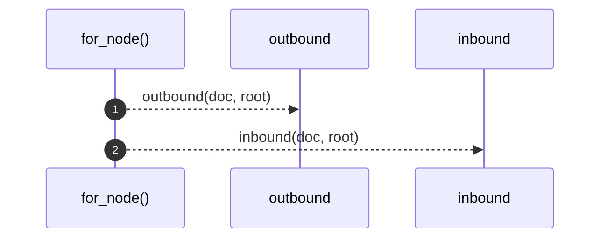
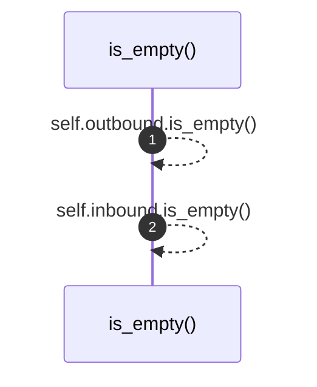

# `robby_render::view::links::impl LinkGraph`

[Self-model](../../../README.md) · [view::links](index.md)

| | |
|---|---|
| kind | `code.impl` |
| location | [`crates/robby-render/src/view/links.rs:31`](../../../../../crates/robby-render/src/view/links.rs#L31) |
| provenance | extractor · confidence 1.00 |

```rust
impl LinkGraph {
    pub fn for_node(doc: &Document, root: &Node) -> Self {
        Self {
            outbound: outbound(doc, root),
            inbound: inbound(doc, root),
        }
    }

    pub fn is_empty(&self) -> bool {
        self.outbound.is_empty() && self.inbound.is_empty()
    }
}
```

## References

- calls → [`robby_render::view::links`](index.md) — inbound, outbound

## Referenced by

- calls ← [`robby_render::class_diagram`](../../class-diagram.md)
- calls ← [`robby_render::coupling`](../../coupling.md)
- calls ← [`robby_render::dependencies`](../../dependencies.md)
- calls ← [`robby_render::dependency_report`](../../dependency-report.md)
- calls ← [`robby_render::markdown::coverage_section`](../../markdown/coverage-section.md)
- calls ← [`robby_render::markdown::node_section`](../../markdown/node-section.md)
- calls ← [`robby_render::pipeline::load_sources`](../../pipeline/load-sources.md)
- calls ← [`robby_render::pipeline::slug`](../../pipeline/slug.md)
- calls ← [`robby_render::render::markdown::impl MarkdownRenderer::fence`](../../render/markdown/index.md)
- calls ← [`robby_render::render::markdown::impl Renderer for MarkdownRenderer::links`](../../render/markdown/index.md)
- calls ← [`robby_render::render::mermaid::dsm_markdown_table`](../../render/mermaid/dsm-markdown-table.md)
- calls ← [`robby_render::render::mermaid::emit_coupling_subgraph`](../../render/mermaid/emit-coupling-subgraph.md)
- calls ← [`robby_render::render::mermaid::emit_package_subgraph`](../../render/mermaid/emit-package-subgraph.md)
- calls ← [`robby_render::render::mermaid::emit_workspace_coupling`](../../render/mermaid/emit-workspace-coupling.md)
- calls ← [`robby_render::render::mermaid::impl Renderer for MermaidRenderer::coupling_deps`](../../render/mermaid/index.md)
- calls ← [`robby_render::render::mermaid::impl Renderer for MermaidRenderer::package_deps`](../../render/mermaid/index.md)
- calls ← [`robby_render::render::tui::ascii_coupling`](../../render/tui/ascii-coupling.md)
- calls ← [`robby_render::render::tui::ascii_package_structure`](../../render/tui/ascii-package-structure.md)
- calls ← [`robby_render::render::tui::impl Renderer for TuiRenderer::links`](../../render/tui/index.md)
- calls ← [`robby_render::render::tui::impl Renderer for TuiRenderer::process`](../../render/tui/index.md)
- calls ← [`robby_render::render::tui::impl Renderer for TuiRenderer::sibling_graph`](../../render/tui/index.md)
- calls ← [`robby_render::report::impl Report::to_terminal`](../../report/index.md)
- calls ← [`robby_render::report::impl Section::is_blank`](../../report/index.md)
- calls ← [`robby_render::tree::global_index`](../../tree/global-index.md)
- calls ← [`robby_render::tree::item_slug`](../../tree/item-slug.md)
- calls ← [`robby_render::tree::module_page`](../../tree/module-page.md)
- calls ← [`robby_render::tree::render_links`](../../tree/render-links.md)
- calls ← [`robby_render::tree::render_node`](../../tree/render-node.md)
- calls ← [`robby_render::tree::resolve_use_path`](../../tree/resolve-use-path.md)
- calls ← [`robby_render::tree::source_link`](../../tree/source-link.md)
- calls ← [`robby_render::util::alias`](../../util/alias.md)
- calls ← [`robby_render::view::entrypoints::impl CallTree::from_document`](../entrypoints/index.md)
- calls ← [`robby_render::view::execution::from_code_path`](../execution/from-code-path.md)
- calls ← [`robby_render::view::execution::owning_type_label`](../execution/owning-type-label.md)
- calls ← [`robby_render::view::scene::crate_roots`](../scene/crate-roots.md)
- calls ← [`robby_render::view::scene::portals_for`](../scene/portals-for.md)
- calls ← [`robby_render::view::select::collect`](../select/collect.md)
- calls ← [`robby_render::web::impl FrameDetail::from_node_in_doc`](../../web/index.md)
- calls ← [`robby_render::workspace_dependencies`](../../workspace-dependencies.md)

### `for_node`

| | |
|---|---|
| kind | `code.method` |
| signature | `fn for_node(2)` |
| location | [`crates/robby-render/src/view/links.rs:32`](../../../../../crates/robby-render/src/view/links.rs#L32) |
| provenance | extractor · confidence 1.00 |

```rust
pub fn for_node(doc: &Document, root: &Node) -> Self {
        Self {
            outbound: outbound(doc, root),
            inbound: inbound(doc, root),
        }
    }
```



2 steps · 0 observed · 2 possible only

**Edges**

- calls → [`robby_render::view::links::outbound`](outbound.md)
- calls → [`robby_render::view::links::inbound`](inbound.md)

### `is_empty`

| | |
|---|---|
| kind | `code.method` |
| signature | `fn is_empty(1)` |
| location | [`crates/robby-render/src/view/links.rs:39`](../../../../../crates/robby-render/src/view/links.rs#L39) |
| provenance | extractor · confidence 1.00 |

```rust
pub fn is_empty(&self) -> bool {
        self.outbound.is_empty() && self.inbound.is_empty()
    }
```



2 steps · 0 observed · 2 possible only

**Edges**

- calls → [`robby_render::view::links::impl LinkGraph::is_empty`](index.md)
- calls → [`robby_render::view::links::impl LinkGraph::is_empty`](index.md)

