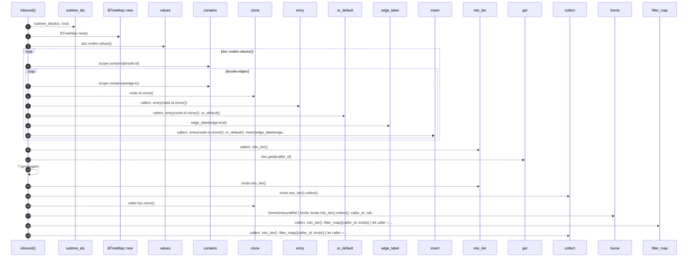

# `robby_render::view::links::inbound`

[Self-model](../../../README.md) · [view::links](index.md)

| | |
|---|---|
| kind | `code.function` |
| signature | `fn inbound(doc: &Document, root: &Node) -> Vec<InboundRef>` |
| location | [`crates/robby-render/src/view/links.rs:84`](../../../../../crates/robby-render/src/view/links.rs#L84) |
| provenance | extractor · confidence 1.00 |

```rust
fn inbound(doc: &Document, root: &Node) -> Vec<InboundRef> {
    let scope = subtree_ids(doc, root);
    let mut callers: BTreeMap<NodeId, BTreeSet<&'static str>> = BTreeMap::new();

    for node in doc.nodes.values() {
        if scope.contains(&node.id) {
            continue;
        }
        for edge in &node.edges {
            if !scope.contains(&edge.to) {
                continue;
            }
            callers
                .entry(node.id.clone())
                .or_default()
                .insert(edge_label(edge.kind));
        }
    }

    callers
        .into_iter()
        .filter_map(|(caller_id, kinds)| {
            let caller = doc.get(&caller_id)?;
            Some(InboundRef {
                kinds: kinds.into_iter().collect(),
                caller_id,
                caller_fqn: caller.fqn.clone(),
            })
        })
        .collect()
}
```



19 steps · 0 observed · 19 possible only

**Edges**

- calls → [`robby_render::view::links::subtree_ids`](subtree-ids.md)
- calls → [`robby_render::view::scene::impl Rect::new`](../scene/index.md)
- calls → [`robby_render::view::scene::impl WorldRect::contains`](../scene/index.md)
- calls → [`robby_render::view::scene::impl WorldRect::contains`](../scene/index.md)
- calls → [`robby_render::util::edge_label`](../../util/edge-label.md)
- calls → [`robby_ir::model::impl Document::insert`](../../../robby_ir/model/index.md)
- calls → [`robby_ir::model::impl Document::get`](../../../robby_ir/model/index.md)
- calls → [`robby_render::view::select::collect`](../select/collect.md)
- calls → [`robby_render::view::select::collect`](../select/collect.md)

## References

- calls → [`robby_ir::model`](../../../robby_ir/model/index.md) — get, insert
- calls → [`robby_render::util`](../../util/index.md) — edge_label
- calls → [`robby_render::view::links`](index.md) — subtree_ids
- calls → [`robby_render::view::scene`](../scene/index.md) — contains, new
- calls → [`robby_render::view::select`](../select/index.md) — collect

## Referenced by

- calls ← [`robby_render::view::links::impl LinkGraph::for_node`](index.md)

