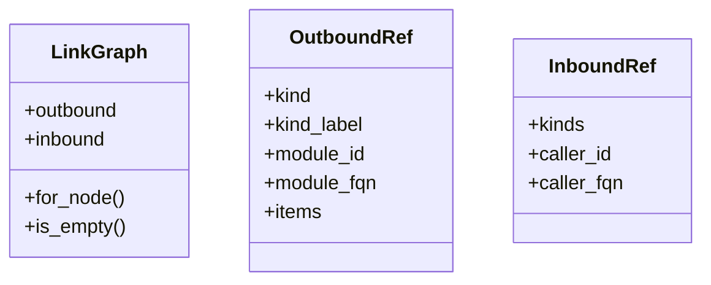
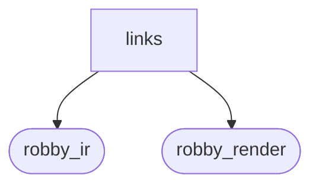
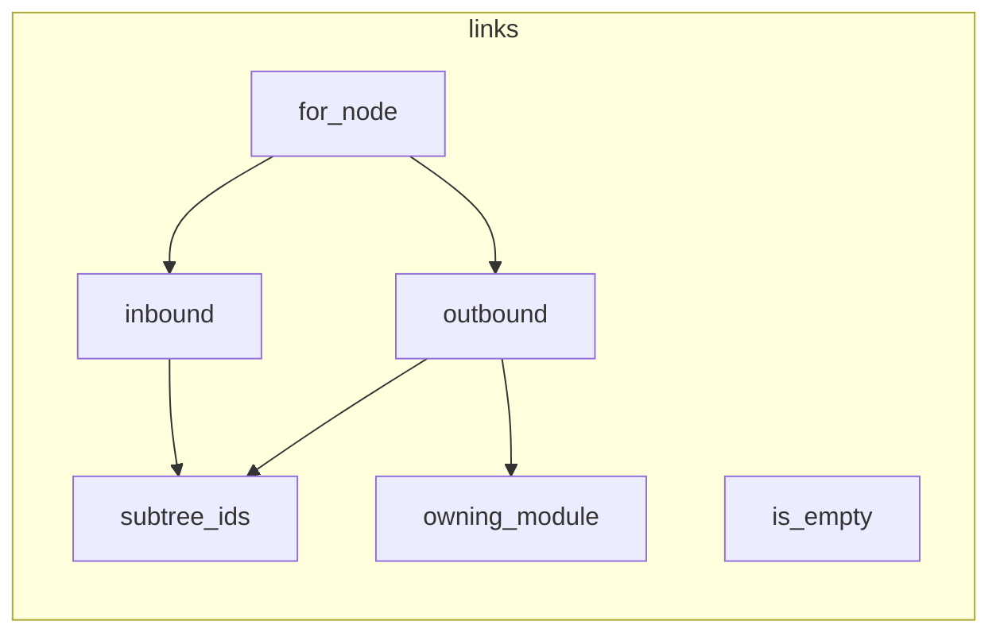

# `robby_render::view::links`

[Self-model](../../../README.md) · [robby_render](../../index.md)

| | |
|---|---|
| kind | `code.module` |
| declared at | [`crates/robby-render/src/view/mod.rs:12`](../../../../../crates/robby-render/src/view/mod.rs#L12) |
| provenance | extractor · confidence 1.00 |
| nodes | 25 |

## Types

## Package diagram

## Module coupling

## Dependency matrix

| | links | robby_ir | robby_render |
|---|---:|---:|---:|
| **links** | · | 9 | 16 |
| **robby_ir** | | · | |
| **robby_render** | | | · |
## References

- calls → [`robby_ir::model`](../../../robby_ir/model/index.md) — insert, subtree
- calls → [`robby_ir::run`](../../../robby_ir/run/index.md) — get
- calls → [`robby_render::util`](../../util/index.md) — edge_label, is_container
- calls → [`robby_render::view::scene`](../scene/index.md) — contains, new
- calls → [`robby_render::view::select`](../select/index.md) — collect

## Referenced by

- calls ← [`robby_render::class_diagram`](../../class-diagram.md)
- calls ← [`robby_render::coupling`](../../coupling.md)
- calls ← [`robby_render::dependencies`](../../dependencies.md)
- calls ← [`robby_render::dependency_report`](../../dependency-report.md)
- calls ← [`robby_render::markdown::coverage_section`](../../markdown/coverage-section.md)
- calls ← [`robby_render::markdown::node_section`](../../markdown/node-section.md)
- calls ← [`robby_render::pipeline::load_sources`](../../pipeline/load-sources.md)
- calls ← [`robby_render::pipeline::slug`](../../pipeline/slug.md)
- calls ← [`robby_render::render::markdown::impl MarkdownRenderer::fence`](../../render/markdown/index.md)
- calls ← [`robby_render::render::markdown::impl Renderer for MarkdownRenderer::links`](../../render/markdown/index.md)
- calls ← [`robby_render::render::mermaid::dsm_markdown_table`](../../render/mermaid/dsm-markdown-table.md)
- calls ← [`robby_render::render::mermaid::emit_coupling_subgraph`](../../render/mermaid/emit-coupling-subgraph.md)
- calls ← [`robby_render::render::mermaid::emit_package_subgraph`](../../render/mermaid/emit-package-subgraph.md)
- calls ← [`robby_render::render::mermaid::emit_workspace_coupling`](../../render/mermaid/emit-workspace-coupling.md)
- calls ← [`robby_render::render::mermaid::impl Renderer for MermaidRenderer::coupling_deps`](../../render/mermaid/index.md)
- calls ← [`robby_render::render::mermaid::impl Renderer for MermaidRenderer::package_deps`](../../render/mermaid/index.md)
- calls ← [`robby_render::render::tui::ascii_coupling`](../../render/tui/ascii-coupling.md)
- calls ← [`robby_render::render::tui::ascii_package_structure`](../../render/tui/ascii-package-structure.md)
- calls ← [`robby_render::render::tui::impl Renderer for TuiRenderer::links`](../../render/tui/index.md)
- calls ← [`robby_render::render::tui::impl Renderer for TuiRenderer::process`](../../render/tui/index.md)
- calls ← [`robby_render::render::tui::impl Renderer for TuiRenderer::sibling_graph`](../../render/tui/index.md)
- calls ← [`robby_render::report::impl Report::to_terminal`](../../report/index.md)
- calls ← [`robby_render::report::impl Section::is_blank`](../../report/index.md)
- calls ← [`robby_render::tree::global_index`](../../tree/global-index.md)
- calls ← [`robby_render::tree::item_slug`](../../tree/item-slug.md)
- calls ← [`robby_render::tree::module_page`](../../tree/module-page.md)
- calls ← [`robby_render::tree::render_links`](../../tree/render-links.md)
- calls ← [`robby_render::tree::render_node`](../../tree/render-node.md)
- calls ← [`robby_render::tree::resolve_use_path`](../../tree/resolve-use-path.md)
- calls ← [`robby_render::tree::source_link`](../../tree/source-link.md)
- calls ← [`robby_render::util::alias`](../../util/alias.md)
- calls ← [`robby_render::view::entrypoints::impl CallTree::from_document`](../entrypoints/index.md)
- calls ← [`robby_render::view::execution::from_code_path`](../execution/from-code-path.md)
- calls ← [`robby_render::view::execution::owning_type_label`](../execution/owning-type-label.md)
- calls ← [`robby_render::view::externals::owning_container_fqn`](../externals/owning-container-fqn.md)
- calls ← [`robby_render::view::scene::crate_roots`](../scene/crate-roots.md)
- calls ← [`robby_render::view::scene::portals_for`](../scene/portals-for.md)
- calls ← [`robby_render::view::select::collect`](../select/collect.md)
- calls ← [`robby_render::web::impl FrameDetail::from_node_in_doc`](../../web/index.md)
- calls ← [`robby_render::workspace_dependencies`](../../workspace-dependencies.md)

## Items

| Item | Kind | Steps | Location |
|---|---|---:|---|
| [`LinkGraph`](linkgraph.md) | `code.struct` | — | `crates/robby-render/src/view/links.rs:9:1` |
| [`OutboundRef`](outboundref.md) | `code.struct` | — | `crates/robby-render/src/view/links.rs:15:1` |
| [`InboundRef`](inboundref.md) | `code.struct` | — | `crates/robby-render/src/view/links.rs:24:1` |
| [`impl LinkGraph`](impl-linkgraph.md) | `code.impl` | — | `crates/robby-render/src/view/links.rs:31:1` |
| [`outbound`](outbound.md) | `code.function` | 23 | `crates/robby-render/src/view/links.rs:44:1` |
| [`inbound`](inbound.md) | `code.function` | 19 | `crates/robby-render/src/view/links.rs:84:1` |
| [`owning_module`](owning-module.md) | `code.function` | 12 | `crates/robby-render/src/view/links.rs:116:1` |
| [`subtree_ids`](subtree-ids.md) | `code.function` | 5 | `crates/robby-render/src/view/links.rs:130:1` |
| [`is_module_kind`](is-module-kind.md) | `code.function` | 1 | `crates/robby-render/src/view/links.rs:137:1` |

## Imports

- `use std::collections::{BTreeMap, BTreeSet};`
- [`use robby_ir::{Document, EdgeKind, Node, NodeId, kind};`](../../../robby_ir/index.md)
- `use crate::util::{edge_label, is_container};`

