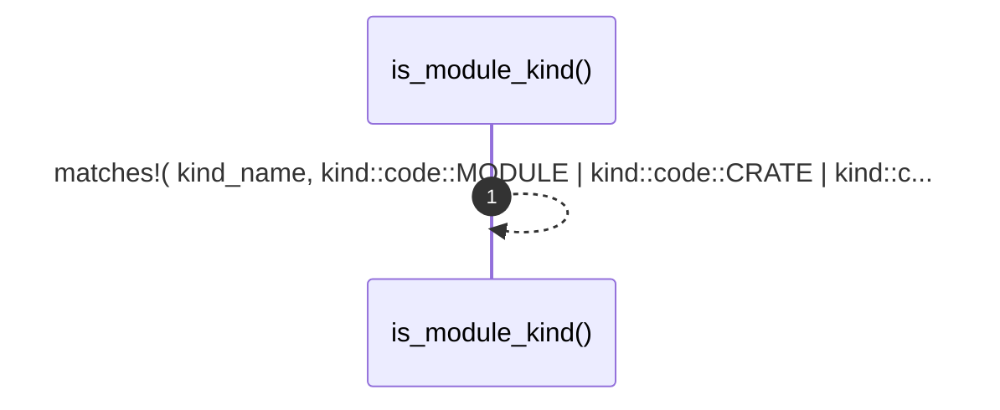

# `robby_render::view::links::is_module_kind`

[Self-model](../../../README.md) · [view::links](index.md)

| | |
|---|---|
| kind | `code.function` |
| signature | `fn is_module_kind(kind_name: &str) -> bool` |
| location | [`crates/robby-render/src/view/links.rs:137`](../../../../../crates/robby-render/src/view/links.rs#L137) |
| provenance | extractor · confidence 1.00 |

```rust
pub fn is_module_kind(kind_name: &str) -> bool {
    matches!(
        kind_name,
        kind::code::MODULE | kind::code::CRATE | kind::code::PACKAGE
    )
}
```



1 steps · 0 observed · 1 possible only

## Referenced by

- calls ← [`robby_render::view::externals::owning_container_fqn`](../externals/owning-container-fqn.md)
- calls ← [`robby_render::view::select::collect`](../select/collect.md)

