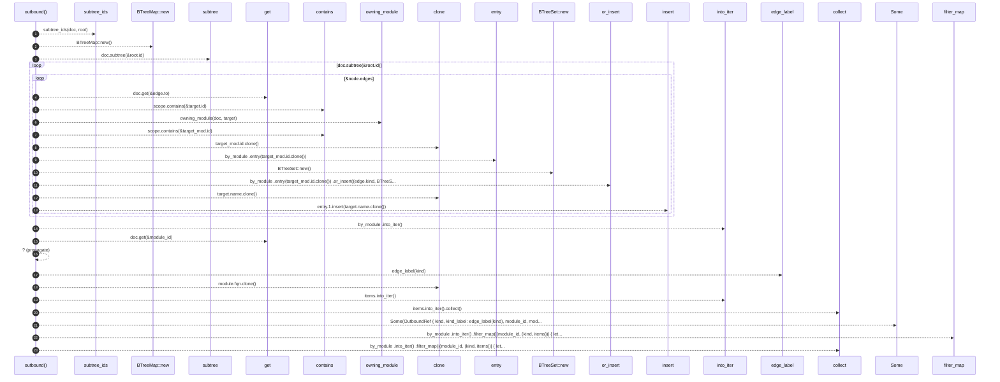

# `robby_render::view::links::outbound`

[Self-model](../../../README.md) · [view::links](index.md)

| | |
|---|---|
| kind | `code.function` |
| signature | `fn outbound(doc: &Document, root: &Node) -> Vec<OutboundRef>` |
| location | [`crates/robby-render/src/view/links.rs:44`](../../../../../crates/robby-render/src/view/links.rs#L44) |
| provenance | extractor · confidence 1.00 |

```rust
fn outbound(doc: &Document, root: &Node) -> Vec<OutboundRef> {
    let scope = subtree_ids(doc, root);
    let mut by_module: BTreeMap<NodeId, (EdgeKind, BTreeSet<String>)> = BTreeMap::new();

    for node in doc.subtree(&root.id) {
        for edge in &node.edges {
            let Some(target) = doc.get(&edge.to) else {
                continue;
            };
            if scope.contains(&target.id) {
                continue;
            }
            let Some(target_mod) = owning_module(doc, target) else {
                continue;
            };
            if scope.contains(&target_mod.id) {
                continue;
            }
            let entry = by_module
                .entry(target_mod.id.clone())
                .or_insert((edge.kind, BTreeSet::new()));
            entry.1.insert(target.name.clone());
        }
    }

    by_module
        .into_iter()
        .filter_map(|(module_id, (kind, items))| {
            let module = doc.get(&module_id)?;
            Some(OutboundRef {
                kind,
                kind_label: edge_label(kind),
                module_id,
                module_fqn: module.fqn.clone(),
                items: items.into_iter().collect(),
            })
        })
        .collect()
}
```



23 steps · 0 observed · 23 possible only

**Edges**

- calls → [`robby_render::view::links::subtree_ids`](subtree-ids.md)
- calls → [`robby_render::view::scene::impl Rect::new`](../scene/index.md)
- calls → [`robby_ir::model::impl Document::subtree`](../../../robby_ir/model/index.md)
- calls → [`robby_ir::model::impl Document::get`](../../../robby_ir/model/index.md)
- calls → [`robby_render::view::scene::impl WorldRect::contains`](../scene/index.md)
- calls → [`robby_render::view::links::owning_module`](owning-module.md)
- calls → [`robby_render::view::scene::impl WorldRect::contains`](../scene/index.md)
- calls → [`robby_render::view::scene::impl Rect::new`](../scene/index.md)
- calls → [`robby_ir::model::impl Document::insert`](../../../robby_ir/model/index.md)
- calls → [`robby_ir::model::impl Document::get`](../../../robby_ir/model/index.md)
- calls → [`robby_render::util::edge_label`](../../util/edge-label.md)
- calls → [`robby_render::view::select::collect`](../select/collect.md)
- calls → [`robby_render::view::select::collect`](../select/collect.md)

## References

- calls → [`robby_ir::model`](../../../robby_ir/model/index.md) — get, insert, subtree
- calls → [`robby_render::util`](../../util/index.md) — edge_label
- calls → [`robby_render::view::links`](index.md) — owning_module, subtree_ids
- calls → [`robby_render::view::scene`](../scene/index.md) — contains, new
- calls → [`robby_render::view::select`](../select/index.md) — collect

## Referenced by

- calls ← [`robby_render::view::links::impl LinkGraph::for_node`](index.md)

