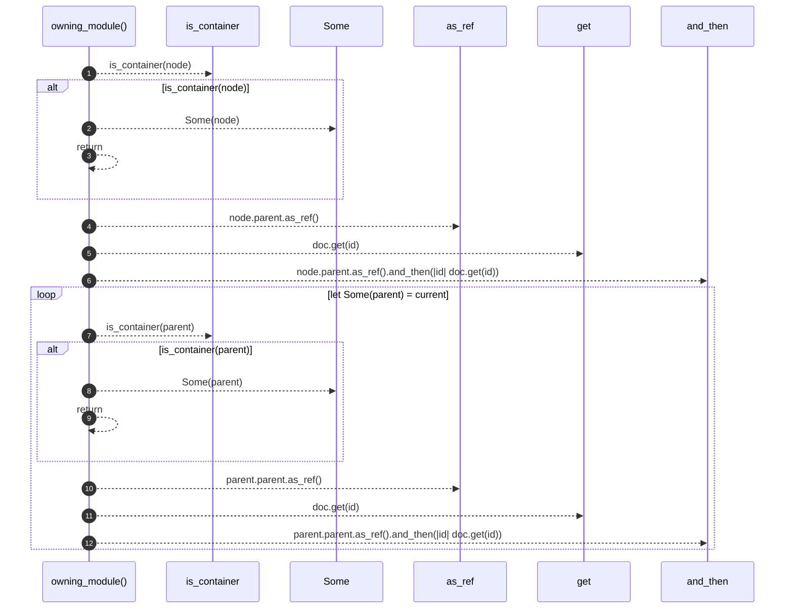

# `robby_render::view::links::owning_module`

[Self-model](../../../README.md) · [view::links](index.md)

| | |
|---|---|
| kind | `code.function` |
| signature | `fn owning_module<'a>(doc: &'a Document, node: &'a Node) -> Option<&'a Node>` |
| location | [`crates/robby-render/src/view/links.rs:116`](../../../../../crates/robby-render/src/view/links.rs#L116) |
| provenance | extractor · confidence 1.00 |

```rust
fn owning_module<'a>(doc: &'a Document, node: &'a Node) -> Option<&'a Node> {
    if is_container(node) {
        return Some(node);
    }
    let mut current = node.parent.as_ref().and_then(|id| doc.get(id));
    while let Some(parent) = current {
        if is_container(parent) {
            return Some(parent);
        }
        current = parent.parent.as_ref().and_then(|id| doc.get(id));
    }
    None
}
```



12 steps · 0 observed · 12 possible only

**Edges**

- calls → [`robby_render::util::is_container`](../../util/is-container.md)
- calls → [`robby_ir::run::RecipeCatalog::get`](../../../robby_ir/run/index.md)
- calls → [`robby_render::util::is_container`](../../util/is-container.md)
- calls → [`robby_ir::run::RecipeCatalog::get`](../../../robby_ir/run/index.md)

## References

- calls → [`robby_ir::run`](../../../robby_ir/run/index.md) — get
- calls → [`robby_render::util`](../../util/index.md) — is_container

## Referenced by

- calls ← [`robby_render::view::links::outbound`](outbound.md)

