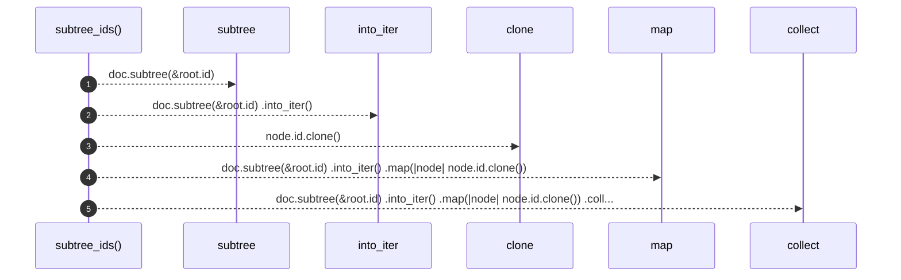

# `robby_render::view::links::subtree_ids`

[Self-model](../../../README.md) · [view::links](index.md)

| | |
|---|---|
| kind | `code.function` |
| signature | `fn subtree_ids(doc: &Document, root: &Node) -> BTreeSet<NodeId>` |
| location | [`crates/robby-render/src/view/links.rs:130`](../../../../../crates/robby-render/src/view/links.rs#L130) |
| provenance | extractor · confidence 1.00 |

```rust
fn subtree_ids(doc: &Document, root: &Node) -> BTreeSet<NodeId> {
    doc.subtree(&root.id)
        .into_iter()
        .map(|node| node.id.clone())
        .collect()
}
```



5 steps · 0 observed · 5 possible only

**Edges**

- calls → [`robby_ir::model::impl Document::subtree`](../../../robby_ir/model/index.md)
- calls → [`robby_render::view::select::collect`](../select/collect.md)

## References

- calls → [`robby_ir::model`](../../../robby_ir/model/index.md) — subtree
- calls → [`robby_render::view::select`](../select/index.md) — collect

## Referenced by

- calls ← [`robby_render::view::links::inbound`](inbound.md)
- calls ← [`robby_render::view::links::outbound`](outbound.md)

