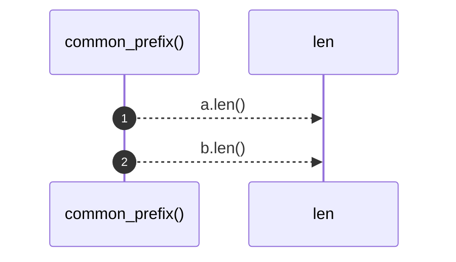

# `robby_render::view::process::common_prefix`

[Self-model](../../../README.md) · [view::process](index.md)

| | |
|---|---|
| kind | `code.function` |
| signature | `fn common_prefix(a: &[Block], b: &[Block]) -> usize` |
| location | [`crates/robby-render/src/view/process.rs:115`](../../../../../crates/robby-render/src/view/process.rs#L115) |
| provenance | extractor · confidence 1.00 |

```rust
fn common_prefix(a: &[Block], b: &[Block]) -> usize {
    let mut i = 0;
    while i < a.len() && i < b.len() && a[i].kind == b[i].kind && a[i].label == b[i].label {
        i += 1;
    }
    i
}
```



2 steps · 0 observed · 2 possible only

## Referenced by

- calls ← [`robby_render::view::process::impl ProcessView::from_process`](index.md)

