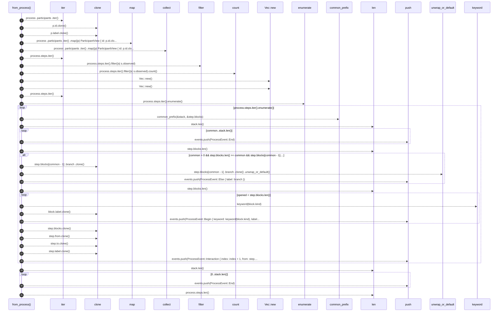
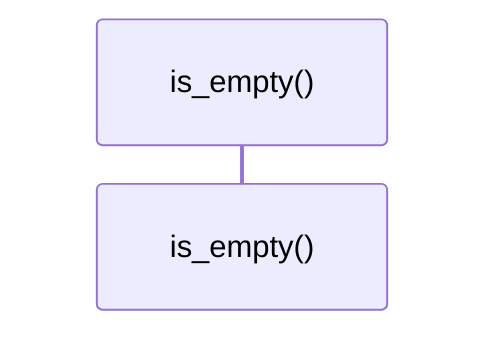

# `robby_render::view::process::impl ProcessView`

[Self-model](../../../README.md) · [view::process](index.md)

| | |
|---|---|
| kind | `code.impl` |
| location | [`crates/robby-render/src/view/process.rs:42`](../../../../../crates/robby-render/src/view/process.rs#L42) |
| provenance | extractor · confidence 1.00 |

```rust
impl ProcessView {
    pub fn from_process(process: &Process) -> Self {
        let participants = process
            .participants
            .iter()
            .map(|p| ParticipantView {
                id: p.id.clone(),
                label: p.label.clone(),
            })
            .collect();

        let observed_count = process.steps.iter().filter(|s| s.observed).count();
        let mut events = Vec::new();
        let mut stack: Vec<Block> = Vec::new();

        for (index, step) in process.steps.iter().enumerate() {
            let common = common_prefix(&stack, &step.blocks);

            for _ in common..stack.len() {
                events.push(ProcessEvent::End);
            }

            if common > 0
                && step.blocks.len() >= common
                && step.blocks[common - 1].branch != stack[common - 1].branch
            {
                let branch = step.blocks[common - 1]
                    .branch
                    .clone()
                    .unwrap_or_default();
                events.push(ProcessEvent::Else { label: branch });
            }

            let mut opened = common;
            while opened < step.blocks.len() {
                let block = &step.blocks[opened];
                events.push(ProcessEvent::Begin {
                    keyword: keyword(block.kind),
                    label: block.label.clone(),
                });
                opened += 1;
            }

            stack = step.blocks.clone();

            events.push(ProcessEvent::Interaction {
                index: index + 1,
                from: step.from.clone(),
                to: step.to.clone(),
                label: step.label.clone(),
                observed: step.observed,
                kind: step.kind,
            });
        }

        for _ in 0..stack.len() {
            events.push(ProcessEvent::End);
        }

        Self {
            participants,
            events,
            step_count: process.steps.len(),
            observed_count,
        }
    }

    pub fn is_empty(&self) -> bool {
        self.step_count == 0
    }
}
```

## References

- calls → [`robby_render::report`](../../report/index.md) — push
- calls → [`robby_render::util`](../../util/index.md) — keyword
- calls → [`robby_render::view::process`](index.md) — common_prefix
- calls → [`robby_render::view::scene`](../scene/index.md) — new
- calls → [`robby_render::view::select`](../select/index.md) — collect

## Referenced by

- calls ← [`robby_render::sequence`](../../sequence.md)
- calls ← [`robby_render::tui::timeline`](../../tui/timeline.md)
- calls ← [`robby_render::web::impl FrameDetail::from_node_in_doc`](../../web/index.md)

### `from_process`

| | |
|---|---|
| kind | `code.method` |
| signature | `fn from_process(1)` |
| location | [`crates/robby-render/src/view/process.rs:43`](../../../../../crates/robby-render/src/view/process.rs#L43) |
| provenance | extractor · confidence 1.00 |

```rust
pub fn from_process(process: &Process) -> Self {
        let participants = process
            .participants
            .iter()
            .map(|p| ParticipantView {
                id: p.id.clone(),
                label: p.label.clone(),
            })
            .collect();

        let observed_count = process.steps.iter().filter(|s| s.observed).count();
        let mut events = Vec::new();
        let mut stack: Vec<Block> = Vec::new();

        for (index, step) in process.steps.iter().enumerate() {
            let common = common_prefix(&stack, &step.blocks);

            for _ in common..stack.len() {
                events.push(ProcessEvent::End);
            }

            if common > 0
                && step.blocks.len() >= common
                && step.blocks[common - 1].branch != stack[common - 1].branch
            {
                let branch = step.blocks[common - 1]
                    .branch
                    .clone()
                    .unwrap_or_default();
                events.push(ProcessEvent::Else { label: branch });
            }

            let mut opened = common;
            while opened < step.blocks.len() {
                let block = &step.blocks[opened];
                events.push(ProcessEvent::Begin {
                    keyword: keyword(block.kind),
                    label: block.label.clone(),
                });
                opened += 1;
            }

            stack = step.blocks.clone();

            events.push(ProcessEvent::Interaction {
                index: index + 1,
                from: step.from.clone(),
                to: step.to.clone(),
                label: step.label.clone(),
                observed: step.observed,
                kind: step.kind,
            });
        }

        for _ in 0..stack.len() {
            events.push(ProcessEvent::End);
        }

        Self {
            participants,
            events,
            step_count: process.steps.len(),
            observed_count,
        }
    }
```



31 steps · 0 observed · 31 possible only

**Edges**

- calls → [`robby_render::view::select::collect`](../select/collect.md)
- calls → [`robby_render::view::scene::impl Rect::new`](../scene/index.md)
- calls → [`robby_render::view::scene::impl Rect::new`](../scene/index.md)
- calls → [`robby_render::view::process::common_prefix`](common-prefix.md)
- calls → [`robby_render::report::impl Report::push`](../../report/index.md)
- calls → [`robby_render::report::impl Report::push`](../../report/index.md)
- calls → [`robby_render::util::keyword`](../../util/keyword.md)
- calls → [`robby_render::report::impl Report::push`](../../report/index.md)
- calls → [`robby_render::report::impl Report::push`](../../report/index.md)
- calls → [`robby_render::report::impl Report::push`](../../report/index.md)

### `is_empty`

| | |
|---|---|
| kind | `code.method` |
| signature | `fn is_empty(1)` |
| location | [`crates/robby-render/src/view/process.rs:109`](../../../../../crates/robby-render/src/view/process.rs#L109) |
| provenance | extractor · confidence 1.00 |

```rust
pub fn is_empty(&self) -> bool {
        self.step_count == 0
    }
```



0 steps · 0 observed · 0 possible only

