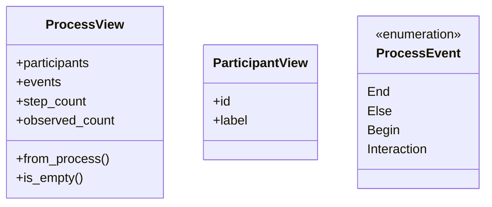
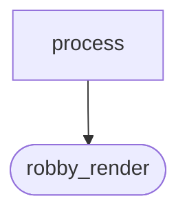
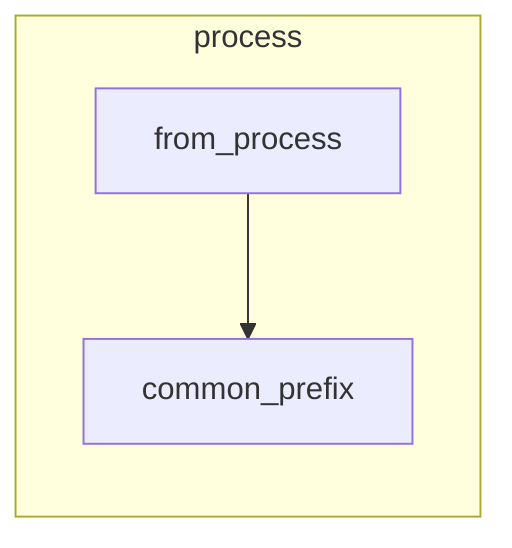

# `robby_render::view::process`

[Self-model](../../../README.md) · [view](../index.md)

| | |
|---|---|
| kind | `code.module` |
| declared at | [`crates/robby-render/src/view/mod.rs:13`](../../../../../crates/robby-render/src/view/mod.rs#L13) |
| provenance | extractor · confidence 1.00 |
| nodes | 20 |

## Types



## Package diagram



## Module coupling



## Dependency matrix

| | process | robby_render |
|---|---:|---:|
| **process** | · | 9 |
| **robby_render** | | · |

## Comments

- `crates/robby-render/src/view/process.rs:7:1` (docs, `robby_render::view::process::ProcessView`): "Format-agnostic process diagram data."
  ```
  /// Format-agnostic process diagram data.
  #[derive(Debug, Clone, PartialEq, Eq)]
  pub struct ProcessView {
      pub participants: Vec<ParticipantView>,
      pub events: Vec<ProcessEvent>,
      pub step_count: usize,
      pub observed_count: usize,
  }
  ```
## References

- calls → [`robby_render::report`](../../report/index.md) — push
- calls → [`robby_render::util`](../../util/index.md) — keyword
- calls → [`robby_render::view::scene`](../scene/index.md) — new
- calls → [`robby_render::view::select`](../select/index.md) — collect

## Referenced by

- calls ← [`robby_render::sequence`](../../sequence.md)
- calls ← [`robby_render::tui::timeline`](../../tui/timeline.md)
- calls ← [`robby_render::web::impl FrameDetail::from_node_in_doc`](../../web/index.md)

## Items

| Item | Kind | Steps | Location |
|---|---|---:|---|
| [`ProcessView`](processview.md) | `code.struct` | — | `crates/robby-render/src/view/process.rs:7:1` |
| [`ParticipantView`](participantview.md) | `code.struct` | — | `crates/robby-render/src/view/process.rs:16:1` |
| [`ProcessEvent`](processevent.md) | `code.enum` | — | `crates/robby-render/src/view/process.rs:22:1` |
| [`impl ProcessView`](impl-processview.md) | `code.impl` | — | `crates/robby-render/src/view/process.rs:42:1` |
| [`common_prefix`](common-prefix.md) | `code.function` | 2 | `crates/robby-render/src/view/process.rs:114:1` |

## Imports

- [`use robby_ir::{Block, Process, StepKind};`](../../../robby_ir/index.md)
- `use crate::util::keyword;`

