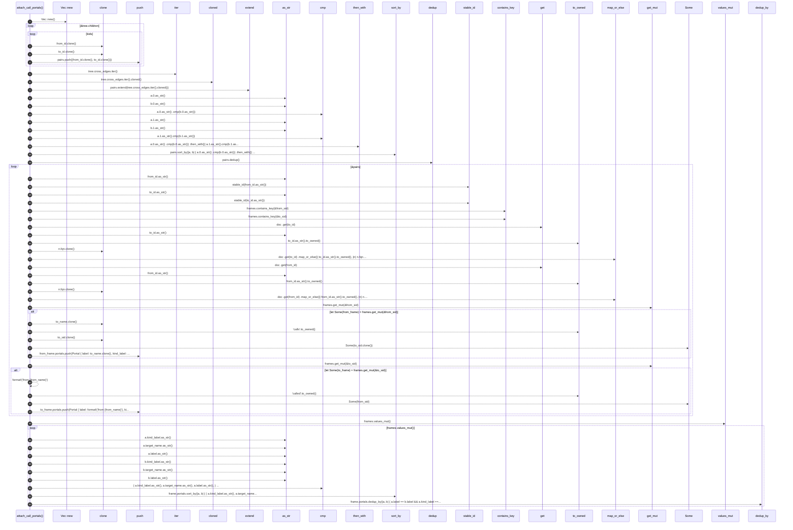

# `robby_render::view::scene::attach_call_portals`

[Self-model](../../../README.md) · [view::scene](index.md)

| | |
|---|---|
| kind | `code.function` |
| signature | `fn attach_call_portals(doc: &Document, tree: &CallTree, frames: &mut BTreeMap<String, Frame>)` |
| location | [`crates/robby-render/src/view/scene.rs:368`](../../../../../crates/robby-render/src/view/scene.rs#L368) |
| provenance | extractor · confidence 1.00 |

> Portals for every Calls hop among placed frames (tree children + cross edges).

```rust
/// Portals for every Calls hop among placed frames (tree children + cross edges).
fn attach_call_portals(doc: &Document, tree: &CallTree, frames: &mut BTreeMap<String, Frame>) {
    let mut pairs: Vec<(NodeId, NodeId)> = Vec::new();
    for (from_id, kids) in &tree.children {
        for to_id in kids {
            pairs.push((from_id.clone(), to_id.clone()));
        }
    }
    pairs.extend(tree.cross_edges.iter().cloned());
    pairs.sort_by(|a, b| {
        a.0.as_str()
            .cmp(b.0.as_str())
            .then_with(|| a.1.as_str().cmp(b.1.as_str()))
    });
    pairs.dedup();

    for (from_id, to_id) in &pairs {
        let from_sid = stable_id(from_id.as_str());
        let to_sid = stable_id(to_id.as_str());
        if !frames.contains_key(&from_sid) || !frames.contains_key(&to_sid) {
            continue;
        }
        let to_name = doc
            .get(to_id)
            .map_or_else(|| to_id.as_str().to_owned(), |n| n.fqn.clone());
        let from_name = doc
            .get(from_id)
            .map_or_else(|| from_id.as_str().to_owned(), |n| n.fqn.clone());

        if let Some(from_frame) = frames.get_mut(&from_sid) {
            from_frame.portals.push(Portal {
                label: to_name.clone(),
                kind_label: "calls".to_owned(),
                target: Some(to_sid.clone()),
                target_name: to_name,
            });
        }
        if let Some(to_frame) = frames.get_mut(&to_sid) {
            to_frame.portals.push(Portal {
                label: format!("from {from_name}"),
                kind_label: "called".to_owned(),
                target: Some(from_sid),
                target_name: from_name,
            });
        }
    }

    for frame in frames.values_mut() {
        frame.portals.sort_by(|a, b| {
            (
                a.kind_label.as_str(),
                a.target_name.as_str(),
                a.label.as_str(),
            )
                .cmp(&(
                    b.kind_label.as_str(),
                    b.target_name.as_str(),
                    b.label.as_str(),
                ))
        });
        frame.portals.dedup_by(|a, b| {
            a.label == b.label && a.kind_label == b.kind_label && a.target == b.target
        });
    }
}
```



53 steps · 0 observed · 53 possible only

**Edges**

- calls → [`robby_render::view::scene::impl Rect::new`](index.md)
- calls → [`robby_render::report::impl Report::push`](../../report/index.md)
- calls → [`robby_render::view::comments::impl CommentKind::as_str`](../comments/index.md)
- calls → [`robby_render::view::comments::impl CommentKind::as_str`](../comments/index.md)
- calls → [`robby_render::view::comments::impl CommentKind::as_str`](../comments/index.md)
- calls → [`robby_render::view::comments::impl CommentKind::as_str`](../comments/index.md)
- calls → [`robby_render::view::comments::impl CommentKind::as_str`](../comments/index.md)
- calls → [`robby_render::stable_id`](../../stable-id.md)
- calls → [`robby_render::view::comments::impl CommentKind::as_str`](../comments/index.md)
- calls → [`robby_render::stable_id`](../../stable-id.md)
- calls → [`robby_ir::run::RecipeCatalog::get`](../../../robby_ir/run/index.md)
- calls → [`robby_render::view::comments::impl CommentKind::as_str`](../comments/index.md)
- calls → [`robby_ir::run::RecipeCatalog::get`](../../../robby_ir/run/index.md)
- calls → [`robby_render::view::comments::impl CommentKind::as_str`](../comments/index.md)
- calls → [`robby_render::report::impl Report::push`](../../report/index.md)
- calls → [`robby_render::report::impl Report::push`](../../report/index.md)
- calls → [`robby_render::view::comments::impl CommentKind::as_str`](../comments/index.md)
- calls → [`robby_render::view::comments::impl CommentKind::as_str`](../comments/index.md)
- calls → [`robby_render::view::comments::impl CommentKind::as_str`](../comments/index.md)
- calls → [`robby_render::view::comments::impl CommentKind::as_str`](../comments/index.md)
- calls → [`robby_render::view::comments::impl CommentKind::as_str`](../comments/index.md)
- calls → [`robby_render::view::comments::impl CommentKind::as_str`](../comments/index.md)

## References

- calls → [`robby_ir::run`](../../../robby_ir/run/index.md) — get
- calls → [`robby_render`](../../index.md) — stable_id
- calls → [`robby_render::report`](../../report/index.md) — push
- calls → [`robby_render::view::comments`](../comments/index.md) — as_str
- calls → [`robby_render::view::scene`](index.md) — new

## Referenced by

- calls ← [`robby_render::view::scene::impl Scene::from_entrypoints`](index.md)

