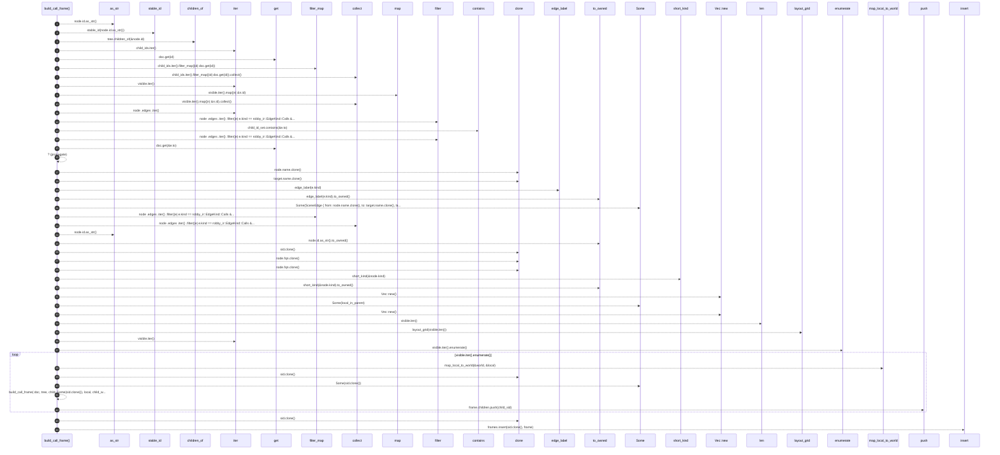

# `robby_render::view::scene::build_call_frame`

[Self-model](../../../README.md) · [view::scene](index.md)

| | |
|---|---|
| kind | `code.function` |
| signature | `fn build_call_frame(     doc: &Document,     tree: &CallTree,     node: &Node,     parent: Option<String>,     local_in_parent: Rect,     world: WorldRect,     frames: &mut BTreeMap<String, Frame>, ) -> String` |
| location | [`crates/robby-render/src/view/scene.rs:312`](../../../../../crates/robby-render/src/view/scene.rs#L312) |
| provenance | extractor · confidence 1.00 |

```rust
fn build_call_frame(
    doc: &Document,
    tree: &CallTree,
    node: &Node,
    parent: Option<String>,
    local_in_parent: Rect,
    world: WorldRect,
    frames: &mut BTreeMap<String, Frame>,
) -> String {
    let sid = stable_id(node.id.as_str());
    let child_ids = tree.children_of(&node.id);
    let visible: Vec<&Node> = child_ids.iter().filter_map(|id| doc.get(id)).collect();
    let child_id_set: BTreeSet<&NodeId> = visible.iter().map(|n| &n.id).collect();

    let edges: Vec<SceneEdge> = node
        .edges
        .iter()
        .filter(|e| e.kind == robby_ir::EdgeKind::Calls && e.resolved)
        .filter(|e| child_id_set.contains(&e.to))
        .filter_map(|e| {
            let target = doc.get(&e.to)?;
            Some(SceneEdge {
                from: node.name.clone(),
                to: target.name.clone(),
                label: edge_label(e.kind).to_owned(),
                resolved: e.resolved,
            })
        })
        .collect();

    let mut frame = Frame {
        id: node.id.as_str().to_owned(),
        stable_id: sid.clone(),
        // Entrypoints org: many leaves share names like `main` — title with path.
        name: node.fqn.clone(),
        fqn: node.fqn.clone(),
        kind_tag: short_kind(&node.kind).to_owned(),
        parent,
        children: Vec::new(),
        world,
        local_in_parent: Some(local_in_parent),
        edges,
        portals: Vec::new(),
    };

    let placements = layout_grid(visible.len());
    for (i, child) in visible.iter().enumerate() {
        let local = placements[i];
        let child_world = map_local_to_world(&world, &local);
        let child_sid = build_call_frame(
            doc,
            tree,
            child,
            Some(sid.clone()),
            local,
            child_world,
            frames,
        );
        frame.children.push(child_sid);
    }

    frames.insert(sid.clone(), frame);
    sid
}
```



44 steps · 0 observed · 44 possible only

**Edges**

- calls → [`robby_render::view::comments::impl NoteKind::as_str`](../comments/index.md)
- calls → [`robby_render::stable_id`](../../stable-id.md)
- calls → [`robby_render::view::entrypoints::impl CallTree::children_of`](../entrypoints/index.md)
- calls → [`robby_ir::model::impl Document::get`](../../../robby_ir/model/index.md)
- calls → [`robby_render::view::select::collect`](../select/collect.md)
- calls → [`robby_render::view::select::collect`](../select/collect.md)
- calls → [`robby_render::view::scene::impl WorldRect::contains`](index.md)
- calls → [`robby_ir::model::impl Document::get`](../../../robby_ir/model/index.md)
- calls → [`robby_render::util::edge_label`](../../util/edge-label.md)
- calls → [`robby_render::view::select::collect`](../select/collect.md)
- calls → [`robby_render::view::comments::impl NoteKind::as_str`](../comments/index.md)
- calls → [`robby_render::util::short_kind`](../../util/short-kind.md)
- calls → [`robby_render::view::scene::impl Rect::new`](index.md)
- calls → [`robby_render::view::scene::impl Rect::new`](index.md)
- calls → [`robby_render::view::scene::layout_grid`](layout-grid.md)
- calls → [`robby_render::view::scene::map_local_to_world`](map-local-to-world.md)
- calls → [`robby_render::view::scene::build_call_frame`](build-call-frame.md)
- calls → [`robby_render::report::impl Report::push`](../../report/index.md)
- calls → [`robby_ir::model::impl Document::insert`](../../../robby_ir/model/index.md)

## References

- calls → [`robby_ir::model`](../../../robby_ir/model/index.md) — get, insert
- calls → [`robby_render`](../../index.md) — stable_id
- calls → [`robby_render::report`](../../report/index.md) — push
- calls → [`robby_render::util`](../../util/index.md) — edge_label, short_kind
- calls → [`robby_render::view::comments`](../comments/index.md) — as_str
- calls → [`robby_render::view::entrypoints`](../entrypoints/index.md) — children_of
- calls → [`robby_render::view::scene`](index.md) — contains, layout_grid, map_local_to_world, new
- calls → [`robby_render::view::select`](../select/index.md) — collect

## Referenced by

- calls ← [`robby_render::view::scene::impl Scene::from_entrypoints`](index.md)

