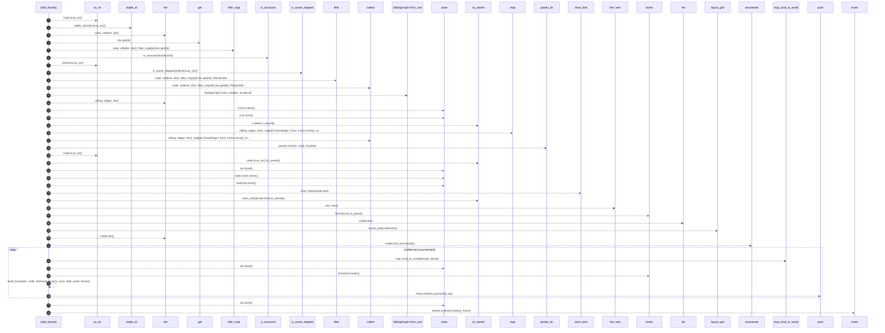

# `robby_render::view::scene::build_frame`

[Self-model](../../../README.md) · [view::scene](index.md)

| | |
|---|---|
| kind | `code.function` |
| signature | `fn build_frame(     doc: &Document,     node: &Node,     parent: Option<String>,     local_in_parent: Rect,     world: WorldRect,     frames: &mut BTreeMap<String, Frame>, ) -> String` |
| location | [`crates/robby-render/src/view/scene.rs:246`](../../../../../crates/robby-render/src/view/scene.rs#L246) |
| provenance | extractor · confidence 1.00 |

```rust
fn build_frame(
    doc: &Document,
    node: &Node,
    parent: Option<String>,
    local_in_parent: Rect,
    world: WorldRect,
    frames: &mut BTreeMap<String, Frame>,
) -> String {
    let sid = stable_id(node.id.as_str());

    let visible: Vec<&Node> = node
        .children
        .iter()
        .filter_map(|id| doc.get(id))
        .filter(|child| is_structural(&child.kind) && !is_scene_skipped(child.kind.as_str()))
        .collect();

    let sibling = SiblingGraph::from_root(doc, &node.id);
    let edges: Vec<SceneEdge> = sibling
        .edges
        .iter()
        .map(|e| SceneEdge {
            from: e.from.clone(),
            to: e.to.clone(),
            label: e.label.to_owned(),
            resolved: e.resolved,
        })
        .collect();

    let portals = portals_for(doc, node, &visible);

    let mut frame = Frame {
        id: node.id.as_str().to_owned(),
        stable_id: sid.clone(),
        name: node.name.clone(),
        fqn: node.fqn.clone(),
        kind_tag: short_kind(&node.kind).to_owned(),
        parent,
        children: Vec::new(),
        world,
        local_in_parent: Some(local_in_parent),
        edges,
        portals,
    };

    let placements = layout_grid(visible.len());
    for (i, child) in visible.iter().enumerate() {
        let local = placements[i];
        let child_world = map_local_to_world(&world, &local);
        let child_sid = build_frame(doc, child, Some(sid.clone()), local, child_world, frames);
        frame.children.push(child_sid);
    }

    frames.insert(sid.clone(), frame);
    sid
}
```



38 steps · 0 observed · 38 possible only

**Edges**

- calls → [`robby_render::view::comments::impl CommentKind::as_str`](../comments/index.md)
- calls → [`robby_render::stable_id`](../../stable-id.md)
- calls → [`robby_ir::run::RecipeCatalog::get`](../../../robby_ir/run/index.md)
- calls → [`robby_render::util::is_structural`](../../util/is-structural.md)
- calls → [`robby_render::view::comments::impl CommentKind::as_str`](../comments/index.md)
- calls → [`robby_render::view::scene::is_scene_skipped`](is-scene-skipped.md)
- calls → [`robby_render::view::select::collect`](../select/collect.md)
- calls → [`robby_render::view::deps::impl CouplingGraph::from_root`](../deps/index.md)
- calls → [`robby_render::view::select::collect`](../select/collect.md)
- calls → [`robby_render::view::scene::portals_for`](portals-for.md)
- calls → [`robby_render::view::comments::impl CommentKind::as_str`](../comments/index.md)
- calls → [`robby_render::util::short_kind`](../../util/short-kind.md)
- calls → [`robby_render::view::scene::impl Rect::new`](index.md)
- calls → [`robby_render::view::scene::layout_grid`](layout-grid.md)
- calls → [`robby_render::view::scene::map_local_to_world`](map-local-to-world.md)
- calls → [`robby_render::view::scene::build_frame`](build-frame.md)
- calls → [`robby_render::report::impl Report::push`](../../report/index.md)
- calls → [`robby_ir::model::impl Document::insert`](../../../robby_ir/model/index.md)

## References

- calls → [`robby_ir::model`](../../../robby_ir/model/index.md) — insert
- calls → [`robby_ir::run`](../../../robby_ir/run/index.md) — get
- calls → [`robby_render`](../../index.md) — stable_id
- calls → [`robby_render::report`](../../report/index.md) — push
- calls → [`robby_render::util`](../../util/index.md) — is_structural, short_kind
- calls → [`robby_render::view::comments`](../comments/index.md) — as_str
- calls → [`robby_render::view::deps`](../deps/index.md) — from_root
- calls → [`robby_render::view::scene`](index.md) — 5 items
- calls → [`robby_render::view::select`](../select/index.md) — collect

## Referenced by

- calls ← [`robby_render::view::scene::impl Scene::from_document`](index.md)

