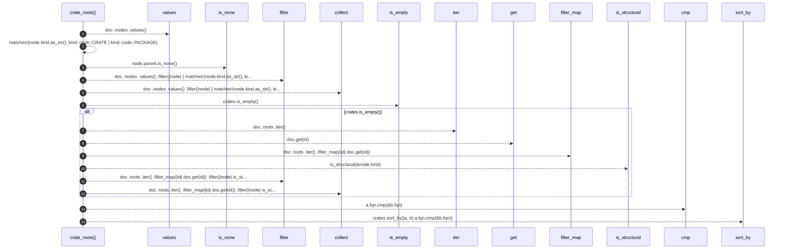

# `robby_render::view::scene::crate_roots`

[Self-model](../../../README.md) · [view::scene](index.md)

| | |
|---|---|
| kind | `code.function` |
| signature | `fn crate_roots(doc: &Document) -> Vec<&Node>` |
| location | [`crates/robby-render/src/view/scene.rs:225`](../../../../../crates/robby-render/src/view/scene.rs#L225) |
| provenance | extractor · confidence 1.00 |

```rust
fn crate_roots(doc: &Document) -> Vec<&Node> {
    let mut crates: Vec<&Node> = doc
        .nodes
        .values()
        .filter(|node| {
            matches!(node.kind.as_str(), kind::code::CRATE | kind::code::PACKAGE)
                && node.parent.is_none()
        })
        .collect();
    if crates.is_empty() {
        crates = doc
            .roots
            .iter()
            .filter_map(|id| doc.get(id))
            .filter(|node| is_structural(&node.kind))
            .collect();
    }
    crates.sort_by(|a, b| a.fqn.cmp(&b.fqn));
    crates
}
```



14 steps · 0 observed · 14 possible only

**Edges**

- calls → [`robby_render::view::select::collect`](../select/collect.md)
- calls → [`robby_render::view::links::impl LinkGraph::is_empty`](../links/index.md)
- calls → [`robby_ir::run::RecipeCatalog::get`](../../../robby_ir/run/index.md)
- calls → [`robby_render::util::is_structural`](../../util/is-structural.md)
- calls → [`robby_render::view::select::collect`](../select/collect.md)

## References

- calls → [`robby_ir::run`](../../../robby_ir/run/index.md) — get
- calls → [`robby_render::util`](../../util/index.md) — is_structural
- calls → [`robby_render::view::links`](../links/index.md) — is_empty
- calls → [`robby_render::view::select`](../select/index.md) — collect

## Referenced by

- calls ← [`robby_render::view::scene::impl Scene::from_document`](index.md)

