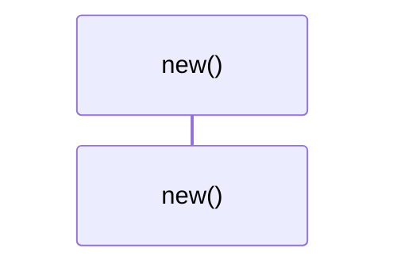

# `robby_render::view::scene::impl Rect`

[Self-model](../../../README.md) · [view::scene](index.md)

| | |
|---|---|
| kind | `code.impl` |
| location | [`crates/robby-render/src/view/scene.rs:49`](../../../../../crates/robby-render/src/view/scene.rs#L49) |
| provenance | extractor · confidence 1.00 |

```rust
impl Rect {
    pub fn new(x: i64, y: i64, w: i64, h: i64) -> Self {
        Self { x, y, w, h }
    }
}
```

## Referenced by

- calls ← [`robby_render::view::comments::apply_highlights`](../comments/apply-highlights.md)
- calls ← [`robby_render::view::comments::impl CommentsView::from_root`](../comments/index.md)
- calls ← [`robby_render::view::comments::line_window`](../comments/line-window.md)
- calls ← [`robby_render::view::deps::finalize_edges`](../deps/finalize-edges.md)
- calls ← [`robby_render::view::deps::impl CouplingGraph::empty`](../deps/index.md)
- calls ← [`robby_render::view::deps::impl CouplingGraph::from_root`](../deps/index.md)
- calls ← [`robby_render::view::deps::impl CouplingGraph::workspace`](../deps/index.md)
- calls ← [`robby_render::view::deps::impl PackageStructure::empty`](../deps/index.md)
- calls ← [`robby_render::view::deps::package_edges`](../deps/package-edges.md)
- calls ← [`robby_render::view::deps::package_leaf`](../deps/package-leaf.md)
- calls ← [`robby_render::view::deps::tarjan`](../deps/tarjan.md)
- calls ← [`robby_render::view::deps::topological_layers`](../deps/topological-layers.md)
- calls ← [`robby_render::view::entrypoints::collect_cross_edges`](../entrypoints/collect-cross-edges.md)
- calls ← [`robby_render::view::entrypoints::doc_with_mains`](../entrypoints/tests/doc-with-mains.md)
- calls ← [`robby_render::view::entrypoints::impl CallTree::from_code_paths`](../entrypoints/index.md)
- calls ← [`robby_render::view::execution::from_code_path`](../execution/from-code-path.md)
- calls ← [`robby_render::view::execution::sample`](../execution/tests/sample.md)
- calls ← [`robby_render::view::externals::impl ExternalsView::from_root`](../externals/index.md)
- calls ← [`robby_render::view::hierarchy::build`](../hierarchy/build.md)
- calls ← [`robby_render::view::links::inbound`](../links/inbound.md)
- calls ← [`robby_render::view::links::outbound`](../links/outbound.md)
- calls ← [`robby_render::view::process::impl ProcessView::from_process`](../process/index.md)
- calls ← [`robby_render::view::scene::attach_call_portals`](attach-call-portals.md)
- calls ← [`robby_render::view::scene::build_call_frame`](build-call-frame.md)
- calls ← [`robby_render::view::scene::build_frame`](build-frame.md)
- calls ← [`robby_render::view::scene::impl Scene::from_document`](index.md)
- calls ← [`robby_render::view::scene::impl Scene::from_entrypoints`](index.md)
- calls ← [`robby_render::view::scene::layout_grid`](layout-grid.md)
- calls ← [`robby_render::view::scene::map_local_to_world`](map-local-to-world.md)
- calls ← [`robby_render::view::scene::portals_for`](portals-for.md)
- calls ← [`robby_render::view::sibling::impl SiblingGraph::from_root`](../sibling/index.md)
- calls ← [`robby_render::view::types::class_from_node`](../types/class-from-node.md)
- calls ← [`robby_render::view::types::impl TypeModel::from_module`](../types/index.md)

### `new`

| | |
|---|---|
| kind | `code.method` |
| signature | `fn new(4)` |
| location | [`crates/robby-render/src/view/scene.rs:50`](../../../../../crates/robby-render/src/view/scene.rs#L50) |
| provenance | extractor · confidence 1.00 |

```rust
pub fn new(x: i64, y: i64, w: i64, h: i64) -> Self {
        Self { x, y, w, h }
    }
```



0 steps · 0 observed · 0 possible only

